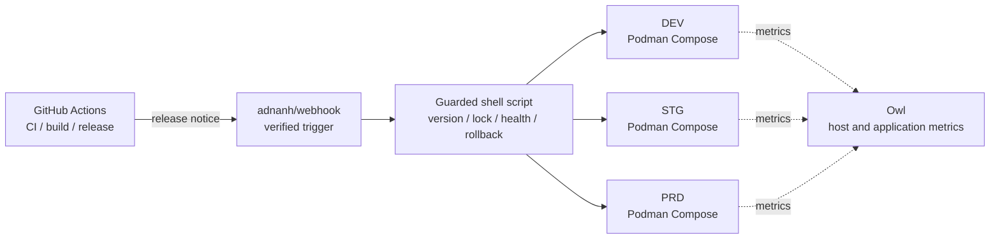

<div align="center">
    

<h1>Yin-Panel</h1>

[](https://github.com/yinorg/Yin-Panel/releases)
[](LICENSE)


**English** | [简体中文](docs/zh-CN/README.md) | [繁體中文](docs/zh-TW/README.md) | [日本語](docs/ja-JP/README.md) | [한국어](docs/ko-KR/README.md) | [Deutsch](docs/de-DE/README.md) | [Français](docs/fr-FR/README.md) | [Español](docs/es-ES/README.md) | [Português (Brasil)](docs/pt-BR/README.md) | [Русский](docs/ru-RU/README.md) | [Bahasa Indonesia](docs/id-ID/README.md) | [Türkçe](docs/tr-TR/README.md) | [Polski](docs/pl-PL/README.md) | [Italiano](docs/it-IT/README.md) | [Nederlands](docs/nl-NL/README.md) | [हिन्दी](docs/hi-IN/README.md) | [ไทย](docs/th-TH/README.md)

</div>

Yin-Panel is a lightweight, self-hostable navigation panel for personal and shared spaces. It fits home networks, NAS devices, servers, and small organizations.

## Demo

<picture>
  <source media="(prefers-color-scheme: dark)" srcset="docs/images/readme-home-dark.jpg">
  
</picture>

| Item editor | Space management |
| --- | --- |
|  |  |

### Interface preview

| Login | Public access |
| --- | --- |
|  |  |

| Wallpaper centre | Space default wallpaper |
| --- | --- |
|  |  |

**Directory theme**: each Space can use its own theme package, so Spaces in one instance can look different.


## Features

- Personal and shared spaces with isolated content
- Space creation, renaming, copying, and administrator transfer
- Group trees, bookmarks, icons, and sorting
- Bookmark import and export in the browser HTML format
- Space members with administrator, editor, and viewer roles
- OAuth 2.0 / OIDC login, account linking, and OIDC group authorization
- Email as the login identity, with an independent nickname
- Custom icons, installable theme packages, 17 UI languages, wallpapers, WAN/LAN and mobile URL modes, and in-page popup windows
- SQLite, MySQL, MariaDB, or PostgreSQL storage, Docker images for amd64 and arm64, and a Helm chart for Kubernetes

## Hosted environments

We run three online environments you can register on and try right away; all three support GitHub / GitLab / Google sign-in, and a monitoring panel shows their metrics and alerts.

You can look around without an account through the public link <https://panel.yiniot.com/my-demo> (it works as a browser homepage too).

You can also install the companion browser extension [Yin-Panel Helper](https://github.com/yinorg/yin-panel-extension) (now on the [Chrome Web Store](https://chromewebstore.google.com/detail/yin-panel-helper/hlfhnjccidngjjkidlgejefcchoegofo)). It does exactly two things: point the new tab at your panel, and help fetch site icons.

| Environment | Address | Purpose | Availability |
| --- | --- | --- | --- |
| Production (PRD) | <https://panel.yiniot.com> | Everyday use | Best effort towards 99.9% availability |
| STG | <https://panel-stg.yiniot.com> | Verify before release | May restart or roll back at any time |
| DEV | <https://panel-dev.yiniot.com> | Try things and report issues | Least stable; data may be wiped at any time |
| Monitoring | <https://owl.yiniot.com> | Metrics and alerts for the three environments | — |

All three run on the same free server and **there is no high availability**: PRD aims for 99.9% but carries no compensation, while STG and DEV can go down at any time. Please do not keep important data there; for long-term use, deploy it yourself as described below.

## Quick start

### Docker Compose

Requires Docker with the Compose plugin.

```bash
mkdir yin-panel && cd yin-panel
curl -LO https://raw.githubusercontent.com/yinorg/Yin-Panel/master/docker/docker-compose.yml
curl -o conf.yaml https://raw.githubusercontent.com/yinorg/Yin-Panel/master/backend/conf.yaml.example
mkdir -p database uploads
jwt_secret="$(openssl rand -hex 32)"
sed -i "s#^  secret: your_secret_key$#  secret: ${jwt_secret}#" conf.yaml
unset jwt_secret
YIN_PANEL_IMAGE=ghcr.io/yinorg/yin-panel-ce:latest docker compose up -d
```

Open <http://localhost:3002>.

`latest` points at the current release and is the quickest way to try the panel; **pin a specific tag or image digest in production** (see [CI/CD architecture](#cicd-architecture)) so a deployment cannot drift.

Default administrator: `admin@yiniot.com`, password `admin@yiniot.com`. Change the password immediately after the first login, and set `base.root_url` and a unique `jwt.secret` in `conf.yaml`.

Every deployment should generate its own random `jwt.secret`. The repository ships only `conf.yaml.example`; the `conf.yaml` in your runtime directory holds instance secrets and OAuth credentials and must not be committed to Git.

### GHCR images

```bash
docker pull ghcr.io/yinorg/yin-panel-ce:latest
docker pull ghcr.io/yinorg/yin-panel-ce:<x.y.z>
```

`latest` points at the current release; it and every release tag are multi-architecture manifests for amd64 and arm64 hosts. Release tags never carry an architecture suffix; tags like `-amd64` or `-arm64` are not part of a release.

## Performance and recommended configuration

The numbers below come from local single-machine benchmarks (SQLite, empty database, loopback, load generator on the same host). Treat them as a sizing reference, not a production capacity promise. Real capacity depends mainly on the data volume per space, the write rate, and peak concurrency.

### Resource usage (measured magnitudes)

| Metric | Idle | 5000 req/s mixed load | Limit (tens of thousands of req/s) |
| --- | --- | --- | --- |
| Memory (RSS) | ~16 MB | ~105 MB | ~500 MB peak; falls back after the load stops |
| CPU | near zero | ~0.3 core | 2–3 cores |

- Memory stays around **105 MB** up to roughly **20k req/s** and does not grow linearly with load; the ~500 MB figure appears only under synthetic extreme pressure.
- A single core carries about **10k–12k req/s** (mixed read/write, small data set).
- Under a 5000 req/s mixed load: 0 failures, p95 about **0.25 ms**.

### Recommended configuration

| Scenario | CPU | Memory | Storage | Database |
| --- | --- | --- | --- | --- |
| Personal / home / NAS | 1 vCPU | 128–256 MB | SSD, 512 MB+ (plus headroom for icon uploads) | SQLite |
| Small team / shared spaces | 1–2 vCPU | 256–512 MB | SSD, 1–2 GB | SQLite |
| Organization / high concurrency | 2–4 vCPU | 1–2 GB | SSD | SQLite (single host) or MySQL (multiple instances, HA) |

### User scale reference

Assuming about 0.1 req/s per online user (mostly idle) and reserving peak headroom:

| Configuration | Theoretical average throughput | Idle concurrency (theoretical ceiling) | Suggested scale (with peak headroom) |
| --- | --- | --- | --- |
| 1 vCPU | ~10k req/s | ~100k | 20k–40k |
| 2 vCPU | ~20k req/s | ~200k | 50k–80k |
| 4 vCPU | ~40k req/s | ~400k | 100k+ |

The more active the users (editing, importing, refreshing frequently), the higher the request rate each user produces, and the lower the sustainable user count.

### Key factors that affect capacity

1. **Data volume** — list endpoints return every entry of a space in one response; more entries mean a costlier request. This is the part most worth measuring on your own data.
2. **Write rate** — SQLite allows only one writer at a time; write throughput is bound by disk fsync (on the order of hundreds of writes per second). For write-heavy or multi-instance setups, use MySQL.
3. **Peak, not average** — size for peaks, usually reserving 2–5× the average.
4. **Static assets** — let a reverse proxy or CDN serve `/assets/*` and other hashed assets, and cache those hashed files for a long time; entry documents and `/api/*` should stay fresh.

## Database

SQLite (default), MySQL, MariaDB, and PostgreSQL are supported.

- `base.database_drive`: `sqlite` (default) | `mysql` | `postgres`. **MariaDB uses `mysql`.**
- SQLite: `sqlite.file_path` (also see `read_pool_size`).
- MySQL / MariaDB: `mysql.{host,port,username,password,db_name,wait_timeout}`.
- PostgreSQL: `postgres.{host,port,username,password,db_name,ssl_mode,time_zone,wait_timeout}`.

SQLite-only capabilities (WAL, the read-only connection pool, and file-snapshot migration backups) apply to SQLite only; back up MySQL/MariaDB/PostgreSQL with their own tools.

### Migrating from SQLite to MySQL/MariaDB/PostgreSQL

```bash
# conf.yaml        — existing SQLite configuration
# conf.target.yaml — target configuration pointing at mysql or postgres (the target database must be empty)
./yin-panel migrate-db -source conf.yaml -target conf.target.yaml
```

The migration creates the complete schema in the target, copies every row while preserving primary keys (and resets identity sequences on PostgreSQL). It can be run repeatedly — each run replaces the target table contents. Afterwards, point `database_drive` in `conf.yaml` at the target.

## Configuration and OAuth/OIDC

`oauth` is the unified configuration entry for OAuth 2.0 and OpenID Connect (OIDC). The default template includes three verified examples: GitHub (OAuth 2.0), GitLab (standard OIDC), and Google (OAuth 2.0). The examples are all commented out by default; a provider is enabled only after you fill in real credentials and set `oauth.enable: true`. All configuration keys are documented in `backend/conf.yaml.example`.

A standard OIDC provider must support discovery, authorization code + PKCE, and JWKS signature validation, and must provide `email` and `email_verified` in the user information. Providers that meet these standards work in principle, but different vendors may still need extra field-mapping configuration.

OIDC callback URL:

```text
<base.root_url>/api/oauth/<provider>/callback
```

After the callback, the provider must return a verified email. The system identifies external identities by `provider + sub` and links local accounts by email.

## Spaces and permissions

Space permissions are keyed by an internal `UserID`, never by the email text. Changing an email therefore keeps existing space permissions, and the member list shows the latest email.

- Administrator: manages the space, members, roles, and OIDC rules
- Editor: maintains groups and bookmarks
- Viewer: read-only access

Creating a space, renaming it, adding groups, adding members, and adding OIDC rules all happen in dialogs.

## Helm

```bash
helm upgrade --install yin-panel ./distribution/helm-chart/yin-panel \
  --set image.tag=latest
```

For production, replace `image.tag` with a specific version. Before deploying, preview the rendered manifests with `helm template yin-panel ./distribution/helm-chart/yin-panel`.

## Source development

Requirements: Go `1.27.1`, Node.js `24.21.0`, npm or pnpm `9.15.5`.

```bash
cd frontend
npm ci
npm run build-only
```

Or with the pinned pnpm:

```bash
cd frontend
corepack pnpm install --frozen-lockfile
pnpm run build-only
```

```bash
cd backend
go test ./...
go build ./...
```

Full local update (frontend build, backend tests and build, deployment, restart) in one command:

```bash
./scripts/deploy-local.sh
```

The script uses the repository's `backend/` as the runtime directory by default and requires a local `conf.yaml` there; `YIN_PANEL_RUNTIME_DIR` in `.env.local` can override it. After all builds and tests pass, it stops only the Yin-Panel listener, uses `sudo` to replace the old binary and static files, and never touches the database, uploads, or configuration files.

The home-page theme system is documented in [`frontend/THEME_SYSTEM.md`](frontend/THEME_SYSTEM.md); scaffold a new theme with `npm run create:theme -- init "<name>"`. Full AI development, release, and restart conventions live in [AGENTS.md](./AGENTS.md).

Browser-level acceptance tests live in the separate [yinorg/yin-panel-e2e](https://github.com/yinorg/yin-panel-e2e) repository: Playwright drives real browsers through complete journeys (login and accounts, spaces and permissions, bookmark import and export, the theme system, PWA offline behaviour, and the extension's new-tab override), with a k6 suite for load and capacity measurements. It needs a running Yin-Panel instance, the Core repository's `.env.local` and the unpacked extension source, and the checkout location is set by `YIN_PANEL_E2E_DIR`.

## Backup and upgrade

Before upgrading, back up the database, `uploads/`, `conf.yaml`, and Helm values. Migrations preserve users, spaces, groups, bookmarks, and file references. If an upgrade goes wrong, restore the pre-upgrade backup; do not delete the database and start over.

To upgrade a Compose deployment:

```bash
docker compose pull
docker compose up -d
```

`docker/docker-compose.yml` defaults to `latest`, and `pull_policy: missing` only pulls when the image is absent locally, so an upgrade has to run `docker compose pull` explicitly. In production, pin `YIN_PANEL_IMAGE` to a specific version and change it when you upgrade.

## CI/CD architecture

The official environments run DEV, STG and PRD on a single 1C1G VPS. The goal is not a pile of components but **few resident processes, low overhead, auditable releases and recoverable failures**.



| Layer | Component | Responsibility |
| --- | --- | --- |
| CI | GitHub Actions | Test, build the image, stamp the version, trigger the release |
| Release entry | adnanh/webhook | Verify the origin and the request; only run fixed release tasks |
| Release execution | Shell script | Version check, environment selection, locking, deploy, health check and rollback |
| Runtime | Podman Compose | Run the three isolated application instances (Podman saves ~150 MB RSS over Docker) |
| Monitoring | Owl | Host and application metrics |

**Why it is split this way**: all CI runs on GitHub Actions and the VPS only pulls the built image and deploys it — the small machine never carries the compile peak and runs no CI/CD control plane. The three environments share one release chain but keep separate Compose projects, configuration, volumes, networks and ports; sharing the release mechanism is not sharing data.

### Release flow

1. **Build**: Actions tests and builds the image; the version is pinned by a Git tag, commit SHA or image digest, and production never deploys `latest`.
2. **Trigger and validation**: Actions sends a verified release request to the webhook; the script checks the version, the target environment and the allowed action, and never splices arbitrary input into a shell command.
3. **Locking and deploy**: one deployment per environment at a time, and only the target environment is updated — nothing is restarted blindly.
4. **Health check and failure handling**: confirm the service starts and answers; on failure keep the previous good version and roll back, recording the environment, version, trigger source, result and rollback reason.

Promotion: DEV deploys automatically → STG deploys the same version after verification → **PRD requires human approval** after smoke tests. Emergency fixes still go through an auditable exception path, so an ordinary development event never bypasses production approval.

### Boundaries

This is a **single-machine, low-resource, auditable** deployment architecture, not a high-availability one: the three environments are isolated in process, configuration and data, but they share one VPS kernel, disk, network and memory, so a host failure or resource exhaustion hits all three at once. Its value is keeping the mechanisms a reliable release needs — pinned versions, environment isolation, health checks, rollback, monitoring and an audit trail — with very few resident components.

## Open Core

The Yin-Panel Core edition is free and will continue to be maintained and updated. This repository is the only public source for the Core and publishes the `yin-panel-ce` image. The Enterprise edition lives in the private repository [yinorg/Yin-Panel-EE](https://github.com/yinorg/Yin-Panel-EE) and connects through public interfaces.

A running instance exposes its edition, capabilities, read-only state, and version at `GET /api/system/capabilities`. Report problems and suggestions in [GitHub Issues](https://github.com/yinorg/Yin-Panel/issues).

Contributions merged into this repository stay in the Core: they are not moved behind the Enterprise edition and are not relicensed. See [Core and Enterprise](./GOVERNANCE.md).

## Credits

Yin-Panel grew out of the open-source project [hslr-s/sun-panel](https://github.com/hslr-s/sun-panel); thanks to the original author for building the foundation.

Thanks as well to [PhantomMaa/sun-panel](https://github.com/PhantomMaa/sun-panel) for its optimizations and maintenance work. Yin-Panel took over continued maintenance from that base and keeps adding features, interaction improvements, and self-hosting-oriented changes.

Thanks to all original authors, contributors, and users.

## Contributing

The project keeps going because people take the time to report problems and share ideas. Every kind of contribution is welcome:

- **Suggestions and bug reports**: open an [issue](https://github.com/yinorg/Yin-Panel/issues) with the version, environment, reproduction steps and what you saw — a screenshot or log makes it much faster to handle.
- **Code and docs**: pull requests are welcome. Fixing a bug, rewording a sentence, adding a language, or replacing a screenshot all count.
- **Not sure yet**: open an issue first and settle the approach before writing code, so the work does not go in a direction nobody wants.

Take a look at [CONTRIBUTING.md](./CONTRIBUTING.md) before you start: larger changes are worth discussing first, and security problems should be reported privately rather than in a public issue. If something is unclear, just ask in an issue and I will try to point you in the right direction.

Issues and pull requests are both read, and I aim to respond within 7 days; reproducible problems and well-described suggestions move fastest. Every piece of feedback is a reason for this project to keep going.

## License

Yin-Panel is licensed under the [Business Source License 1.1](./LICENSE). Forking, modifying, and self-hosting are free, including for internal business use and for serving your own customers; offering Yin-Panel itself to third parties as a hosted service requires a commercial license. Each version becomes available under the AGPL-3.0-or-later license three years after its own first public distribution. See [Core and Enterprise](./GOVERNANCE.md).

Third-party notices are listed in [THIRD-PARTY-NOTICES.md](./THIRD-PARTY-NOTICES.md), and contributions are accepted under the [Contributor License Agreement](./CLA.md).
