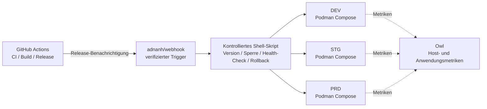

<div align="center">
    

<h1>Yin-Panel</h1>

[](https://github.com/yinorg/Yin-Panel/releases)
[](../../LICENSE)


[English](../../README.md) | [简体中文](../zh-CN/README.md) | [繁體中文](../zh-TW/README.md) | [日本語](../ja-JP/README.md) | [한국어](../ko-KR/README.md) | **Deutsch** | [Français](../fr-FR/README.md) | [Español](../es-ES/README.md) | [Português (Brasil)](../pt-BR/README.md) | [Русский](../ru-RU/README.md) | [Bahasa Indonesia](../id-ID/README.md) | [Türkçe](../tr-TR/README.md) | [Polski](../pl-PL/README.md) | [Italiano](../it-IT/README.md) | [Nederlands](../nl-NL/README.md) | [हिन्दी](../hi-IN/README.md) | [ไทย](../th-TH/README.md)

</div>

Yin-Panel ist ein leichtgewichtiges, selbst hostbares Navigationspanel für persönliche und gemeinsame Bereiche. Es passt zu Heimnetzwerken, NAS-Geräten, Servern und kleinen Organisationen.

## Demo

<picture>
  <source media="(prefers-color-scheme: dark)" srcset="../images/readme-home-dark.jpg">
  
</picture>

| Eintrag-Editor | Bereichsverwaltung |
| --- | --- |
|  |  |

### Oberflächen-Vorschau

| Anmelden | Öffentlicher Zugriff |
| --- | --- |
|  |  |

| Tapeten-Zentrum | Standard-Hintergrund des Bereichs |
| --- | --- |
|  |  |

**Directory-Theme**: Jeder Space kann ein eigenes Theme-Paket verwenden, sodass Spaces derselben Instanz unterschiedlich aussehen.


## Funktionen

- Persönliche und gemeinsame Bereiche mit voneinander getrennten Inhalten
- Erstellen, Umbenennen, Kopieren und Übertragen der Administration von Bereichen
- Gruppenbäume, Lesezeichen, Symbole und Sortierung
- Lesezeichen-Import und -Export im HTML-Format des Browsers
- Bereichsmitglieder mit den Rollen Administrator, Bearbeiter und Betrachter
- OAuth 2.0-/OIDC-Anmeldung, Kontoverknüpfung und OIDC-Gruppenautorisierung
- E-Mail als Anmeldekonto, Nickname separat gepflegt
- Eigene Symbole, installierbare Theme-Pakete, 17 UI-Sprachen, Hintergründe, WAN/LAN- und Mobil-URL-Modus, Pop-up-Fenster innerhalb der Seite
- SQLite-, MySQL-, MariaDB- oder PostgreSQL-Speicher, Docker-Images für amd64 und arm64 und ein Helm-Chart für Kubernetes

## Offiziell gehostete Umgebungen

Wir betreiben drei Online-Umgebungen, auf denen Sie sich direkt registrieren und alles ausprobieren können. Alle drei unterstützen die Anmeldung per GitHub / GitLab / Google, und ein Monitoring-Panel zeigt Betriebskennzahlen und Alarme.

| Umgebung | Adresse | Zweck | Verfügbarkeit |
| --- | --- | --- | --- |
| Produktion (PRD) | <https://panel.yiniot.com> | Reguläre Nutzung | Best effort mit dem Ziel 99,9 % Verfügbarkeit |
| STG | <https://panel-stg.yiniot.com> | Prüfung vor der Veröffentlichung | Kann jederzeit neu gestartet oder zurückgerollt werden |
| DEV | <https://panel-dev.yiniot.com> | Ausprobieren, Fehler melden | Am instabilsten; Daten können jederzeit gelöscht werden |
| Monitoring | <https://owl.yiniot.com> | Betriebskennzahlen und Alarme der drei Umgebungen | — |

Alle drei Umgebungen laufen auf demselben kostenlosen Server und **es gibt keine Hochverfügbarkeit**: PRD zielt auf 99,9 % und bietet dafür keine Ausfallentschädigung; STG und DEV können jederzeit ausfallen. Bitte legen Sie dort keine wichtigen Daten ab; für den dauerhaften Einsatz betreiben Sie Yin-Panel selbst, wie unten beschrieben.

## Schnellstart

### Docker Compose

Erfordert Docker mit dem Compose-Plugin.

```bash
mkdir yin-panel && cd yin-panel
curl -LO https://raw.githubusercontent.com/yinorg/Yin-Panel/master/docker/docker-compose.yml
curl -o conf.yaml https://raw.githubusercontent.com/yinorg/Yin-Panel/master/backend/conf.yaml.example
mkdir -p database uploads
jwt_secret="$(openssl rand -hex 32)"
sed -i "s#^  secret: your_secret_key$#  secret: ${jwt_secret}#" conf.yaml
unset jwt_secret
YIN_PANEL_IMAGE=ghcr.io/yinorg/yin-panel-ce:latest docker compose up -d
```

Öffnen Sie <http://localhost:3002>.

`latest` zeigt auf die aktuelle Release und ist der schnellste Weg zum Ausprobieren; **in der Produktion sollten Sie auf einen konkreten Tag oder Image-Digest festlegen** (siehe „CI/CD-Architektur“), damit ein Deployment nicht wandert.

Standard-Administrator: `admin@yiniot.com`, Passwort `admin@yiniot.com`. Ändern Sie das Passwort direkt nach der ersten Anmeldung und setzen Sie `base.root_url` und ein eindeutiges `jwt.secret` in `conf.yaml`.

Jede Bereitstellung sollte ein eigenes zufälliges `jwt.secret` erzeugen. Das Repository liefert nur `conf.yaml.example`; die `conf.yaml` im Laufzeitverzeichnis enthält Instanz-Geheimnisse und OAuth-Zugangsdaten und darf nicht in Git eingecheckt werden.

### GHCR-Images

```bash
docker pull ghcr.io/yinorg/yin-panel-ce:latest
docker pull ghcr.io/yinorg/yin-panel-ce:<x.y.z>
```

`latest` zeigt auf die aktuelle Release; es und jedes Release-Tag sind Multi-Architektur-Manifeste für amd64- und arm64-Hosts. Release-Tags tragen nie ein Architektur-Suffix; Tags wie `-amd64` oder `-arm64` sind kein Teil einer Release.

## Leistung und empfohlene Konfiguration

Die folgenden Zahlen stammen aus lokalen Einzelmaschinen-Benchmarks (SQLite, leere Datenbank, Loopback, Lasttest auf demselben Host). Sie dienen als Dimensionierungshilfe, nicht als Kapazitätszusage für den Produktivbetrieb. Die tatsächliche Kapazität hängt vor allem vom Datenvolumen je Bereich, der Schreibfrequenz und der Spitzenlast ab.

### Ressourcenverbrauch (gemessene Größenordnungen)

| Metrik | Leerlauf | 5000 req/s Mischlast | Grenzbereich (Zehntausende req/s) |
| --- | --- | --- | --- |
| Speicher (RSS) | ~16 MB | ~105 MB | Spitze ~500 MB, fällt nach Lastende zurück |
| CPU | nahe 0 | ~0.3 Kern | 2–3 Kerne |

- Der Speicher bleibt bis etwa **20k req/s** konstant bei rund **105 MB** und wächst nicht linear mit der Last; die ~500 MB treten nur unter synthetischer Extremlast auf.
- Ein einzelner Kern trägt etwa **10k–12k req/s** (gemischtes Lesen/Schreiben, kleine Datenmenge).
- Bei 5000 req/s Mischlast: 0 Fehler, p95 etwa **0.25 ms**.

### Empfohlene Konfiguration

| Szenario | CPU | Arbeitsspeicher | Speicher | Datenbank |
| --- | --- | --- | --- | --- |
| Privat / Zuhause / NAS | 1 vCPU | 128–256 MB | SSD, 512 MB+ (plus Reserve für Symbol-Uploads) | SQLite |
| Kleines Team / gemeinsame Bereiche | 1–2 vCPU | 256–512 MB | SSD, 1–2 GB | SQLite |
| Organisation / hohe Nebenläufigkeit | 2–4 vCPU | 1–2 GB | SSD | SQLite (einzelner Host) oder MySQL (mehrere Instanzen, HA) |

### Referenz zur Benutzerzahl

Unter der Annahme von etwa 0.1 req/s pro Online-Benutzer (überwiegend im Leerlauf) und mit reservierter Spitzenreserve:

| Konfiguration | Theoretischer Durchschnittsdurchsatz | Leerlauf-Nebenläufigkeit (theoretisches Maximum) | Empfohlene Größe (inkl. Spitzenreserve) |
| --- | --- | --- | --- |
| 1 vCPU | ~10k req/s | ~100k | 20k–40k |
| 2 vCPU | ~20k req/s | ~200k | 50k–80k |
| 4 vCPU | ~40k req/s | ~400k | 100k+ |

Je aktiver die Nutzer sind (Bearbeiten, Importieren, häufiges Aktualisieren), desto höher ist die Anfrage-Rate pro Nutzer und desto niedriger die nachhaltig tragfähige Benutzerzahl.

### Wichtigste Faktoren für die Kapazität

1. **Datenvolumen** — Listen-Endpunkte liefern alle Einträge eines Bereichs in einer Antwort; mehr Einträge bedeuten teurere Anfragen. Diesen Teil lohnt es sich, mit eigenen Daten zu messen.
2. **Schreibfrequenz** — SQLite erlaubt nur einen Schreiber gleichzeitig; der Schreibdurchsatz ist durch Disk-fsync begrenzt (Größenordnung Hunderte Schreibvorgänge pro Sekunde). Für schreibintensive oder Multi-Instanz-Setups MySQL verwenden.
3. **Spitze statt Durchschnitt** — für Spitzen dimensionieren, üblicherweise 2–5× des Durchschnitts einplanen.
4. **Statische Assets** — lassen Sie `/assets/*` und andere gehashte Assets von einem Reverse-Proxy oder CDN ausliefern, und cachen Sie die gehashten Dateien langfristig; Einstiegsdateien und `/api/*` sollten immer aktuell bleiben.

## Datenbank

Unterstützt werden SQLite (Standard), MySQL, MariaDB und PostgreSQL.

- `base.database_drive`: `sqlite` (Standard) | `mysql` | `postgres`. **MariaDB verwendet `mysql`.**
- SQLite: `sqlite.file_path` (siehe auch `read_pool_size`).
- MySQL / MariaDB: `mysql.{host,port,username,password,db_name,wait_timeout}`.
- PostgreSQL: `postgres.{host,port,username,password,db_name,ssl_mode,time_zone,wait_timeout}`.

SQLite-spezifische Funktionen (WAL, schreibgeschützter Verbindungspool und dateischnappschussbasierte Migrations-Backups) gelten nur für SQLite; sichern Sie MySQL/MariaDB/PostgreSQL mit den jeweiligen Werkzeugen.

### Migration von SQLite zu MySQL/MariaDB/PostgreSQL

```bash
# conf.yaml        — bestehende SQLite-Konfiguration
# conf.target.yaml — Zielkonfiguration für mysql oder postgres (die Zieldatenbank muss leer sein)
./yin-panel migrate-db -source conf.yaml -target conf.target.yaml
```

Die Migration erstellt das vollständige Schema im Ziel, kopiert alle Zeilen unter **Beibehaltung der Primärschlüssel** (auf PostgreSQL werden auch ID-Sequenzen zurückgesetzt) und kann wiederholt ausgeführt werden — jeder Lauf ersetzt die Inhalte der Zieltabelle. Richten Sie danach `database_drive` in `conf.yaml` auf das Ziel aus.

## Konfiguration und OAuth/OIDC

`oauth` ist der einheitliche Konfigurationseinstieg für OAuth 2.0 und OpenID Connect (OIDC). Die Standardvorlage enthält drei verifizierte Beispiele: GitHub (OAuth 2.0), GitLab (Standard-OIDC) und Google (OAuth 2.0). Die Beispiele sind standardmäßig auskommentiert; ein Provider wird erst aktiviert, wenn echte Zugangsdaten eingetragen und `oauth.enable: true` gesetzt ist. Alle Konfigurationsschlüssel sind in `backend/conf.yaml.example` dokumentiert.

Ein Standard-OIDC-Provider muss Discovery, Authorization Code + PKCE und JWKS-Signaturprüfung unterstützen und `email` und `email_verified` in den Nutzerinformationen liefern. Provider, die diese Standards erfüllen, funktionieren grundsätzlich, können je nach Anbieter aber zusätzliche Feldzuordnungen erfordern.

OIDC-Callback-URL:

```text
<base.root_url>/api/oauth/<provider>/callback
```

Nach dem Callback muss der Provider eine verifizierte E-Mail-Adresse zurückgeben. Das System identifiziert externe Identitäten über `provider + sub` und verknüpft lokale Konten über die E-Mail-Adresse.

## Bereiche und Berechtigungen

Bereichsberechtigungen sind an die interne `UserID` gebunden, nie an den E-Mail-Text. Eine geänderte E-Mail-Adresse lässt bestehende Bereichsberechtigungen daher gültig, und die Mitgliederliste zeigt die neueste E-Mail-Adresse.

- Administrator: verwaltet Bereich, Mitglieder, Rollen und OIDC-Regeln
- Bearbeiter: pflegt Gruppen und Lesezeichen
- Betrachter: Lesezugriff

Erstellen eines Bereichs, Umbenennen, Hinzufügen von Gruppen, Mitgliedern und OIDC-Regeln geschehen in Dialogen.

## Helm

```bash
helm upgrade --install yin-panel ./distribution/helm-chart/yin-panel \
  --set image.tag=latest
```

Ändern Sie in der Produktion `image.tag` auf eine konkrete Version.

Vor dem Deployment können Sie die gerenderten Manifeste mit `helm template yin-panel ./distribution/helm-chart/yin-panel` prüfen.

## Entwicklung aus dem Quellcode

Anforderungen: Go `1.27.1`, Node.js `24.21.0`, npm oder pnpm `9.15.5`.

```bash
cd frontend
npm ci
npm run build-only
```

Oder mit dem gepinnten pnpm:

```bash
cd frontend
corepack pnpm install --frozen-lockfile
pnpm run build-only
```

```bash
cd backend
go test ./...
go build ./...
```

Vollständiges lokales Update (Frontend-Build, Backend-Tests und -Build, Deployment, Neustart) mit einem Befehl:

```bash
./scripts/deploy-local.sh
```

Das Skript verwendet standardmäßig `backend/` aus dem Repository als Laufzeitverzeichnis und erfordert dort eine lokale `conf.yaml`; `YIN_PANEL_RUNTIME_DIR` in `.env.local` kann dies überschreiben. Nach erfolgreichen Builds und Tests stoppt es nur den Yin-Panel-Listener, ersetzt altes Binary und statische Dateien per `sudo` und berührt Datenbank, Uploads und Konfigurationsdateien nicht.

Das Theme-System der Startseite ist in [`frontend/THEME_SYSTEM.md`](../../frontend/THEME_SYSTEM.md) dokumentiert; ein neues Theme lässt sich mit `npm run create:theme -- init "<Name>"` anlegen. Die vollständigen AI-Entwicklungs-, Release- und Neustart-Konventionen stehen in [AGENTS.md](../../AGENTS.md).

## Backup und Upgrade

Sichern Sie vor einem Upgrade Datenbank, `uploads/`, `conf.yaml` und Helm-Values. Migrationen erhalten Benutzer, Bereiche, Gruppen, Lesezeichen und Dateiverweise. Bei Problemen aus dem Backup vor dem Upgrade wiederherstellen; die Datenbank nicht löschen und neu aufbauen.

Upgrade-Schritte für eine Compose-Installation:

```bash
docker compose pull
docker compose up -d
```

`docker/docker-compose.yml` verwendet standardmäßig `latest`, und `pull_policy: missing` lädt nur, wenn lokal kein Image vorhanden ist – deshalb ist beim Upgrade `docker compose pull` ausdrücklich nötig. In der Produktion sollten Sie `YIN_PANEL_IMAGE` auf eine konkrete Version festlegen und beim Upgrade auf die Zielversion ändern.

## CI/CD-Architektur

Die offiziellen Umgebungen betreiben DEV, STG und PRD auf einem einzigen 1C1G-VPS. Das Ziel sind nicht möglichst viele Komponenten, sondern **wenige Dauerprozesse, geringer Overhead, nachvollziehbare Releases und Fehler, aus denen man zurückrollen kann**.



| Ebene | Komponente | Aufgabe |
| --- | --- | --- |
| CI | GitHub Actions | Testen, Image bauen, Version vergeben, Release auslösen |
| Release-Eingang | adnanh/webhook | Herkunft und Anfrage prüfen; nur feste Release-Aufgaben auslösen |
| Release-Ausführung | Shell-Skript | Versionsprüfung, Auswahl der Umgebung, Sperre, Deployment, Health-Check und Rollback |
| Laufzeit | Podman Compose | Drei isolierte Instanzen betreiben (Podman spart rund 150 MB RSS gegenüber Docker) |
| Monitoring | Owl | Host- und Anwendungsmetriken |

**Warum diese Aufteilung**: Die gesamte CI läuft bei GitHub Actions, und der VPS lädt nur das fertige Image und deployt es. Die kleine Maschine trägt nie den Kompilierungs-Peak und betreibt keine CI/CD-Control-Plane. Die drei Umgebungen teilen sich eine Release-Kette, behalten aber getrennte Compose-Projekte, Konfiguration, Volumes, Netzwerke und Ports; einen Release-Mechanismus zu teilen heißt nicht, Daten zu teilen.

### Ablauf eines Releases

1. **Build**: Actions testet und baut das Image; die Version ist über Git-Tag, Commit-SHA oder Image-Digest festgelegt, und in der Produktion wird nie `latest` deployt.
2. **Auslösen und Prüfen**: Actions schickt eine verifizierte Release-Anfrage an den Webhook; das Skript prüft Version, Zielumgebung und erlaubte Aktion und setzt niemals beliebige Eingaben in Shell-Befehle ein.
3. **Sperre und Deployment**: Pro Umgebung läuft immer nur ein Deployment, und es wird nur die Zielumgebung aktualisiert – nichts wird blind neu gestartet.
4. **Health-Check und Fehlerfall**: Es wird geprüft, ob der Dienst startet und antwortet; schlägt es fehl, bleibt die letzte gute Version erhalten und wird zurückgerollt, und Umgebung, Version, Auslöser, Ergebnis und Rollback-Grund werden protokolliert.

Beförderung: DEV deployt automatisch → nach der Prüfung deployt STG dieselbe Version → nach Smoke-Tests **erfordert PRD eine menschliche Freigabe**. Notfall-Fixes laufen ebenfalls über einen nachvollziehbaren Ausnahmeweg, damit ein normaler Entwicklungsvorgang die Produktionsfreigabe nie umgeht.

### Grenzen

Das ist eine **Single-Machine-, ressourcenschonende und nachvollziehbare** Deployment-Architektur, keine Hochverfügbarkeitsarchitektur: Die drei Umgebungen sind in Prozess, Konfiguration und Daten getrennt, teilen aber Kernel, Festplatte, Netzwerk und Arbeitsspeicher desselben VPS – ein Host-Ausfall oder Ressourcenmangel trifft alle drei gleichzeitig. Ihr Wert liegt darin, die Mechanismen eines verlässlichen Releases – feste Versionen, getrennte Umgebungen, Health-Checks, Rollback, Monitoring und Audit-Trail – mit sehr wenigen Dauerprozessen bereitzustellen.

## Open Core

Die Core-Edition von Yin-Panel ist kostenlos und wird weiter gepflegt und aktualisiert. Dieses Repository ist die einzige öffentliche Quelle des Cores und veröffentlicht das `yin-panel-ce`-Image. Die Enterprise-Edition liegt im privaten Repository [yinorg/Yin-Panel-EE](https://github.com/yinorg/Yin-Panel-EE) und wird über öffentliche Schnittstellen angebunden.

Eine laufende Instanz zeigt Edition, Fähigkeiten, Nur-Lese-Status und Version unter `GET /api/system/capabilities`. Probleme und Vorschläge bitte in den [GitHub Issues](https://github.com/yinorg/Yin-Panel/issues) melden.

In dieses Repository übernommene Beiträge bleiben im Core: Sie werden weder hinter die Enterprise-Edition verschoben noch neu lizenziert. Siehe [Core und Enterprise](../../GOVERNANCE.md).

## Danksagung

Yin-Panel entstand aus dem Open-Source-Projekt [hslr-s/sun-panel](https://github.com/hslr-s/sun-panel); Dank an den ursprünglichen Autor für das Fundament.

Ebenso Dank an [PhantomMaa/sun-panel](https://github.com/PhantomMaa/sun-panel) für Optimierungen und Wartung. Yin-Panel übernahm auf dieser Basis die weitere Pflege und ergänzt laufend Funktionen, Interaktionsverbesserungen und Änderungen für Self-Hosting-Szenarien.

Dank an alle ursprünglichen Autoren, Mitwirkenden und Nutzer.

## Mitwirken

Das Projekt lebt davon, dass Nutzer sich die Zeit nehmen, Probleme und Ideen zu teilen. Jede Form der Mitarbeit ist willkommen:

- **Vorschläge und Fehlerberichte**: Öffnen Sie ein [Issue](https://github.com/yinorg/Yin-Panel/issues) mit Version, Umgebung, Schritten zur Reproduktion und dem beobachteten Verhalten – ein Screenshot oder ein Log beschleunigt die Bearbeitung deutlich.
- **Code und Doku**: Pull Requests sind willkommen. Einen Fehler beheben, einen Satz umformulieren, eine Sprache ergänzen oder einen Screenshot ersetzen ist ebenfalls eine wertvolle Mitarbeit.
- **Noch unklar**: Öffnen Sie zuerst ein Issue und klären Sie den Ansatz, bevor Sie Code schreiben, damit die Arbeit nicht in eine Richtung läuft, die niemand braucht.

Werfen Sie vor dem Start einen Blick in [CONTRIBUTING.md](../../CONTRIBUTING.md): Größere Änderungen sollten zuerst besprochen werden, und Sicherheitsprobleme melden Sie bitte privat statt in einem öffentlichen Issue. Wenn etwas unklar ist, fragen Sie einfach im Issue – ich versuche, die Richtung zu zeigen.

Issues und Pull Requests werden beide gelesen, und ich versuche, innerhalb von 7 Tagen zu antworten; reproduzierbare Probleme und gut beschriebene Vorschläge gehen am schnellsten. Jedes Feedback ist ein Grund, dieses Projekt weiterzuführen.

## Lizenz

Yin-Panel ist unter der [Business Source License 1.1](../../LICENSE) lizenziert. Forken, Ändern und Selbst-Hosten sind kostenlos, einschließlich der internen Nutzung im Unternehmen und der Bereitstellung für Ihre eigenen Kunden; das Anbieten von Yin-Panel selbst als gehosteten Dienst an Dritte erfordert eine kommerzielle Lizenz. Jede Version wird drei Jahre nach ihrer eigenen ersten öffentlichen Verbreitung unter der AGPL-3.0-or-later-Lizenz verfügbar. Siehe [Core und Enterprise](../../GOVERNANCE.md).

Hinweise zu Drittanbietern sind in [THIRD-PARTY-NOTICES.md](../../THIRD-PARTY-NOTICES.md) aufgeführt; Beiträge werden unter der [Contributor License Agreement](../../CLA.md) angenommen.
