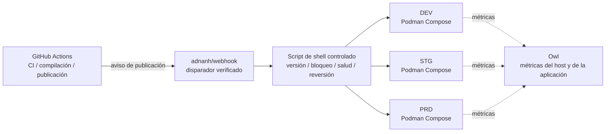

<div align="center">
    

<h1>Yin-Panel</h1>

[](https://github.com/yinorg/Yin-Panel/releases)
[](../../LICENSE)


[English](../../README.md) | [简体中文](../zh-CN/README.md) | [繁體中文](../zh-TW/README.md) | [日本語](../ja-JP/README.md) | [한국어](../ko-KR/README.md) | [Deutsch](../de-DE/README.md) | [Français](../fr-FR/README.md) | **Español** | [Português (Brasil)](../pt-BR/README.md) | [Русский](../ru-RU/README.md) | [Bahasa Indonesia](../id-ID/README.md) | [Türkçe](../tr-TR/README.md) | [Polski](../pl-PL/README.md) | [Italiano](../it-IT/README.md) | [Nederlands](../nl-NL/README.md) | [हिन्दी](../hi-IN/README.md) | [ไทย](../th-TH/README.md)

</div>

Yin-Panel es un panel de navegación ligero y autoalojable para espacios personales y compartidos. Encaja en redes domésticas, NAS, servidores y pequeñas organizaciones.

## Demostración

<picture>
  <source media="(prefers-color-scheme: dark)" srcset="../images/readme-home-dark.jpg">
  
</picture>

| Editor de elementos | Gestión de espacios |
| --- | --- |
|  |  |

### Vista previa de la interfaz

| Iniciar sesión | Acceso público |
| --- | --- |
|  |  |

| Centro de fondos | Fondo predeterminado del espacio |
| --- | --- |
|  |  |

**Tema Directory**: cada espacio puede usar su propio paquete de tema, así que los espacios de una misma instancia pueden verse distintos.


## Funciones

- Espacios personales y compartidos con contenido aislado entre sí
- Creación, cambio de nombre, copia y transferencia de administración de espacios
- Árboles de grupos, marcadores, iconos y ordenación
- Importación y exportación de marcadores en formato HTML del navegador
- Miembros del espacio con roles de administrador, editor y lector
- Inicio de sesión OAuth 2.0 / OIDC, vinculación de cuentas y autorización por grupos OIDC
- El correo electrónico como cuenta de inicio de sesión, con apodo gestionado por separado
- Iconos personalizados, temas instalables, 17 idiomas de interfaz, fondos, modos de URL WAN/LAN y móvil, ventanas emergentes dentro de la página
- Almacenamiento SQLite, MySQL, MariaDB o PostgreSQL, imágenes Docker para amd64 y arm64 y chart de Helm para Kubernetes

## Entornos alojados oficiales

Mantenemos tres entornos en línea en los que puede registrarse y probarlo de inmediato; los tres admiten inicio de sesión con GitHub / GitLab / Google, y un panel de monitorización muestra sus métricas y alertas.

Sin cuenta puede echar un vistazo por el enlace público <https://panel.yiniot.com/my-demo> (también sirve como página de inicio del navegador).

También puede instalar la extensión complementaria [Yin-Panel Helper](https://github.com/yinorg/yin-panel-extension) (ya está en la [Chrome Web Store](https://chromewebstore.google.com/detail/yin-panel-helper/hlfhnjccidngjjkidlgejefcchoegofo)). Hace exactamente dos cosas: llevar la pestaña nueva a su panel y ayudar a obtener los iconos de los sitios.

| Entorno | Dirección | Uso | Disponibilidad |
| --- | --- | --- | --- |
| Producción (PRD) | <https://panel.yiniot.com> | Uso diario | Best effort con el objetivo del 99,9 % de disponibilidad |
| STG | <https://panel-stg.yiniot.com> | Verificación antes de publicar | Puede reiniciarse o revertirse en cualquier momento |
| DEV | <https://panel-dev.yiniot.com> | Probar cosas y reportar problemas | El menos estable; los datos pueden borrarse en cualquier momento |
| Monitorización | <https://owl.yiniot.com> | Métricas y alertas de los tres entornos | — |

Los tres entornos se ejecutan en el mismo servidor gratuito y **no hay alta disponibilidad**: PRD apunta al 99,9 % pero no ofrece compensación, mientras que STG y DEV pueden caerse en cualquier momento. No guarde datos importantes ahí; para un uso a largo plazo, despliegue el suyo propio como se describe abajo.

## Inicio rápido

### Docker Compose

Requiere Docker con el plugin de Compose.

```bash
mkdir yin-panel && cd yin-panel
curl -LO https://raw.githubusercontent.com/yinorg/Yin-Panel/master/docker/docker-compose.yml
curl -o conf.yaml https://raw.githubusercontent.com/yinorg/Yin-Panel/master/backend/conf.yaml.example
mkdir -p database uploads
jwt_secret="$(openssl rand -hex 32)"
sed -i "s#^  secret: your_secret_key$#  secret: ${jwt_secret}#" conf.yaml
unset jwt_secret
YIN_PANEL_IMAGE=ghcr.io/yinorg/yin-panel-ce:latest docker compose up -d
```

Abra <http://localhost:3002>.

`latest` apunta a la versión actual y es la forma más rápida de probarlo; **en producción fije una etiqueta concreta o un digest de imagen** (véase «Arquitectura CI/CD») para que el despliegue no derive.

Administrador predeterminado: `admin@yiniot.com`, contraseña `admin@yiniot.com`. Cambie la contraseña inmediatamente después del primer inicio de sesión y establezca `base.root_url` y un `jwt.secret` único en `conf.yaml`.

Cada despliegue debe generar su propio `jwt.secret` aleatorio. El repositorio solo incluye `conf.yaml.example`; el `conf.yaml` de su directorio de ejecución contiene secretos de la instancia y credenciales OAuth y no debe subirse a Git.

### Imágenes GHCR

```bash
docker pull ghcr.io/yinorg/yin-panel-ce:latest
docker pull ghcr.io/yinorg/yin-panel-ce:<x.y.z>
```

`latest` apunta a la versión actual; tanto él como cada etiqueta de versión son manifiestos multiarquitectura para hosts amd64 y arm64. Las etiquetas de versión nunca llevan sufijo de arquitectura; etiquetas como `-amd64` o `-arm64` no forman parte de una versión publicada.

## Rendimiento y configuración recomendada

Las cifras siguientes proceden de pruebas locales en una sola máquina (SQLite, base de datos vacía, loopback, prueba de carga en el mismo host). Sirven como referencia de dimensionamiento, no como promesa de capacidad en producción. La capacidad real depende principalmente del volumen de datos por espacio, la frecuencia de escritura y la concurrencia máxima.

### Uso de recursos (órdenes de magnitud medidos)

| Métrica | Inactivo | Carga mixta de 5000 req/s | Límite (decenas de miles de req/s) |
| --- | --- | --- | --- |
| Memoria (RSS) | ~16 MB | ~105 MB | Pico de ~500 MB; baja tras detener la carga |
| CPU | casi 0 | ~0,3 núcleo | 2–3 núcleos |

- La memoria se mantiene en torno a **105 MB** hasta unos **20 000 req/s** y no crece de forma lineal con la carga; el valor de ~500 MB solo aparece bajo presión sintética extrema.
- Un solo núcleo soporta unos **10 000–12 000 req/s** (lectura/escritura mixta, conjunto de datos pequeño).
- Con una carga mixta de 5000 req/s: 0 fallos, p95 de unos **0,25 ms**.

### Configuración recomendada

| Escenario | CPU | Memoria | Almacenamiento | Base de datos |
| --- | --- | --- | --- | --- |
| Personal / hogar / NAS | 1 vCPU | 128–256 MB | SSD, 512 MB+ (más margen para iconos subidos) | SQLite |
| Equipo pequeño / espacios compartidos | 1–2 vCPU | 256–512 MB | SSD, 1–2 GB | SQLite |
| Organización / alta concurrencia | 2–4 vCPU | 1–2 GB | SSD | SQLite (máquina única) o MySQL (varias instancias, HA) |

### Referencia de escala de usuarios

Suponiendo unos 0,1 req/s por usuario en línea (mayormente inactivo) y reservando margen para picos:

| Configuración | Rendimiento medio teórico | Concurrencia inactiva (techo teórico) | Escala recomendada (con margen de pico) |
| --- | --- | --- | --- |
| 1 vCPU | ~10k req/s | ~100k | 20k–40k |
| 2 vCPU | ~20k req/s | ~200k | 50k–80k |
| 4 vCPU | ~40k req/s | ~400k | 100k+ |

Cuanto más activos sean los usuarios (editar, importar, refrescar con frecuencia), mayor será la tasa de peticiones por usuario y menor el número de usuarios sostenible.

### Factores clave que afectan a la capacidad

1. **Volumen de datos**: los endpoints de lista devuelven todas las entradas de un espacio en una sola respuesta; cuantas más entradas, más costosa es la petición. Es la parte que más merece la pena medir con sus propios datos.
2. **Frecuencia de escritura**: SQLite permite un solo escritor a la vez; el rendimiento de escritura está limitado por el fsync del disco (del orden de cientos de escrituras por segundo). Para cargas intensivas de escritura o despliegues con varias instancias, use MySQL.
3. **Picos, no medias**: dimensione para los picos, reservando normalmente 2–5× la media.
4. **Recursos estáticos**: sirva `/assets/*` y los demás recursos con hash desde un proxy inverso o un CDN, y cachee esos archivos con hash a largo plazo; los archivos de entrada y `/api/*` deben mantenerse siempre actualizados.

## Base de datos

Se admiten SQLite (predeterminada), MySQL, MariaDB y PostgreSQL.

- `base.database_drive`: `sqlite` (predeterminada) | `mysql` | `postgres`. **MariaDB usa `mysql`.**
- SQLite: `sqlite.file_path` (véase también `read_pool_size`).
- MySQL / MariaDB: `mysql.{host,port,username,password,db_name,wait_timeout}`.
- PostgreSQL: `postgres.{host,port,username,password,db_name,ssl_mode,time_zone,wait_timeout}`.

Las capacidades exclusivas de SQLite (WAL, el pool de conexiones de solo lectura y las copias de migración basadas en instantáneas de archivo) solo se aplican a SQLite; haga copias de seguridad de MySQL/MariaDB/PostgreSQL con sus propias herramientas.

### Migración de SQLite a MySQL/MariaDB/PostgreSQL

```bash
# conf.yaml        — configuración existente de SQLite
# conf.target.yaml — configuración de destino apuntando a mysql o postgres (la base de datos de destino debe estar vacía)
./yin-panel migrate-db -source conf.yaml -target conf.target.yaml
```

La migración crea el esquema completo en el destino, copia todas las filas **conservando las claves primarias** (y restablece las secuencias de identidad en PostgreSQL). Se puede ejecutar repetidamente: cada ejecución reemplaza el contenido de las tablas de destino. Después, apunte `database_drive` en `conf.yaml` al destino.

## Configuración y OAuth/OIDC

`oauth` es el punto de entrada de configuración unificado para OAuth 2.0 y OpenID Connect (OIDC). La plantilla predeterminada incluye tres ejemplos verificados: GitHub (OAuth 2.0), GitLab (OIDC estándar) y Google (OAuth 2.0). Todos los ejemplos están comentados por defecto; un proveedor solo se activa tras rellenar credenciales reales y establecer `oauth.enable: true`. Todas las claves de configuración están documentadas en `backend/conf.yaml.example`.

Un proveedor OIDC estándar debe admitir discovery, código de autorización + PKCE y validación de firma JWKS, y proporcionar `email` y `email_verified` en la información del usuario. Los proveedores que cumplen estos estándares funcionan en principio, pero algunos servicios aún pueden necesitar configuración adicional de mapeo de campos.

URL de callback de OIDC:

```text
<base.root_url>/api/oauth/<provider>/callback
```

Tras el callback, el proveedor debe devolver un correo electrónico verificado. El sistema identifica identidades externas por `provider + sub` y vincula cuentas locales por correo electrónico.

## Espacios y permisos

Los permisos de espacio se vinculan al `UserID` interno, nunca al texto del correo electrónico. Por eso, cambiar el correo conserva los permisos de espacio existentes y la lista de miembros muestra el correo más reciente.

- Administrador: gestiona el espacio, los miembros, los roles y las reglas OIDC
- Editor: mantiene grupos y marcadores
- Lector: acceso de solo lectura

Crear un espacio, renombrarlo, añadir grupos, miembros y reglas OIDC se hace en diálogos.

## Helm

```bash
helm upgrade --install yin-panel ./distribution/helm-chart/yin-panel \
  --set image.tag=latest
```

En producción, cambie `image.tag` por una versión concreta.

Antes de desplegar, revise los manifiestos renderizados con `helm template yin-panel ./distribution/helm-chart/yin-panel`.

## Desarrollo desde el código fuente

Requisitos: Go `1.27.1`, Node.js `24.21.0`, npm o pnpm `9.15.5`.

```bash
cd frontend
npm ci
npm run build-only
```

O con el pnpm fijado:

```bash
cd frontend
corepack pnpm install --frozen-lockfile
pnpm run build-only
```

```bash
cd backend
go test ./...
go build ./...
```

Actualización local completa (compilación del frontend, pruebas y compilación del backend, despliegue, reinicio) en un solo comando:

```bash
./scripts/deploy-local.sh
```

El script usa `backend/` del repositorio como directorio de ejecución de forma predeterminada y requiere un `conf.yaml` local allí; `YIN_PANEL_RUNTIME_DIR` en `.env.local` puede sobrescribirlo. Tras pasar todas las compilaciones y pruebas, detiene solo el listener de Yin-Panel, reemplaza el binario antiguo y los archivos estáticos con `sudo`, y nunca toca la base de datos, las subidas ni los archivos de configuración.

El sistema de temas de la página de inicio está documentado en [`frontend/THEME_SYSTEM.md`](../../frontend/THEME_SYSTEM.md); cree un tema nuevo con `npm run create:theme -- init "<nombre>"`. Las convenciones completas de desarrollo con IA, publicación y reinicio están en [AGENTS.md](../../AGENTS.md).

Las pruebas de aceptación en el navegador están en el repositorio aparte [yinorg/yin-panel-e2e](https://github.com/yinorg/yin-panel-e2e): Playwright maneja navegadores reales a lo largo de recorridos completos (inicio de sesión y cuentas, espacios y permisos, importación y exportación de marcadores, el sistema de temas, el comportamiento sin conexión de la PWA y la sustitución de la pestaña nueva por parte de la extensión), y hay además un conjunto de k6 para medir carga y capacidad. Necesita una instancia de Yin-Panel en marcha, el `.env.local` del repositorio Core y el código sin empaquetar de la extensión; la ubicación del checkout se indica con `YIN_PANEL_E2E_DIR`.

## Copia de seguridad y actualización

Antes de actualizar, haga copia de seguridad de la base de datos, `uploads/`, `conf.yaml` y los values de Helm. Las migraciones conservan usuarios, espacios, grupos, marcadores y referencias de archivos. Si algo va mal, restaure la copia previa a la actualización; no elimine la base de datos para recrearla.

Pasos de actualización en una instalación con Compose:

```bash
docker compose pull
docker compose up -d
```

`docker/docker-compose.yml` usa `latest` por defecto y `pull_policy: missing` solo descarga cuando la imagen no existe en local, así que al actualizar hay que ejecutar `docker compose pull` de forma explícita. En producción fije `YIN_PANEL_IMAGE` a una versión concreta y cámbiela al actualizar.

## Arquitectura CI/CD

Los entornos oficiales ejecutan DEV, STG y PRD en un único VPS de 1C1G. El objetivo no es acumular componentes, sino **pocos procesos residentes, bajo consumo, publicaciones auditables y fallos de los que se pueda volver atrás**.



| Capa | Componente | Responsabilidad |
| --- | --- | --- |
| CI | GitHub Actions | Probar, construir la imagen, fijar la versión y lanzar la publicación |
| Entrada de publicación | adnanh/webhook | Verificar el origen y la petición; ejecutar solo tareas de publicación fijas |
| Ejecución de la publicación | Script de shell | Comprobación de versión, selección de entorno, bloqueo, despliegue, comprobación de salud y reversión |
| Ejecución | Podman Compose | Ejecutar las tres instancias aisladas (Podman ahorra unos 150 MB de RSS frente a Docker) |
| Monitorización | Owl | Métricas del host y de la aplicación |

**Por qué se reparte así**: toda la CI se ejecuta en GitHub Actions y el VPS solo descarga la imagen ya construida y la despliega; la máquina pequeña nunca soporta el pico de compilación ni mantiene un plano de control de CI/CD. Los tres entornos comparten una única cadena de publicación, pero mantienen proyectos Compose, configuración, volúmenes, redes y puertos separados; compartir el mecanismo de publicación no es compartir datos.

### Flujo de publicación

1. **Compilación**: Actions ejecuta las pruebas y construye la imagen; la versión queda fijada por una etiqueta Git, un SHA de commit o un digest de imagen, y producción nunca despliega `latest`.
2. **Disparo y validación**: Actions envía una petición de publicación verificada al webhook; el script comprueba la versión, el entorno de destino y la acción permitida, y nunca inserta entradas arbitrarias en un comando de shell.
3. **Bloqueo y despliegue**: un despliegue por entorno a la vez, y solo se actualiza el entorno de destino; nada se reinicia a ciegas.
4. **Comprobación de salud y fallos**: se confirma que el servicio arranca y responde; si falla, se conserva la última versión buena y se revierte, registrando el entorno, la versión, el origen del disparo, el resultado y el motivo de la reversión.

Promoción: DEV despliega automáticamente → STG despliega la misma versión tras la verificación → **PRD requiere aprobación humana** después de las pruebas de humo. Las correcciones urgentes también pasan por una vía de excepción auditable, así que un evento de desarrollo normal nunca salta la aprobación de producción.

### Límites

Es una arquitectura de despliegue **de una sola máquina, con pocos recursos y auditable**, no de alta disponibilidad: los tres entornos están aislados en proceso, configuración y datos, pero comparten el kernel, el disco, la red y la memoria de un mismo VPS, así que un fallo del host o el agotamiento de recursos afecta a los tres a la vez. Su valor está en mantener los mecanismos que necesita una publicación fiable —versiones fijadas, entornos aislados, comprobaciones de salud, reversión, monitorización y rastro de auditoría— con muy pocos procesos residentes.

## Open Core

La edición Core de Yin-Panel es gratuita y seguirá recibiendo mantenimiento y actualizaciones. Este repositorio es la única fuente pública del Core y publica la imagen `yin-panel-ce`. La edición Enterprise está en el repositorio privado [yinorg/Yin-Panel-EE](https://github.com/yinorg/Yin-Panel-EE) y se integra mediante interfaces públicas.

Una instancia en ejecución expone su edición, capacidades, estado de solo lectura y versión en `GET /api/system/capabilities`. Informe de problemas y sugerencias en los [GitHub Issues](https://github.com/yinorg/Yin-Panel/issues).

Las contribuciones integradas en este repositorio permanecen en el Core: no se trasladan a la edición Enterprise ni se vuelven a licenciar. Consulta [Core y Enterprise](../../GOVERNANCE.md).

## Créditos

Yin-Panel nació del proyecto de código abierto [hslr-s/sun-panel](https://github.com/hslr-s/sun-panel); gracias al autor original por sentar las bases.

Gracias también a [PhantomMaa/sun-panel](https://github.com/PhantomMaa/sun-panel) por sus optimizaciones y labor de mantenimiento. Yin-Panel retomó el mantenimiento sobre esa base y sigue añadiendo funciones, mejoras de interacción y cambios pensados para el autoalojamiento.

Gracias a todos los autores originales, colaboradores y usuarios.

## Contribuir

El proyecto sigue adelante porque hay gente que se toma el tiempo de contar problemas e ideas. Cualquier forma de participación es bienvenida:

- **Sugerencias y errores**: abra un [issue](https://github.com/yinorg/Yin-Panel/issues) con la versión, el entorno, los pasos para reproducirlo y lo que ha visto; una captura o un log aceleran mucho el trabajo.
- **Código y documentación**: los pull requests son bienvenidos. Arreglar un fallo, reescribir una frase, añadir un idioma o cambiar una captura también cuenta.
- **Todavía no lo tiene claro**: abra primero un issue y acuerde el enfoque antes de escribir código, para no trabajar en una dirección que nadie quiere.

Eche un vistazo a [CONTRIBUTING.md](../../CONTRIBUTING.md) antes de empezar: los cambios grandes conviene hablarlos primero y los problemas de seguridad deben reportarse en privado, no en un issue público. Si algo no está claro, pregunte en un issue y trataré de orientarle.

Tanto los issues como los pull requests se leen, y procuro responder en un plazo de 7 días; los problemas reproducibles y las sugerencias bien descritas avanzan más rápido. Cada comentario es un motivo para que el proyecto continúe.

## Licencia

Yin-Panel se distribuye bajo [Business Source License 1.1](../../LICENSE). El fork, la modificación y el autoalojamiento son gratuitos, incluido el uso interno en su organización y el servicio a sus propios clientes; ofrecer Yin-Panel como servicio alojado a terceros requiere una licencia comercial. Cada versión pasa a estar disponible bajo la licencia AGPL-3.0-or-later tres años después de su primera distribución pública. Consulte [Core y Enterprise](../../GOVERNANCE.md).

Los avisos de terceros se enumeran en [THIRD-PARTY-NOTICES.md](../../THIRD-PARTY-NOTICES.md); las contribuciones se aceptan bajo el [Contributor License Agreement](../../CLA.md).
