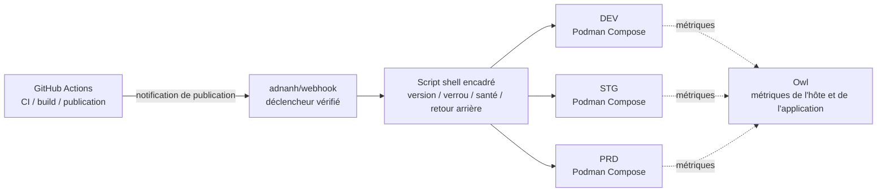

<div align="center">
    

<h1>Yin-Panel</h1>

[](https://github.com/yinorg/Yin-Panel/releases)
[](../../LICENSE)


[English](../../README.md) | [简体中文](../zh-CN/README.md) | [繁體中文](../zh-TW/README.md) | [日本語](../ja-JP/README.md) | [한국어](../ko-KR/README.md) | [Deutsch](../de-DE/README.md) | **Français** | [Español](../es-ES/README.md) | [Português (Brasil)](../pt-BR/README.md) | [Русский](../ru-RU/README.md) | [Bahasa Indonesia](../id-ID/README.md) | [Türkçe](../tr-TR/README.md) | [Polski](../pl-PL/README.md) | [Italiano](../it-IT/README.md) | [Nederlands](../nl-NL/README.md) | [हिन्दी](../hi-IN/README.md) | [ไทย](../th-TH/README.md)

</div>

Yin-Panel est un panneau de navigation léger et auto-hébergeable pour les espaces personnels et partagés. Il convient aux réseaux domestiques, aux NAS, aux serveurs et aux petites organisations.

## Démonstration

<picture>
  <source media="(prefers-color-scheme: dark)" srcset="../images/readme-home-dark.jpg">
  
</picture>

| Éditeur d'éléments | Gestion des espaces |
| --- | --- |
|  |  |

### Aperçu de l’interface

| Connexion | Accès public |
| --- | --- |
|  |  |

| Centre de fonds d'écran | Fond d'écran par défaut de l'espace |
| --- | --- |
|  |  |

**Thème Directory** : chaque espace peut utiliser son propre paquet de thème ; dans une même instance, les espaces peuvent donc avoir des mises en page différentes.


## Fonctionnalités

- Espaces personnels et partagés, contenus isolés entre eux
- Création, renommage, copie et transfert d'administration des espaces
- Arborescences de groupes, signets, icônes et tri
- Import et export de signets au format HTML du navigateur
- Membres d'espace avec les rôles administrateur, éditeur et lecteur
- Connexion OAuth 2.0 / OIDC, liaison de comptes et autorisation par groupes OIDC
- L'adresse e-mail comme identifiant de connexion, pseudonyme géré séparément
- Icônes personnalisées, thèmes installables, 17 langues d'interface, arrière-plans, modes d'URL WAN/LAN et mobile, fenêtres contextuelles dans la page
- Stockage SQLite, MySQL, MariaDB ou PostgreSQL, images Docker amd64 et arm64, chart Helm pour Kubernetes

## Environnements hébergés officiels

Nous maintenons trois environnements en ligne sur lesquels vous pouvez vous inscrire et tout essayer immédiatement ; tous les trois acceptent la connexion GitHub / GitLab / Google, et un panneau de supervision affiche leurs métriques et leurs alertes.

Sans compte, vous pouvez jeter un œil via le lien public <https://panel.yiniot.com/my-demo> (il peut aussi servir de page d'accueil au navigateur).

Vous pouvez aussi installer l'extension complémentaire [Yin-Panel Helper](https://github.com/yinorg/yin-panel-extension) (désormais sur le [Chrome Web Store](https://chromewebstore.google.com/detail/yin-panel-helper/hlfhnjccidngjjkidlgejefcchoegofo)). Elle fait exactement deux choses : rediriger le nouvel onglet vers votre panneau et aider à récupérer les icônes des sites.

| Environnement | Adresse | Usage | Disponibilité |
| --- | --- | --- | --- |
| Production (PRD) | <https://panel.yiniot.com> | Usage courant | Best effort avec un objectif de 99,9 % de disponibilité |
| STG | <https://panel-stg.yiniot.com> | Vérification avant publication | Peut être redémarré ou annulé à tout moment |
| DEV | <https://panel-dev.yiniot.com> | Essayer, signaler des problèmes | Le moins stable ; les données peuvent être effacées à tout moment |
| Supervision | <https://owl.yiniot.com> | Métriques et alertes des trois environnements | — |

Les trois environnements tournent sur le même serveur gratuit et **il n'y a pas de haute disponibilité** : PRD vise 99,9 % sans compensation, tandis que STG et DEV peuvent tomber à tout moment. N'y conservez pas de données importantes ; pour un usage durable, déployez le vôtre comme décrit ci-dessous.

## Démarrage rapide

### Docker Compose

Nécessite Docker avec le plugin Compose.

```bash
mkdir yin-panel && cd yin-panel
curl -LO https://raw.githubusercontent.com/yinorg/Yin-Panel/master/docker/docker-compose.yml
curl -o conf.yaml https://raw.githubusercontent.com/yinorg/Yin-Panel/master/backend/conf.yaml.example
mkdir -p database uploads
jwt_secret="$(openssl rand -hex 32)"
sed -i "s#^  secret: your_secret_key$#  secret: ${jwt_secret}#" conf.yaml
unset jwt_secret
YIN_PANEL_IMAGE=ghcr.io/yinorg/yin-panel-ce:latest docker compose up -d
```

Ouvrez <http://localhost:3002>.

`latest` désigne la version courante et permet d'essayer le panneau au plus vite ; **en production, figez un tag précis ou un digest d'image** (voir « Architecture CI/CD ») pour éviter une dérive du déploiement.

Administrateur par défaut : `admin@yiniot.com`, mot de passe `admin@yiniot.com`. Changez le mot de passe immédiatement après la première connexion, et définissez `base.root_url` et un `jwt.secret` unique dans `conf.yaml`.

Chaque déploiement doit générer son propre `jwt.secret` aléatoire. Le dépôt ne fournit que `conf.yaml.example` ; le fichier `conf.yaml` de votre répertoire d'exécution contient les secrets de l'instance et les identifiants OAuth et ne doit pas être commité dans Git.

### Images GHCR

```bash
docker pull ghcr.io/yinorg/yin-panel-ce:latest
docker pull ghcr.io/yinorg/yin-panel-ce:<x.y.z>
```

`latest` désigne la version courante ; lui et chaque tag de version sont des manifestes multi-architectures pour les hôtes amd64 et arm64. Les tags de version ne portent jamais de suffixe d'architecture ; des tags comme `-amd64` ou `-arm64` ne font pas partie d'une version publiée.

## Performances et configuration recommandée

Les chiffres ci-dessous proviennent de benchmarks locaux sur une seule machine (SQLite, base vide, loopback, test de charge sur le même hôte). Ils servent de référence de dimensionnement, pas de promesse de capacité en production. La capacité réelle dépend principalement du volume de données par espace, du débit d'écriture et de la concurrence de pointe.

### Utilisation des ressources (ordres de grandeur mesurés)

| Métrique | Inactif | Charge mixte 5000 req/s | Limite (dizaines de milliers de req/s) |
| --- | --- | --- | --- |
| Mémoire (RSS) | ~16 Mo | ~105 Mo | Pic ~500 Mo, redescend après l'arrêt de la charge |
| CPU | proche de 0 | ~0,3 cœur | 2–3 cœurs |

- La mémoire reste autour de **105 Mo** jusqu'à environ **20 000 req/s** et n'augmente pas linéairement avec la charge ; le pic de ~500 Mo n'apparaît que sous une pression synthétique extrême.
- Un seul cœur supporte environ **10 000–12 000 req/s** (lecture/écriture mixte, petit volume de données).
- Sous une charge mixte de 5000 req/s : 0 échec, p95 d'environ **0,25 ms**.

### Configuration recommandée

| Scénario | CPU | Mémoire | Stockage | Base de données |
| --- | --- | --- | --- | --- |
| Personnel / maison / NAS | 1 vCPU | 128–256 Mo | SSD, 512 Mo+ (plus marge pour les icônes téléversées) | SQLite |
| Petite équipe / espaces partagés | 1–2 vCPU | 256–512 Mo | SSD, 1–2 Go | SQLite |
| Organisation / forte concurrence | 2–4 vCPU | 1–2 Go | SSD | SQLite (machine unique) ou MySQL (plusieurs instances, HA) |

### Ordre de grandeur des utilisateurs

En supposant environ 0,1 req/s par utilisateur connecté (majoritairement inactif) et en réservant une marge de pointe :

| Configuration | Débit moyen théorique | Concurrence inactive (plafond théorique) | Échelle conseillée (avec marge de pointe) |
| --- | --- | --- | --- |
| 1 vCPU | ~10k req/s | ~100k | 20k–40k |
| 2 vCPU | ~20k req/s | ~200k | 50k–80k |
| 4 vCPU | ~40k req/s | ~400k | 100k+ |

Plus les utilisateurs sont actifs (édition, import, actualisations fréquentes), plus la demande par utilisateur est élevée, et plus le nombre d'utilisateurs soutenable diminue.

### Facteurs clés influant sur la capacité

1. **Volume de données** — les endpoints de liste renvoient toutes les entrées d'un espace en une seule réponse ; plus il y a d'entrées, plus la requête coûte cher. C'est le point le plus utile à mesurer avec vos propres données.
2. **Débit d'écriture** — SQLite n'autorise qu'un seul écrivain à la fois ; le débit d'écriture est limité par les fsync du disque (de l'ordre de quelques centaines d'écritures par seconde). Pour les charges d'écriture intense ou les déploiements multi-instances, utilisez MySQL.
3. **Le pic, pas la moyenne** — dimensionnez pour les pics, en prévoyant généralement 2 à 5× la moyenne.
4. **Ressources statiques** — faites servir `/assets/*` et les autres ressources hachées par un reverse proxy ou un CDN, et cachez durablement ces fichiers hachés ; les fichiers d'entrée et `/api/*` doivent rester toujours à jour.

## Base de données

SQLite (par défaut), MySQL, MariaDB et PostgreSQL sont pris en charge.

- `base.database_drive` : `sqlite` (par défaut) | `mysql` | `postgres`. **MariaDB utilise `mysql`.**
- SQLite : `sqlite.file_path` (voir aussi `read_pool_size`).
- MySQL / MariaDB : `mysql.{host,port,username,password,db_name,wait_timeout}`.
- PostgreSQL : `postgres.{host,port,username,password,db_name,ssl_mode,time_zone,wait_timeout}`.

Les capacités propres à SQLite (WAL, pool de connexions en lecture seule et sauvegardes de migration par instantané de fichier) ne s'appliquent qu'à SQLite ; sauvegardez MySQL/MariaDB/PostgreSQL avec leurs propres outils.

### Migration de SQLite vers MySQL/MariaDB/PostgreSQL

```bash
# conf.yaml        — configuration SQLite existante
# conf.target.yaml — configuration cible pointant vers mysql ou postgres (la base cible doit être vide)
./yin-panel migrate-db -source conf.yaml -target conf.target.yaml
```

La migration crée le schéma complet dans la cible, copie toutes les lignes en **conservant les clés primaires** (et réinitialise les séquences d'identité sur PostgreSQL). Elle peut être relancée — chaque exécution remplace le contenu des tables cibles. Ensuite, pointez `database_drive` dans `conf.yaml` vers la cible.

## Configuration et OAuth/OIDC

`oauth` est le point d'entrée de configuration unifié pour OAuth 2.0 et OpenID Connect (OIDC). Le modèle par défaut contient trois exemples vérifiés : GitHub (OAuth 2.0), GitLab (OIDC standard) et Google (OAuth 2.0). Les exemples sont tous commentés par défaut ; un fournisseur n'est activé qu'après avoir renseigné de vrais identifiants et défini `oauth.enable: true`. Toutes les clés de configuration sont documentées dans `backend/conf.yaml.example`.

Un fournisseur OIDC standard doit prendre en charge la découverte (discovery), le code d'autorisation + PKCE et la validation de signature JWKS, et fournir `email` et `email_verified` dans les informations utilisateur. Les fournisseurs conformes fonctionnent en principe, mais certains prestataires peuvent nécessiter une configuration supplémentaire du mappage des champs.

URL de rappel OIDC :

```text
<base.root_url>/api/oauth/<provider>/callback
```

Après le rappel, le fournisseur doit renvoyer une adresse e-mail vérifiée. Le système identifie les identités externes par `provider + sub` et associe les comptes locaux par e-mail.

## Espaces et permissions

Les permissions d'espace sont liées au `UserID` interne, jamais au texte de l'e-mail. Changer d'e-mail conserve donc les permissions d'espace existantes, et la liste des membres affiche l'e-mail le plus récent.

- Administrateur : gère l'espace, les membres, les rôles et les règles OIDC
- Éditeur : gère les groupes et les signets
- Lecteur : accès en lecture seule

La création d'un espace, le renommage, l'ajout de groupes, de membres et de règles OIDC se font dans des boîtes de dialogue.

## Helm

```bash
helm upgrade --install yin-panel ./distribution/helm-chart/yin-panel \
  --set image.tag=latest
```

En production, remplacez `image.tag` par une version précise.

Avant le déploiement, prévisualisez les manifestes rendus avec `helm template yin-panel ./distribution/helm-chart/yin-panel`.

## Développement à partir des sources

Prérequis : Go `1.27.1`, Node.js `24.21.0`, npm ou pnpm `9.15.5`.

```bash
cd frontend
npm ci
npm run build-only
```

Ou avec le pnpm épinglé :

```bash
cd frontend
corepack pnpm install --frozen-lockfile
pnpm run build-only
```

```bash
cd backend
go test ./...
go build ./...
```

Mise à jour locale complète (build frontend, tests et build backend, déploiement, redémarrage) en une seule commande :

```bash
./scripts/deploy-local.sh
```

Le script utilise `backend/` du dépôt comme répertoire d'exécution par défaut et exige un `conf.yaml` local à cet endroit ; `YIN_PANEL_RUNTIME_DIR` dans `.env.local` peut le remplacer. Une fois les builds et les tests réussis, il arrête uniquement l'écouteur Yin-Panel, remplace l'ancien binaire et les fichiers statiques avec `sudo`, et ne touche jamais à la base de données, aux fichiers téléversés ni aux fichiers de configuration.

Le système de thèmes de la page d'accueil est documenté dans [`frontend/THEME_SYSTEM.md`](../../frontend/THEME_SYSTEM.md) ; créez un nouveau thème avec `npm run create:theme -- init "<nom>"`. Les conventions complètes de développement AI, de publication et de redémarrage se trouvent dans [AGENTS.md](../../AGENTS.md).

Les tests d'acceptation dans le navigateur vivent dans un dépôt séparé, [yinorg/yin-panel-e2e](https://github.com/yinorg/yin-panel-e2e) : Playwright pilote de vrais navigateurs sur des parcours complets (connexion et comptes, espaces et permissions, import et export de signets, système de thèmes, comportement hors ligne de la PWA et reprise du nouvel onglet par l'extension), avec en plus une suite k6 pour mesurer la charge et la capacité. Il faut une instance Yin-Panel en marche, le `.env.local` du dépôt Core et les sources non empaquetées de l'extension ; l'emplacement du checkout est indiqué par `YIN_PANEL_E2E_DIR`.

## Sauvegarde et mise à niveau

Avant toute mise à niveau, sauvegardez la base de données, `uploads/`, `conf.yaml` et les values Helm. Les migrations préservent les utilisateurs, les espaces, les groupes, les signets et les références de fichiers. En cas de problème, restaurez la sauvegarde d'avant mise à niveau ; ne supprimez pas la base de données pour la recréer.

Étapes de mise à niveau d'une installation Compose :

```bash
docker compose pull
docker compose up -d
```

`docker/docker-compose.yml` utilise `latest` par défaut, et `pull_policy: missing` ne récupère l'image que si elle est absente localement : lors d'une mise à niveau, exécutez donc explicitement `docker compose pull`. En production, figez `YIN_PANEL_IMAGE` sur une version précise et changez-la lors de la mise à jour.

## Architecture CI/CD

Les environnements officiels font tourner DEV, STG et PRD sur un seul VPS 1C1G. Le but n'est pas d'empiler des composants, mais **peu de processus résidents, peu de surcharge, des publications auditables et des échecs dont on peut revenir**.



| Couche | Composant | Rôle |
| --- | --- | --- |
| CI | GitHub Actions | Tester, construire l'image, estampiller la version, déclencher la publication |
| Entrée de publication | adnanh/webhook | Vérifier l'origine et la requête ; n'exécuter que des tâches de publication fixes |
| Exécution de la publication | Script shell | Vérification de version, choix de l'environnement, verrouillage, déploiement, contrôle de santé et retour arrière |
| Exécution | Podman Compose | Faire tourner les trois instances isolées (Podman économise environ 150 Mo de RSS par rapport à Docker) |
| Supervision | Owl | Métriques de l'hôte et de l'application |

**Pourquoi ce découpage** : toute la CI s'exécute sur GitHub Actions et le VPS ne fait que récupérer l'image déjà construite et la déployer ; la petite machine ne supporte jamais le pic de compilation et n'héberge aucun plan de contrôle CI/CD. Les trois environnements partagent une chaîne de publication unique mais gardent des projets Compose, une configuration, des volumes, des réseaux et des ports distincts ; partager le mécanisme de publication n'est pas partager les données.

### Déroulé d'une publication

1. **Build** : Actions teste et construit l'image ; la version est figée par un tag Git, un SHA de commit ou un digest d'image, et la production ne déploie jamais `latest`.
2. **Déclenchement et validation** : Actions envoie une demande de publication vérifiée au webhook ; le script contrôle la version, l'environnement cible et l'action autorisée, et n'insère jamais d'entrée arbitraire dans une commande shell.
3. **Verrouillage et déploiement** : un déploiement à la fois par environnement, et seul l'environnement cible est mis à jour — rien n'est redémarré à l'aveugle.
4. **Contrôle de santé et échec** : on vérifie que le service démarre et répond ; en cas d'échec, la dernière version saine est conservée et restaurée, en enregistrant l'environnement, la version, la source du déclenchement, le résultat et la raison du retour arrière.

Promotion : DEV déploie automatiquement → STG déploie la même version après vérification → **PRD exige une approbation humaine** après les tests de fumée. Les corrections urgentes passent elles aussi par une voie d'exception auditable, afin qu'un événement de développement ordinaire ne contourne jamais l'approbation de production.

### Limites

C'est une architecture de déploiement **mono-machine, sobre en ressources et auditable**, pas une architecture de haute disponibilité : les trois environnements sont isolés en processus, en configuration et en données, mais partagent le noyau, le disque, le réseau et la mémoire d'un même VPS, si bien qu'une panne de l'hôte ou un manque de ressources touche les trois à la fois. Sa valeur est de conserver les mécanismes d'une publication fiable — versions figées, environnements isolés, contrôles de santé, retour arrière, supervision et piste d'audit — avec très peu de processus résidents.

## Open Core

L'édition Core de Yin-Panel est gratuite et continue d'être maintenue et mise à jour. Ce dépôt est la seule source publique du Core et publie l'image `yin-panel-ce`. L'édition Enterprise se trouve dans le dépôt privé [yinorg/Yin-Panel-EE](https://github.com/yinorg/Yin-Panel-EE) et s'intègre via des interfaces publiques.

Une instance en cours d'exécution expose son édition, ses capacités, son état en lecture seule et sa version sur `GET /api/system/capabilities`. Signalez problèmes et suggestions dans les [GitHub Issues](https://github.com/yinorg/Yin-Panel/issues).

Les contributions fusionnées dans ce dépôt restent dans le Core : elles ne sont ni déplacées vers l'édition Enterprise ni relicenciées. Voir [Core et Enterprise](../../GOVERNANCE.md).

## Remerciements

Yin-Panel est issu du projet open source [hslr-s/sun-panel](https://github.com/hslr-s/sun-panel) ; merci à l'auteur original d'avoir posé les fondations.

Merci également à [PhantomMaa/sun-panel](https://github.com/PhantomMaa/sun-panel) pour ses optimisations et son travail de maintenance. Yin-Panel a repris la maintenance sur cette base et continue d'ajouter des fonctionnalités, des améliorations d'interaction et des évolutions pensées pour l'auto-hébergement.

Merci à tous les auteurs originaux, contributeurs et utilisateurs.

## Contribuer

Le projet continue parce que des personnes prennent le temps de signaler des problèmes et de partager des idées. Toute forme de participation est bienvenue :

- **Suggestions et anomalies** : ouvrez une [issue](https://github.com/yinorg/Yin-Panel/issues) en précisant la version, l'environnement, les étapes de reproduction et ce que vous avez observé — une capture d'écran ou un log accélère beaucoup le traitement.
- **Code et documentation** : les pull requests sont bienvenues. Corriger un bug, reformuler une phrase, ajouter une langue ou remplacer une capture compte également.
- **Encore indécis** : ouvrez d'abord une issue pour convenir de l'approche avant d'écrire du code, afin d'éviter un travail dans une direction que personne ne souhaite.

Jetez un œil à [CONTRIBUTING.md](../../CONTRIBUTING.md) avant de commencer : les changements importants méritent d'être discutés d'abord, et les problèmes de sécurité se signalent en privé plutôt que dans une issue publique. Si quelque chose n'est pas clair, posez la question dans une issue et j'essaierai d'indiquer la direction.

Les issues comme les pull requests sont lues, et je m'efforce de répondre sous 7 jours ; les problèmes reproductibles et les suggestions bien décrites avancent le plus vite. Chaque retour est une raison de poursuivre ce projet.

## Licence

Yin-Panel est publié sous [Business Source License 1.1](../../LICENSE). Le fork, la modification et l'auto-hébergement sont gratuits, y compris pour un usage interne à votre organisation et pour servir vos propres clients ; proposer Yin-Panel lui-même en tant que service hébergé à des tiers nécessite une licence commerciale. Chaque version devient disponible sous licence AGPL-3.0-or-later trois ans après sa propre première distribution publique. Voir [Core et Enterprise](../../GOVERNANCE.md).

Les mentions relatives aux tiers sont répertoriées dans [THIRD-PARTY-NOTICES.md](../../THIRD-PARTY-NOTICES.md) ; les contributions sont acceptées sous l'[Contributor License Agreement](../../CLA.md).
