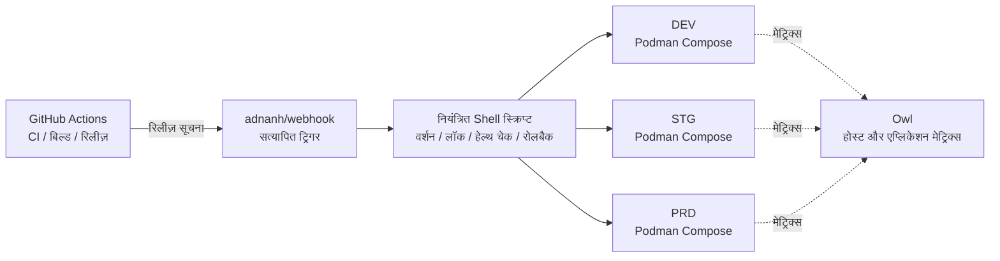

<div align="center">
    

<h1>Yin-Panel</h1>

[](https://github.com/yinorg/Yin-Panel/releases)
[](../../LICENSE)


[English](../../README.md) | [简体中文](../zh-CN/README.md) | [繁體中文](../zh-TW/README.md) | [日本語](../ja-JP/README.md) | [한국어](../ko-KR/README.md) | [Deutsch](../de-DE/README.md) | [Français](../fr-FR/README.md) | [Español](../es-ES/README.md) | [Português (Brasil)](../pt-BR/README.md) | [Русский](../ru-RU/README.md) | [Bahasa Indonesia](../id-ID/README.md) | [Türkçe](../tr-TR/README.md) | [Polski](../pl-PL/README.md) | [Italiano](../it-IT/README.md) | [Nederlands](../nl-NL/README.md) | **हिन्दी** | [ไทย](../th-TH/README.md)

</div>

Yin-Panel व्यक्तिगत और साझा स्पेस के लिए एक हल्का, स्वयं-होस्ट किया जा सकने वाला नेविगेशन पैनल है। यह होम नेटवर्क, NAS डिवाइस, सर्वर और छोटे संगठनों के लिए उपयुक्त है।

## डेमो

<picture>
  <source media="(prefers-color-scheme: dark)" srcset="../images/readme-home-dark.jpg">
  
</picture>

| आइटम एडिटर | स्पेस प्रबंधन |
| --- | --- |
|  |  |

### इंटरफ़ेस पूर्वावलोकन

| लॉगिन | सार्वजनिक पहुँच |
| --- | --- |
|  |  |

| वॉलपेपर केंद्र | स्पेस का डिफ़ॉल्ट वॉलपेपर |
| --- | --- |
|  |  |

**Directory थीम**: हर स्पेस अपना थीम पैकेज चुन सकता है, इसलिए एक ही इंस्टेंस के स्पेस अलग दिख सकते हैं।


## विशेषताएँ

- पृथक सामग्री वाले व्यक्तिगत और साझा स्पेस
- स्पेस बनाना, नाम बदलना, कॉपी करना और एडमिनिस्ट्रेटर हस्तांतरण
- समूह ट्री, बुकमार्क, आइकन और क्रमबद्ध करना
- ब्राउज़र HTML प्रारूप में बुकमार्क आयात और निर्यात
- एडमिनिस्ट्रेटर, एडिटर और व्यूअर भूमिकाओं वाले स्पेस सदस्य
- OAuth 2.0 / OIDC लॉगिन, खाता लिंकिंग और OIDC समूह प्राधिकरण
- लॉगिन पहचान के रूप में ईमेल, स्वतंत्र उपनाम के साथ
- कस्टम आइकन, इंस्टॉल करने योग्य थीम पैकेज, 17 UI भाषाएँ, वॉलपेपर, WAN/LAN और मोबाइल URL मोड, और पेज के भीतर पॉपअप विंडो
- SQLite, MySQL, MariaDB या PostgreSQL स्टोरेज, amd64 और arm64 के लिए Docker इमेज, और Kubernetes के लिए Helm चार्ट

## आधिकारिक होस्ट किए गए एनवायरनमेंट

हम तीन ऑनलाइन एनवायरनमेंट चलाते हैं जिन पर आप तुरंत रजिस्टर करके सब कुछ आज़मा सकते हैं; तीनों में GitHub / GitLab / Google से लॉगिन होता है, और एक मॉनिटरिंग पैनल उनके मेट्रिक्स व अलर्ट दिखाता है।

| एनवायरनमेंट | पता | उद्देश्य | उपलब्धता |
| --- | --- | --- | --- |
| प्रोडक्शन (PRD) | <https://panel.yiniot.com> | नियमित उपयोग | 99.9% उपलब्धता के लक्ष्य के साथ बेस्ट एफ़र्ट |
| STG | <https://panel-stg.yiniot.com> | रिलीज़ से पहले सत्यापन | कभी भी रीस्टार्ट या रोलबैक हो सकता है |
| DEV | <https://panel-dev.yiniot.com> | आज़माना और समस्याएँ बताना | सबसे अस्थिर; डेटा कभी भी मिट सकता है |
| मॉनिटरिंग | <https://owl.yiniot.com> | तीनों एनवायरनमेंट के मेट्रिक्स और अलर्ट | — |

तीनों एनवायरनमेंट एक ही मुफ़्त सर्वर पर चलते हैं और **इसमें हाई अवेलेबिलिटी नहीं है**: PRD का लक्ष्य 99.9% है पर उसके लिए कोई मुआवज़ा नहीं मिलता, जबकि STG और DEV कभी भी बंद हो सकते हैं। इन पर ज़रूरी डेटा न रखें; लंबे समय के उपयोग के लिए नीचे बताए अनुसार खुद होस्ट करें।

## त्वरित शुरुआत

### Docker Compose

Compose प्लगइन के साथ Docker आवश्यक है।

```bash
mkdir yin-panel && cd yin-panel
curl -LO https://raw.githubusercontent.com/yinorg/Yin-Panel/master/docker/docker-compose.yml
curl -o conf.yaml https://raw.githubusercontent.com/yinorg/Yin-Panel/master/backend/conf.yaml.example
mkdir -p database uploads
jwt_secret="$(openssl rand -hex 32)"
sed -i "s#^  secret: your_secret_key$#  secret: ${jwt_secret}#" conf.yaml
unset jwt_secret
YIN_PANEL_IMAGE=ghcr.io/yinorg/yin-panel-ce:latest docker compose up -d
```

<http://localhost:3002> खोलें।

`latest` मौजूदा रिलीज़ की ओर इशारा करता है और आज़माने का सबसे तेज़ तरीका है; **प्रोडक्शन में इसे किसी ठोस tag या इमेज digest पर तय करें** (देखें "CI/CD आर्किटेक्चर"), ताकि डिप्लॉयमेंट खिसके नहीं।

डिफ़ॉल्ट एडमिनिस्ट्रेटर: `admin@yiniot.com`, पासवर्ड `admin@yiniot.com`। पहले लॉगिन के तुरंत बाद पासवर्ड बदलें, और `conf.yaml` में `base.root_url` तथा एक अद्वितीय `jwt.secret` सेट करें।

प्रत्येक डिप्लॉयमेंट को अपना रैंडम `jwt.secret` जनरेट करना चाहिए। रिपॉज़िटरी केवल `conf.yaml.example` देती है; आपकी रनटाइम डायरेक्टरी की `conf.yaml` में इंस्टेंस सीक्रेट और OAuth क्रेडेंशियल होते हैं और इसे Git में कमिट नहीं किया जाना चाहिए।

### GHCR इमेजेज़

```bash
docker pull ghcr.io/yinorg/yin-panel-ce:latest
docker pull ghcr.io/yinorg/yin-panel-ce:<x.y.z>
```

`latest` मौजूदा रिलीज़ की ओर इशारा करता है; यह और हर रिलीज़ tag amd64 तथा arm64 होस्ट के लिए मल्टी-आर्किटेक्चर मैनिफ़ेस्ट हैं। रिलीज़ टैग में कभी आर्किटेक्चर सफ़िक्स नहीं होता; `-amd64` या `-arm64` जैसे टैग किसी रिलीज़ का हिस्सा नहीं हैं।

## प्रदर्शन और अनुशंसित कॉन्फ़िगरेशन

नीचे दिए गए आंकड़े स्थानीय सिंगल-मशीन बेंचमार्क (SQLite, खाली डेटाबेस, लूपबैक, उसी होस्ट पर लोड जनरेटर) से हैं। इन्हें साइज़िंग संदर्भ मानें, उत्पादन क्षमता का वादा नहीं। वास्तविक क्षमता मुख्य रूप से प्रति स्पेस डेटा वॉल्यूम, राइट रेट और पीक कंकरेंसी पर निर्भर करती है।

### संसाधन उपयोग (मापी गई मात्राएँ)

| मेट्रिक | निष्क्रिय | 5000 req/s मिश्रित लोड | सीमा (दसियों हज़ार req/s) |
| --- | --- | --- | --- |
| मेमोरी (RSS) | ~16 MB | ~105 MB | ~500 MB पीक; लोड रुकने के बाद घट जाती है |
| CPU | लगभग शून्य | ~0.3 कोर | 2–3 कोर |

- मेमोरी लगभग **20k req/s** तक **105 MB** के आसपास रहती है और लोड के साथ रैखिक रूप से नहीं बढ़ती; ~500 MB का आंकड़ा केवल कृत्रिम अत्यधिक दबाव में दिखता है।
- एक सिंगल कोर लगभग **10k–12k req/s** संभालता है (मिश्रित पढ़ना/लिखना, छोटा डेटा सेट)।
- 5000 req/s मिश्रित लोड के तहत: 0 विफलताएँ, p95 लगभग **0.25 ms**।

### अनुशंसित कॉन्फ़िगरेशन

| परिदृश्य | CPU | मेमोरी | स्टोरेज | डेटाबेस |
| --- | --- | --- | --- | --- |
| व्यक्तिगत / होम / NAS | 1 vCPU | 128–256 MB | SSD, 512 MB+ (आइकन अपलोड के लिए अतिरिक्त जगह) | SQLite |
| छोटी टीम / साझा स्पेस | 1–2 vCPU | 256–512 MB | SSD, 1–2 GB | SQLite |
| संगठन / उच्च कंकरेंसी | 2–4 vCPU | 1–2 GB | SSD | SQLite (एकल होस्ट) या MySQL (कई इंस्टेंस, HA) |

### उपयोगकर्ता पैमाना संदर्भ

प्रति ऑनलाइन उपयोगकर्ता लगभग 0.1 req/s (अधिकतर निष्क्रिय) मानते हुए और पीक हेडरूम आरक्षित रखते हुए:

| कॉन्फ़िगरेशन | सैद्धांतिक औसत थ्रूपुट | निष्क्रिय कंकरेंसी (सैद्धांतिक ऊपरी सीमा) | सुझाया गया पैमाना (पीक हेडरूम सहित) |
| --- | --- | --- | --- |
| 1 vCPU | ~10k req/s | ~100k | 20k–40k |
| 2 vCPU | ~20k req/s | ~200k | 50k–80k |
| 4 vCPU | ~40k req/s | ~400k | 100k+ |

उपयोगकर्ता जितने अधिक सक्रिय होंगे (संपादन, आयात, बार-बार रीफ़्रेश), प्रति उपयोगकर्ता अनुरोध दर उतनी अधिक होगी, और स्थायी उपयोगकर्ता संख्या उतनी कम होगी।

### क्षमता को प्रभावित करने वाले मुख्य कारक

1. **डेटा वॉल्यूम** — लिस्ट एंडपॉइंट एक ही प्रतिक्रिया में स्पेस की हर प्रविष्टि लौटाते हैं; अधिक प्रविष्टियों का अर्थ है अधिक महँगा अनुरोध। यह वह हिस्सा है जिसे अपने डेटा पर मापना सबसे अधिक उपयोगी है।
2. **राइट रेट** — SQLite एक समय में केवल एक राइटर की अनुमति देता है; राइट थ्रूपुट डिस्क fsync से सीमित है (प्रति सेकंड सैकड़ों राइट के क्रम पर)। राइट-भारी या मल्टी-इंस्टेंस सेटअप के लिए MySQL का उपयोग करें।
3. **औसत नहीं, पीक** — पीक के अनुसार आकार तय करें, सामान्यतः औसत का 2–5× आरक्षित रखें।
4. **स्टैटिक एसेट** — `/assets/*` और अन्य हैश किए गए एसेट किसी रिवर्स प्रॉक्सी या CDN से सर्व करें, और हैश वाली फ़ाइलों को लंबे समय तक कैश करें; एंट्री फ़ाइलें और `/api/*` हमेशा ताज़ा रहनी चाहिए।

## डेटाबेस

SQLite (डिफ़ॉल्ट), MySQL, MariaDB और PostgreSQL समर्थित हैं।

- `base.database_drive`: `sqlite` (डिफ़ॉल्ट) | `mysql` | `postgres`. **MariaDB `mysql` का उपयोग करता है।**
- SQLite: `sqlite.file_path` (`read_pool_size` भी देखें)।
- MySQL / MariaDB: `mysql.{host,port,username,password,db_name,wait_timeout}`।
- PostgreSQL: `postgres.{host,port,username,password,db_name,ssl_mode,time_zone,wait_timeout}`।

केवल-SQLite क्षमताएँ (WAL, रीड-ओनली कनेक्शन पूल और फ़ाइल-स्नैपशॉट माइग्रेशन बैकअप) केवल SQLite पर लागू होती हैं; MySQL/MariaDB/PostgreSQL का बैकअप उनके अपने टूल से लें।

### SQLite से MySQL/MariaDB/PostgreSQL पर माइग्रेशन

```bash
# conf.yaml        — मौजूदा SQLite कॉन्फ़िगरेशन
# conf.target.yaml — mysql या postgres की ओर इंगित लक्ष्य कॉन्फ़िगरेशन (लक्ष्य डेटाबेस खाली होना चाहिए)
./yin-panel migrate-db -source conf.yaml -target conf.target.yaml
```

माइग्रेशन लक्ष्य में पूरा स्कीमा बनाता है, प्राथमिक कुंजियाँ सुरक्षित रखते हुए हर पंक्ति कॉपी करता है (और PostgreSQL पर identity अनुक्रम रीसेट करता है)। इसे बार-बार चलाया जा सकता है — प्रत्येक रन लक्ष्य तालिका की सामग्री बदल देता है। इसके बाद, `conf.yaml` में `database_drive` को लक्ष्य की ओर इंगित करें।

## कॉन्फ़िगरेशन और OAuth/OIDC

`oauth` OAuth 2.0 और OpenID Connect (OIDC) के लिए एकीकृत कॉन्फ़िगरेशन प्रविष्टि है। डिफ़ॉल्ट टेम्पलेट में तीन सत्यापित उदाहरण शामिल हैं: GitHub (OAuth 2.0), GitLab (मानक OIDC) और Google (OAuth 2.0)। उदाहरण डिफ़ॉल्ट रूप से टिप्पणीबद्ध हैं; कोई प्रदाता तभी सक्षम होता है जब आप वास्तविक क्रेडेंशियल भरें और `oauth.enable: true` सेट करें। सभी कॉन्फ़िगरेशन कुंजियाँ `backend/conf.yaml.example` में प्रलेखित हैं।

एक मानक OIDC प्रदाता को डिस्कवरी, authorization code + PKCE और JWKS हस्ताक्षर सत्यापन का समर्थन करना चाहिए, और उपयोगकर्ता जानकारी में `email` और `email_verified` प्रदान करना चाहिए। जो प्रदाता इन मानकों को पूरा करते हैं वे सिद्धांत रूप में काम करते हैं, लेकिन विभिन्न विक्रेताओं को अतिरिक्त फ़ील्ड-मैपिंग कॉन्फ़िगरेशन की आवश्यकता हो सकती है।

OIDC कॉलबैक URL:

```text
<base.root_url>/api/oauth/<provider>/callback
```

कॉलबैक के बाद, प्रदाता को सत्यापित ईमेल लौटाना होगा। सिस्टम बाहरी पहचानों को `provider + sub` से पहचानता है और स्थानीय खातों को ईमेल से लिंक करता है।

## स्पेस और अनुमतियाँ

स्पेस अनुमतियाँ आंतरिक `UserID` से कुंजीबद्ध होती हैं, ईमेल टेक्स्ट से कभी नहीं। इसलिए ईमेल बदलने पर मौजूदा स्पेस अनुमतियाँ बनी रहती हैं, और सदस्य सूची नवीनतम ईमेल दिखाती है।

- एडमिनिस्ट्रेटर: स्पेस, सदस्य, भूमिकाएँ और OIDC नियमों का प्रबंधन करता है
- एडिटर: समूह और बुकमार्क बनाए रखता है
- व्यूअर: केवल-पढ़ने की पहुँच

स्पेस बनाना, उसका नाम बदलना, समूह जोड़ना, सदस्य जोड़ना और OIDC नियम जोड़ना — ये सब डायलॉग में होते हैं।

## Helm

```bash
helm upgrade --install yin-panel ./distribution/helm-chart/yin-panel \
  --set image.tag=latest
```

प्रोडक्शन में `image.tag` को किसी ठोस वर्शन से बदलें।

डिप्लॉय करने से पहले, `helm template yin-panel ./distribution/helm-chart/yin-panel` से रेंडर किए गए मैनिफ़ेस्ट का पूर्वावलोकन करें।

## स्रोत से विकास

आवश्यकताएँ: Go `1.27.1`, Node.js `24.21.0`, npm या pnpm `9.15.5`।

```bash
cd frontend
npm ci
npm run build-only
```

या पिन किए गए pnpm के साथ:

```bash
cd frontend
corepack pnpm install --frozen-lockfile
pnpm run build-only
```

```bash
cd backend
go test ./...
go build ./...
```

एक ही कमांड में पूरा स्थानीय अपडेट (फ़्रंटएंड बिल्ड, बैकएंड टेस्ट और बिल्ड, डिप्लॉयमेंट, रीस्टार्ट):

```bash
./scripts/deploy-local.sh
```

स्क्रिप्ट डिफ़ॉल्ट रूप से रिपॉज़िटरी की `backend/` को रनटाइम डायरेक्टरी के रूप में उपयोग करती है और वहाँ स्थानीय `conf.yaml` आवश्यक है; `.env.local` में `YIN_PANEL_RUNTIME_DIR` इसे ओवरराइड कर सकता है। सभी बिल्ड और टेस्ट पास होने के बाद, यह केवल Yin-Panel लिसनर को रोकती है, `sudo` का उपयोग करके पुराने बाइनरी और स्टैटिक फ़ाइलें बदलती है, और डेटाबेस, uploads या कॉन्फ़िगरेशन फ़ाइलों को कभी नहीं छूती।

होम-पेज थीम सिस्टम [`frontend/THEME_SYSTEM.md`](../../frontend/THEME_SYSTEM.md) में प्रलेखित है; `npm run create:theme -- init "<name>"` से नई थीम का ढाँचा बनाएँ। पूर्ण AI विकास, रिलीज़ और रीस्टार्ट परंपराएँ [AGENTS.md](../../AGENTS.md) में हैं।

## बैकअप और अपग्रेड

अपग्रेड से पहले डेटाबेस, `uploads/`, `conf.yaml` और Helm values का बैकअप लें। माइग्रेशन उपयोगकर्ताओं, स्पेस, समूहों, बुकमार्क और फ़ाइल संदर्भों को सुरक्षित रखते हैं। यदि अपग्रेड गलत हो जाए, तो अपग्रेड-पूर्व बैकअप पुनर्स्थापित करें; डेटाबेस हटाकर नए सिरे से शुरू न करें।

Compose इंस्टॉल को अपग्रेड करने के चरण:

```bash
docker compose pull
docker compose up -d
```

`docker/docker-compose.yml` डिफ़ॉल्ट रूप से `latest` इस्तेमाल करता है, और `pull_policy: missing` सिर्फ़ तब इमेज खींचता है जब वह लोकल में न हो, इसलिए अपग्रेड के समय `docker compose pull` चलाना ज़रूरी है। प्रोडक्शन में `YIN_PANEL_IMAGE` को किसी ठोस वर्शन पर तय करें और अपडेट के समय उसे बदलें।

## CI/CD आर्किटेक्चर

आधिकारिक एनवायरनमेंट एक ही 1C1G VPS पर DEV, STG और PRD चलाते हैं। मकसद ढेर सारे कंपोनेंट जोड़ना नहीं, बल्कि **कम रेज़िडेंट प्रोसेस, कम ओवरहेड, ऑडिट करने योग्य रिलीज़ और फेल होने पर वापस लौट सकने की क्षमता** है।



| लेयर | कंपोनेंट | ज़िम्मेदारी |
| --- | --- | --- |
| CI | GitHub Actions | टेस्ट चलाना, इमेज बनाना, वर्शन दर्ज करना और रिलीज़ शुरू करना |
| रिलीज़ एंट्री | adnanh/webhook | स्रोत और अनुरोध सत्यापित करना; केवल तय रिलीज़ कार्य चलाना |
| रिलीज़ निष्पादन | Shell स्क्रिप्ट | वर्शन जाँच, एनवायरनमेंट चयन, लॉक, डिप्लॉय, हेल्थ चेक और रोलबैक |
| रनटाइम | Podman Compose | तीन अलग-अलग एप्लिकेशन इंस्टेंस चलाना (Podman, Docker की तुलना में लगभग 150 MB RSS बचाता है) |
| मॉनिटरिंग | Owl | होस्ट और एप्लिकेशन मेट्रिक्स |

**यह बँटवारा क्यों**: पूरी CI GitHub Actions पर चलती है और VPS सिर्फ़ बनी हुई इमेज खींचकर तैनात करता है — छोटी मशीन पर कंपाइल का पीक नहीं आता और कोई CI/CD कंट्रोल प्लेन हमेशा नहीं चलता। तीनों एनवायरनमेंट एक ही रिलीज़ चेन साझा करते हैं, पर उनके Compose प्रोजेक्ट, कॉन्फ़िगरेशन, वॉल्यूम, नेटवर्क और पोर्ट अलग रहते हैं; रिलीज़ का तरीका साझा करना डेटा साझा करना नहीं है।

### रिलीज़ का प्रवाह

1. **बिल्ड**: Actions टेस्ट चलाता है और इमेज बनाता है; वर्शन Git tag, commit SHA या इमेज digest से तय होता है, और प्रोडक्शन में कभी `latest` तैनात नहीं होता।
2. **ट्रिगर और सत्यापन**: Actions वेबहुक को सत्यापित रिलीज़ अनुरोध भेजता है; स्क्रिप्ट वर्शन, लक्षित एनवायरनमेंट और अनुमत कार्रवाई जाँचती है और कभी भी मनमाना इनपुट Shell कमांड में नहीं जोड़ती।
3. **लॉक और डिप्लॉय**: एक एनवायरनमेंट पर एक समय में एक ही डिप्लॉय होता है, और सिर्फ़ लक्षित एनवायरनमेंट अपडेट होता है — कुछ भी बिना सोचे रीस्टार्ट नहीं किया जाता।
4. **हेल्थ चेक और विफलता**: सेवा शुरू होकर जवाब दे रही है या नहीं, यह जाँचा जाता है; विफल होने पर पिछला सही वर्शन बनाए रखकर रोलबैक किया जाता है, और एनवायरनमेंट, वर्शन, ट्रिगर स्रोत, परिणाम तथा रोलबैक का कारण दर्ज किया जाता है।

प्रोमोशन: DEV अपने आप डिप्लॉय होता है → सत्यापन के बाद STG वही वर्शन डिप्लॉय करता है → स्मोक टेस्ट के बाद **PRD के लिए इंसानी स्वीकृति ज़रूरी है**। आपात सुधार भी ऑडिट योग्य अपवाद प्रक्रिया से जाते हैं, इसलिए सामान्य डेवलपमेंट घटना प्रोडक्शन स्वीकृति को कभी नहीं लाँघती।

### सीमाएँ

यह **सिंगल-मशीन, कम संसाधन वाला और ऑडिट योग्य** डिप्लॉयमेंट आर्किटेक्चर है, हाई अवेलेबिलिटी आर्किटेक्चर नहीं: तीनों एनवायरनमेंट प्रोसेस, कॉन्फ़िगरेशन और डेटा में अलग हैं, पर एक ही VPS का kernel, डिस्क, नेटवर्क और मेमरी साझा करते हैं, इसलिए होस्ट खराब होने या संसाधन खत्म होने पर तीनों एक साथ प्रभावित होते हैं। इसका मूल्य यह है कि भरोसेमंद रिलीज़ के लिए ज़रूरी तंत्र — तय वर्शन, अलग एनवायरनमेंट, हेल्थ चेक, रोलबैक, मॉनिटरिंग और ऑडिट रिकॉर्ड — बहुत कम रेज़िडेंट कंपोनेंट के साथ बने रहते हैं।

## ओपन कोर

Yin-Panel Core संस्करण निःशुल्क है और इसका रखरखाव तथा अपडेट जारी रहेगा। यह रिपॉज़िटरी Core का एकमात्र सार्वजनिक स्रोत है और `yin-panel-ce` इमेज प्रकाशित करती है। Enterprise संस्करण निजी रिपॉज़िटरी [yinorg/Yin-Panel-EE](https://github.com/yinorg/Yin-Panel-EE) में है और सार्वजनिक इंटरफ़ेस के माध्यम से जुड़ता है।

चलता हुआ इंस्टेंस अपना संस्करण, क्षमताएँ, केवल-पढ़ने की स्थिति और संस्करण `GET /api/system/capabilities` पर उजागर करता है। समस्याएँ और सुझाव [GitHub Issues](https://github.com/yinorg/Yin-Panel/issues) में रिपोर्ट करें।

इस रिपॉज़िटरी में मर्ज किए गए योगदान Core में ही रहते हैं: उन्हें Enterprise संस्करण में नहीं ले जाया जाता और न ही दोबारा लाइसेंस किया जाता है। देखें [Core और Enterprise](../../GOVERNANCE.md)।

## श्रेय

Yin-Panel ओपन-सोर्स प्रोजेक्ट [hslr-s/sun-panel](https://github.com/hslr-s/sun-panel) से विकसित हुआ; नींव रखने के लिए मूल लेखक को धन्यवाद।

इसके अनुकूलन और रखरखाव कार्य के लिए [PhantomMaa/sun-panel](https://github.com/PhantomMaa/sun-panel) को भी धन्यवाद। Yin-Panel ने उसी आधार से निरंतर रखरखाव अपने हाथ में लिया और लगातार सुविधाएँ, इंटरैक्शन सुधार और सेल्फ-होस्टिंग-केंद्रित बदलाव जोड़ता रहा।

सभी मूल लेखकों, योगदानकर्ताओं और उपयोगकर्ताओं को धन्यवाद।

## योगदान करें

यह प्रोजेक्ट इसलिए चलता है क्योंकि लोग समस्याएँ और नए विचार साझा करने का समय निकालते हैं। हर तरह का योगदान स्वागत योग्य है:

- **सुझाव और बग रिपोर्ट**: [Issue](https://github.com/yinorg/Yin-Panel/issues) खोलकर वर्शन, एनवायरनमेंट, दोहराने के चरण और जो देखा वह लिखें — स्क्रीनशॉट या लॉग होने पर काम बहुत तेज़ हो जाता है।
- **कोड और डॉक्यूमेंटेशन**: Pull Request का स्वागत है। बग ठीक करना, एक वाक्य बदलना, एक भाषा जोड़ना या स्क्रीनशॉट बदलना भी मूल्यवान योगदान है।
- **अभी तय नहीं**: कोड लिखने से पहले Issue में दिशा तय कर लें, ताकि मेहनत ऐसी दिशा में न जाए जिसकी किसी को ज़रूरत न हो।

शुरू करने से पहले [CONTRIBUTING.md](../../CONTRIBUTING.md) पर एक नज़र डालें: बड़े बदलाव पहले चर्चा में लाना बेहतर है, और सुरक्षा से जुड़ी बातें सार्वजनिक Issue में नहीं, निजी तौर पर बताएँ। कुछ स्पष्ट न हो तो Issue में पूछ लें, मैं दिशा बताने की कोशिश करूँगा।

Issue और PR दोनों देखे जाते हैं, और मैं 7 दिनों के भीतर जवाब देने की कोशिश करता हूँ; जिन समस्याओं को ठीक से दोहराया जा सके और जिन सुझावों में संदर्भ हो, वे सबसे तेज़ आगे बढ़ते हैं। हर प्रतिक्रिया इस प्रोजेक्ट को जारी रखने की एक वजह है।

## लाइसेंस

Yin-Panel [Business Source License 1.1](../../LICENSE) के अंतर्गत लाइसेंस्ड है। फ़ोर्क करना, संशोधन और स्वयं होस्ट करना निःशुल्क है, जिसमें आपके संगठन के भीतर उपयोग और अपने ग्राहकों की सेवा शामिल है; Yin-Panel को ही तीसरे पक्ष को होस्टेड सेवा के रूप में देना एक वाणिज्यिक लाइसेंस की आवश्यकता है। प्रत्येक संस्करण अपने पहले सार्वजनिक वितरण के तीन वर्ष बाद AGPL-3.0-or-later लाइसेंस के अंतर्गत उपलब्ध हो जाता है। देखें [Core और Enterprise](../../GOVERNANCE.md)।

तृतीय-पक्ष सूचनाएँ [THIRD-PARTY-NOTICES.md](../../THIRD-PARTY-NOTICES.md) में सूचीबद्ध हैं, और योगदान [Contributor License Agreement](../../CLA.md) के अंतर्गत स्वीकार किए जाते हैं।
