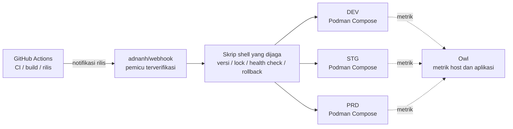

<div align="center">
    

<h1>Yin-Panel</h1>

[](https://github.com/yinorg/Yin-Panel/releases)
[](../../LICENSE)


[English](../../README.md) | [简体中文](../zh-CN/README.md) | [繁體中文](../zh-TW/README.md) | [日本語](../ja-JP/README.md) | [한국어](../ko-KR/README.md) | [Deutsch](../de-DE/README.md) | [Français](../fr-FR/README.md) | [Español](../es-ES/README.md) | [Português (Brasil)](../pt-BR/README.md) | [Русский](../ru-RU/README.md) | **Bahasa Indonesia** | [Türkçe](../tr-TR/README.md) | [Polski](../pl-PL/README.md) | [Italiano](../it-IT/README.md) | [Nederlands](../nl-NL/README.md) | [हिन्दी](../hi-IN/README.md) | [ไทย](../th-TH/README.md)

</div>

Yin-Panel adalah panel navigasi ringan yang dapat dihosting sendiri untuk ruang pribadi dan bersama. Panel ini cocok untuk jaringan rumah, perangkat NAS, server, dan organisasi kecil.

## Demo

<picture>
  <source media="(prefers-color-scheme: dark)" srcset="../images/readme-home-dark.jpg">
  
</picture>

| Editor item | Manajemen ruang |
| --- | --- |
|  |  |

### Pratinjau antarmuka

| Login | Akses publik |
| --- | --- |
|  |  |

| Pusat wallpaper | Wallpaper bawaan ruang |
| --- | --- |
|  |  |

**Tema Directory**: setiap ruang dapat memakai paket temanya sendiri, jadi ruang di satu instans bisa tampil berbeda.


## Fitur

- Ruang pribadi dan bersama dengan konten yang terisolasi
- Pembuatan, penggantian nama, penyalinan, dan pengalihan administrator ruang
- Pohon grup, bookmark, ikon, dan pengurutan
- Impor dan ekspor bookmark dalam format HTML browser
- Anggota ruang dengan peran administrator, editor, dan viewer
- Login OAuth 2.0 / OIDC, penautan akun, dan otorisasi grup OIDC
- Email sebagai identitas login, dengan nama panggilan yang terpisah
- Ikon kustom, paket tema yang dapat dipasang, 17 bahasa UI, wallpaper, mode URL WAN/LAN dan seluler, serta jendela popup dalam halaman
- Penyimpanan SQLite, MySQL, MariaDB, atau PostgreSQL, image Docker untuk amd64 dan arm64, dan chart Helm untuk Kubernetes

## Lingkungan resmi yang dihosting

Kami menjalankan tiga lingkungan online yang bisa langsung Anda daftari dan coba; ketiganya mendukung masuk dengan GitHub / GitLab / Google, dan ada panel pemantauan yang menampilkan metrik serta peringatannya.

| Lingkungan | Alamat | Tujuan | Ketersediaan |
| --- | --- | --- | --- |
| Produksi (PRD) | <https://panel.yiniot.com> | Penggunaan sehari-hari | Best effort dengan target ketersediaan 99,9% |
| STG | <https://panel-stg.yiniot.com> | Verifikasi sebelum rilis | Bisa direstart atau di-rollback kapan saja |
| DEV | <https://panel-dev.yiniot.com> | Mencoba dan melaporkan masalah | Paling tidak stabil; data bisa dihapus kapan saja |
| Pemantauan | <https://owl.yiniot.com> | Metrik dan peringatan untuk ketiga lingkungan | — |

Ketiganya berjalan di server gratis yang sama dan **tidak ada ketersediaan tinggi**: PRD menargetkan 99,9% tanpa kompensasi apa pun, sedangkan STG dan DEV bisa mati kapan saja. Jangan menyimpan data penting di sana; untuk pemakaian jangka panjang, hosting sendiri seperti dijelaskan di bawah.

## Mulai cepat

### Docker Compose

Memerlukan Docker dengan plugin Compose.

```bash
mkdir yin-panel && cd yin-panel
curl -LO https://raw.githubusercontent.com/yinorg/Yin-Panel/master/docker/docker-compose.yml
curl -o conf.yaml https://raw.githubusercontent.com/yinorg/Yin-Panel/master/backend/conf.yaml.example
mkdir -p database uploads
jwt_secret="$(openssl rand -hex 32)"
sed -i "s#^  secret: your_secret_key$#  secret: ${jwt_secret}#" conf.yaml
unset jwt_secret
YIN_PANEL_IMAGE=ghcr.io/yinorg/yin-panel-ce:latest docker compose up -d
```

Buka <http://localhost:3002>.

`latest` menunjuk ke rilis saat ini dan merupakan cara tercepat untuk mencoba; **di produksi patok ke tag atau digest image tertentu** (lihat "Arsitektur CI/CD") supaya deployment tidak bergeser.

Administrator bawaan: `admin@yiniot.com`, kata sandi `admin@yiniot.com`. Ganti kata sandi segera setelah login pertama, lalu tetapkan `base.root_url` dan `jwt.secret` yang unik di `conf.yaml`.

Setiap penerapan harus menghasilkan `jwt.secret` acak miliknya sendiri. Repositori ini hanya menyediakan `conf.yaml.example`; `conf.yaml` di direktori runtime Anda menyimpan rahasia instans dan kredensial OAuth serta tidak boleh di-commit ke Git.

### Image GHCR

```bash
docker pull ghcr.io/yinorg/yin-panel-ce:latest
docker pull ghcr.io/yinorg/yin-panel-ce:<x.y.z>
```

`latest` menunjuk ke rilis saat ini; tag ini dan setiap tag rilis adalah manifes multi-arsitektur untuk host amd64 dan arm64. Tag rilis tidak pernah membawa akhiran arsitektur; tag seperti `-amd64` atau `-arm64` bukan bagian dari sebuah rilis.

## Performa dan konfigurasi yang direkomendasikan

Angka-angka di bawah ini berasal dari benchmark lokal pada satu mesin (SQLite, basis data kosong, loopback, generator beban di host yang sama). Perlakukan ini sebagai referensi penyediaan ukuran, bukan janji kapasitas produksi. Kapasitas nyata terutama bergantung pada volume data per ruang, laju penulisan, dan konkurensi puncak.

### Penggunaan sumber daya (besaran terukur)

| Metrik | Diam | Beban campuran 5000 req/s | Batas (puluhan ribu req/s) |
| --- | --- | --- | --- |
| Memori (RSS) | ~16 MB | ~105 MB | puncak ~500 MB; turun kembali setelah beban berhenti |
| CPU | hampir nol | ~0,3 core | 2–3 core |

- Memori tetap sekitar **105 MB** hingga kira-kira **20k req/s** dan tidak tumbuh linear terhadap beban; angka ~500 MB hanya muncul di bawah tekanan ekstrem sintetis.
- Satu core menangani sekitar **10k–12k req/s** (campuran baca/tulis, kumpulan data kecil).
- Di bawah beban campuran 5000 req/s: 0 kegagalan, p95 sekitar **0,25 ms**.

### Konfigurasi yang direkomendasikan

| Skenario | CPU | Memori | Penyimpanan | Basis data |
| --- | --- | --- | --- | --- |
| Pribadi / rumah / NAS | 1 vCPU | 128–256 MB | SSD, 512 MB+ (ditambah ruang cadangan untuk unggahan ikon) | SQLite |
| Tim kecil / ruang bersama | 1–2 vCPU | 256–512 MB | SSD, 1–2 GB | SQLite |
| Organisasi / konkurensi tinggi | 2–4 vCPU | 1–2 GB | SSD | SQLite (host tunggal) atau MySQL (beberapa instans, HA) |

### Referensi skala pengguna

Dengan asumsi sekitar 0,1 req/s per pengguna online (sebagian besar diam) dan menyisihkan ruang cadangan untuk puncak:

| Konfigurasi | Throughput rata-rata teoretis | Konkurensi diam (batas teoretis) | Skala yang disarankan (dengan ruang cadangan puncak) |
| --- | --- | --- | --- |
| 1 vCPU | ~10k req/s | ~100k | 20k–40k |
| 2 vCPU | ~20k req/s | ~200k | 50k–80k |
| 4 vCPU | ~40k req/s | ~400k | 100k+ |

Semakin aktif pengguna (mengedit, mengimpor, sering memuat ulang), semakin tinggi laju permintaan yang dihasilkan setiap pengguna, dan semakin rendah jumlah pengguna yang dapat ditampung.

### Faktor utama yang memengaruhi kapasitas

1. **Volume data** — endpoint daftar mengembalikan setiap entri suatu ruang dalam satu respons; semakin banyak entri, semakin mahal sebuah permintaan. Ini bagian yang paling layak diukur pada data Anda sendiri.
2. **Laju penulisan** — SQLite hanya mengizinkan satu penulis pada satu waktu; throughput penulisan dibatasi oleh fsync disk (pada kisaran ratusan penulisan per detik). Untuk beban tulis berat atau penyiapan multi-instans, gunakan MySQL.
3. **Puncak, bukan rata-rata** — ukur untuk puncak, biasanya menyisihkan 2–5× rata-rata.
4. **Aset statis** — biarkan reverse proxy atau CDN melayani `/assets/*` dan aset ber-hash lainnya, dan cache berkas ber-hash itu untuk jangka panjang; berkas pintu masuk dan `/api/*` harus selalu terbaru.

## Basis data

SQLite (bawaan), MySQL, MariaDB, dan PostgreSQL didukung.

- `base.database_drive`: `sqlite` (bawaan) | `mysql` | `postgres`. **MariaDB menggunakan `mysql`.**
- SQLite: `sqlite.file_path` (lihat juga `read_pool_size`).
- MySQL / MariaDB: `mysql.{host,port,username,password,db_name,wait_timeout}`.
- PostgreSQL: `postgres.{host,port,username,password,db_name,ssl_mode,time_zone,wait_timeout}`.

Kemampuan khusus SQLite (WAL, kumpulan koneksi hanya-baca, dan pencadangan migrasi snapshot berkas) hanya berlaku untuk SQLite; cadangkan MySQL/MariaDB/PostgreSQL dengan alatnya masing-masing.

### Bermigrasi dari SQLite ke MySQL/MariaDB/PostgreSQL

```bash
# conf.yaml        — konfigurasi SQLite yang ada
# conf.target.yaml — konfigurasi target yang mengarah ke mysql atau postgres (basis data target harus kosong)
./yin-panel migrate-db -source conf.yaml -target conf.target.yaml
```

Migrasi membuat skema lengkap di target, menyalin setiap baris sambil mempertahankan kunci primer (dan mengatur ulang urutan identitas pada PostgreSQL). Migrasi dapat dijalankan berulang kali — setiap kali dijalankan, isi tabel target akan diganti. Setelah itu, arahkan `database_drive` di `conf.yaml` ke target.

## Konfigurasi dan OAuth/OIDC

`oauth` adalah entri konfigurasi terpadu untuk OAuth 2.0 dan OpenID Connect (OIDC). Templat bawaan menyertakan tiga contoh yang telah diverifikasi: GitHub (OAuth 2.0), GitLab (OIDC standar), dan Google (OAuth 2.0). Semua contoh dinonaktifkan secara bawaan; penyedia baru diaktifkan setelah Anda mengisi kredensial asli dan menetapkan `oauth.enable: true`. Semua kunci konfigurasi didokumentasikan di `backend/conf.yaml.example`.

Penyedia OIDC standar harus mendukung discovery, authorization code + PKCE, dan validasi tanda tangan JWKS, serta harus menyediakan `email` dan `email_verified` dalam informasi pengguna. Penyedia yang memenuhi standar ini secara prinsip dapat digunakan, tetapi vendor yang berbeda mungkin tetap memerlukan konfigurasi pemetaan bidang tambahan.

URL callback OIDC:

```text
<base.root_url>/api/oauth/<provider>/callback
```

Setelah callback, penyedia harus mengembalikan email yang telah diverifikasi. Sistem mengidentifikasi identitas eksternal berdasarkan `provider + sub` dan menautkan akun lokal berdasarkan email.

## Ruang dan izin

Izin ruang dikunci berdasarkan `UserID` internal, tidak pernah berdasarkan teks email. Mengubah email karena itu mempertahankan izin ruang yang ada, dan daftar anggota menampilkan email terbaru.

- Administrator: mengelola ruang, anggota, peran, dan aturan OIDC
- Editor: memelihara grup dan bookmark
- Viewer: akses hanya-baca

Membuat ruang, mengganti namanya, menambahkan grup, menambahkan anggota, dan menambahkan aturan OIDC semuanya dilakukan melalui dialog.

## Helm

```bash
helm upgrade --install yin-panel ./distribution/helm-chart/yin-panel \
  --set image.tag=latest
```

Di produksi, ganti `image.tag` dengan versi tertentu.

Sebelum menerapkan, pratinjau manifes yang dirender dengan `helm template yin-panel ./distribution/helm-chart/yin-panel`.

## Pengembangan sumber

Persyaratan: Go `1.27.1`, Node.js `24.21.0`, npm atau pnpm `9.15.5`.

```bash
cd frontend
npm ci
npm run build-only
```

Atau dengan pnpm yang telah dipin:

```bash
cd frontend
corepack pnpm install --frozen-lockfile
pnpm run build-only
```

```bash
cd backend
go test ./...
go build ./...
```

Pembaruan lokal lengkap (build frontend, pengujian dan build backend, penerapan, restart) dalam satu perintah:

```bash
./scripts/deploy-local.sh
```

Skrip ini menggunakan `backend/` repositori sebagai direktori runtime secara bawaan dan memerlukan `conf.yaml` lokal di sana; `YIN_PANEL_RUNTIME_DIR` di `.env.local` dapat menimpanya. Setelah semua build dan pengujian lulus, skrip ini hanya menghentikan listener Yin-Panel, menggunakan `sudo` untuk mengganti biner lama dan berkas statis, serta tidak pernah menyentuh basis data, unggahan, atau berkas konfigurasi.

Sistem tema halaman beranda didokumentasikan di [`frontend/THEME_SYSTEM.md`](../../frontend/THEME_SYSTEM.md); buat kerangka tema baru dengan `npm run create:theme -- init "<name>"`. Konvensi lengkap pengembangan AI, rilis, dan restart ada di [AGENTS.md](../../AGENTS.md).

## Pencadangan dan peningkatan

Sebelum meningkatkan versi, cadangkan basis data, `uploads/`, `conf.yaml`, dan nilai Helm. Migrasi mempertahankan pengguna, ruang, grup, bookmark, dan referensi berkas. Jika peningkatan gagal, pulihkan cadangan sebelum peningkatan; jangan menghapus basis data lalu memulai dari awal.

Langkah upgrade untuk instalasi Compose:

```bash
docker compose pull
docker compose up -d
```

`docker/docker-compose.yml` memakai `latest` secara default, dan `pull_policy: missing` hanya menarik image kalau belum ada di lokal, jadi saat upgrade `docker compose pull` harus dijalankan secara eksplisit. Di produksi patok `YIN_PANEL_IMAGE` ke versi tertentu dan ubah saat memperbarui.

## Arsitektur CI/CD

Lingkungan resmi menjalankan DEV, STG, dan PRD di satu VPS 1C1G. Tujuannya bukan menumpuk komponen, melainkan **sedikit proses yang menetap, overhead rendah, rilis yang bisa diaudit, dan kegagalan yang bisa dipulihkan**.



| Lapisan | Komponen | Tanggung jawab |
| --- | --- | --- |
| CI | GitHub Actions | Menguji, membangun image, menandai versi, memicu rilis |
| Pintu masuk rilis | adnanh/webhook | Memverifikasi asal dan permintaan; hanya menjalankan tugas rilis yang tetap |
| Eksekusi rilis | Skrip shell | Pemeriksaan versi, pemilihan lingkungan, lock, deployment, health check, dan rollback |
| Runtime | Podman Compose | Menjalankan tiga instans aplikasi yang terisolasi (Podman menghemat sekitar 150 MB RSS dibanding Docker) |
| Pemantauan | Owl | Metrik host dan aplikasi |

**Mengapa dibagi begitu**: seluruh CI berjalan di GitHub Actions dan VPS hanya menarik image yang sudah dibangun lalu menerapkannya — mesin kecil ini tidak pernah menanggung puncak kompilasi dan tidak menjalankan control plane CI/CD. Ketiga lingkungan berbagi satu rantai rilis tetapi tetap punya proyek Compose, konfigurasi, volume, jaringan, dan port yang terpisah; berbagi mekanisme rilis bukan berarti berbagi data.

### Alur rilis

1. **Build**: Actions menjalankan pengujian dan membangun image; versi dipatok lewat tag Git, SHA commit, atau digest image, dan produksi tidak pernah menerapkan `latest`.
2. **Pemicu dan validasi**: Actions mengirim permintaan rilis yang terverifikasi ke webhook; skrip memeriksa versi, lingkungan tujuan, dan tindakan yang diizinkan, serta tidak pernah menyisipkan input sembarangan ke perintah shell.
3. **Lock dan deployment**: satu deployment per lingkungan pada satu waktu, dan hanya lingkungan tujuan yang diperbarui — tidak ada yang direstart sembarangan.
4. **Health check dan penanganan gagal**: layanan dipastikan menyala dan menjawab; jika gagal, versi baik terakhir dipertahankan lalu di-rollback, sambil mencatat lingkungan, versi, sumber pemicu, hasil, dan alasan rollback.

Promosi: DEV menerapkan otomatis → setelah verifikasi STG menerapkan versi yang sama → setelah smoke test **PRD memerlukan persetujuan manusia**. Perbaikan darurat juga melewati jalur pengecualian yang bisa diaudit, jadi aktivitas pengembangan biasa tidak pernah melewati persetujuan produksi.

### Batasan

Ini arsitektur deployment **satu mesin, hemat sumber daya, dan bisa diaudit**, bukan arsitektur ketersediaan tinggi: ketiga lingkungan terpisah secara proses, konfigurasi, dan data, tetapi berbagi kernel, disk, jaringan, dan memori VPS yang sama, sehingga kegagalan host atau kehabisan sumber daya memengaruhi ketiganya sekaligus. Nilainya terletak pada tetap tersedianya mekanisme yang dibutuhkan rilis yang andal — versi terpatok, lingkungan terpisah, health check, rollback, pemantauan, dan jejak audit — dengan sangat sedikit komponen yang menetap.

## Open Core

Edisi Core Yin-Panel gratis dan akan terus dipelihara serta diperbarui. Repositori ini adalah satu-satunya sumber publik untuk Core dan menerbitkan image `yin-panel-ce`. Edisi Enterprise berada di repositori privat [yinorg/Yin-Panel-EE](https://github.com/yinorg/Yin-Panel-EE) dan terhubung melalui antarmuka publik.

Instans yang berjalan mengekspos edisi, kemampuan, status hanya-baca, dan versinya di `GET /api/system/capabilities`. Laporkan masalah dan saran di [GitHub Issues](https://github.com/yinorg/Yin-Panel/issues).

Kontribusi yang digabungkan ke repositori ini tetap berada di Core: tidak dipindahkan ke edisi Enterprise dan tidak dilisensikan ulang. Lihat [Core dan Enterprise](../../GOVERNANCE.md).

## Kredit

Yin-Panel tumbuh dari proyek sumber terbuka [hslr-s/sun-panel](https://github.com/hslr-s/sun-panel); terima kasih kepada penulis asli yang telah membangun fondasinya.

Terima kasih juga kepada [PhantomMaa/sun-panel](https://github.com/PhantomMaa/sun-panel) atas optimasi dan pekerjaan pemeliharaannya. Yin-Panel mengambil alih pemeliharaan lanjutan dari basis tersebut dan terus menambahkan fitur, peningkatan interaksi, serta perubahan yang berorientasi pada hosting mandiri.

Terima kasih kepada semua penulis asli, kontributor, dan pengguna.

## Ikut berkontribusi

Proyek ini berjalan karena ada orang yang meluangkan waktu melaporkan masalah dan berbagi ide. Segala bentuk partisipasi diterima:

- **Saran dan laporan bug**: buka [issue](https://github.com/yinorg/Yin-Panel/issues) dengan versi, lingkungan, langkah reproduksi, dan apa yang Anda lihat; tangkapan layar atau log membuat penanganannya jauh lebih cepat.
- **Kode dan dokumentasi**: pull request diterima. Memperbaiki bug, memperbaiki kalimat, menambah bahasa, atau mengganti tangkapan layar sama berharganya.
- **Belum yakin**: buka issue dulu dan sepakati pendekatannya sebelum menulis kode, agar pekerjaannya tidak menuju arah yang tidak dibutuhkan.

Lihat dulu [CONTRIBUTING.md](../../CONTRIBUTING.md) sebelum mulai: perubahan besar sebaiknya dibicarakan lebih dahulu, dan masalah keamanan dilaporkan secara privat, bukan di issue publik. Kalau ada yang belum jelas, tanyakan di issue dan saya akan berusaha menunjukkan arahnya.

Issue dan pull request sama-sama dibaca, dan saya berusaha menjawab dalam 7 hari; masalah yang bisa direproduksi dan saran yang jelas biasanya paling cepat. Setiap masukan adalah alasan proyek ini terus berjalan.

## Lisensi

Yin-Panel dilisensikan di bawah [Business Source License 1.1](../../LICENSE). Fork, modifikasi, dan hosting sendiri gratis, termasuk penggunaan internal di organisasi Anda dan melayani pelanggan Anda sendiri; menawarkan Yin-Panel itu sendiri sebagai layanan terkelola kepada pihak ketiga memerlukan lisensi komersial. Setiap versi menjadi tersedia di bawah lisensi AGPL-3.0-or-later tiga tahun setelah distribusi publik pertamanya. Lihat [Core dan Enterprise](../../GOVERNANCE.md).

Pemberitahuan pihak ketiga tercantum di [THIRD-PARTY-NOTICES.md](../../THIRD-PARTY-NOTICES.md), dan kontribusi diterima berdasarkan [Contributor License Agreement](../../CLA.md).
