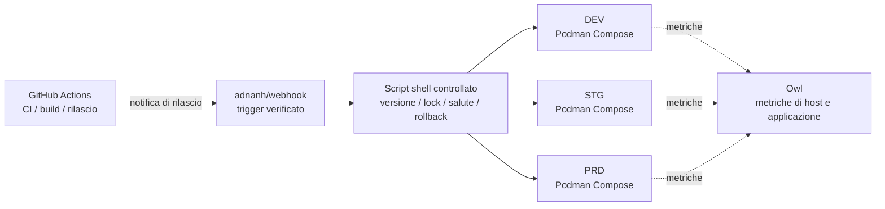

<div align="center">
    

<h1>Yin-Panel</h1>

[](https://github.com/yinorg/Yin-Panel/releases)
[](../../LICENSE)


[English](../../README.md) | [简体中文](../zh-CN/README.md) | [繁體中文](../zh-TW/README.md) | [日本語](../ja-JP/README.md) | [한국어](../ko-KR/README.md) | [Deutsch](../de-DE/README.md) | [Français](../fr-FR/README.md) | [Español](../es-ES/README.md) | [Português (Brasil)](../pt-BR/README.md) | [Русский](../ru-RU/README.md) | [Bahasa Indonesia](../id-ID/README.md) | [Türkçe](../tr-TR/README.md) | [Polski](../pl-PL/README.md) | **Italiano** | [Nederlands](../nl-NL/README.md) | [हिन्दी](../hi-IN/README.md) | [ไทย](../th-TH/README.md)

</div>

Yin-Panel è un pannello di navigazione leggero e self-hostable per spazi personali e condivisi. È adatto a reti domestiche, dispositivi NAS, server e piccole organizzazioni.

## Demo

<picture>
  <source media="(prefers-color-scheme: dark)" srcset="../images/readme-home-dark.jpg">
  
</picture>

| Editor degli elementi | Gestione degli spazi |
| --- | --- |
|  |  |

### Anteprima dell’interfaccia

| Accedi | Accesso pubblico |
| --- | --- |
|  |  |

| Centro sfondi | Sfondo predefinito dello spazio |
| --- | --- |
|  |  |

**Tema Directory**: ogni spazio può usare il proprio pacchetto di tema, quindi spazi della stessa istanza possono avere layout diversi.


## Funzionalità

- Spazi personali e condivisi con contenuti isolati
- Creazione, rinomina, copia e trasferimento dell'amministrazione degli spazi
- Alberi di gruppi, segnalibri, icone e ordinamento
- Importazione ed esportazione dei segnalibri nel formato HTML del browser
- Membri dello spazio con ruoli di amministratore, editor e visualizzatore
- Accesso OAuth 2.0 / OIDC, collegamento degli account e autorizzazione dei gruppi OIDC
- Email come identità di accesso, con un soprannome indipendente
- Icone personalizzate, pacchetti di temi installabili, 17 lingue dell'interfaccia, sfondi, modalità URL WAN/LAN e mobile e finestre popup nella pagina
- Archiviazione SQLite, MySQL, MariaDB o PostgreSQL, immagini Docker per amd64 e arm64 e un chart Helm per Kubernetes

## Ambienti ospitati ufficiali

Gestiamo tre ambienti online su cui puoi registrarti e provare subito tutto; tutti e tre supportano l'accesso con GitHub / GitLab / Google e un pannello di monitoraggio mostra metriche e avvisi.

| Ambiente | Indirizzo | Uso | Disponibilità |
| --- | --- | --- | --- |
| Produzione (PRD) | <https://panel.yiniot.com> | Uso quotidiano | Best effort con l'obiettivo del 99,9% di disponibilità |
| STG | <https://panel-stg.yiniot.com> | Verifica prima del rilascio | Può essere riavviato o riportato indietro in qualsiasi momento |
| DEV | <https://panel-dev.yiniot.com> | Provare e segnalare problemi | Il meno stabile; i dati possono essere cancellati in qualsiasi momento |
| Monitoraggio | <https://owl.yiniot.com> | Metriche e avvisi dei tre ambienti | — |

I tre ambienti girano sullo stesso server gratuito e **non c'è alta disponibilità**: PRD punta al 99,9% ma senza alcun rimborso, mentre STG e DEV possono cadere in qualsiasi momento. Non conservare qui dati importanti; per un uso a lungo termine installa il tuo, come descritto sotto.

## Avvio rapido

### Docker Compose

Richiede Docker con il plugin Compose.

```bash
mkdir yin-panel && cd yin-panel
curl -LO https://raw.githubusercontent.com/yinorg/Yin-Panel/master/docker/docker-compose.yml
curl -o conf.yaml https://raw.githubusercontent.com/yinorg/Yin-Panel/master/backend/conf.yaml.example
mkdir -p database uploads
jwt_secret="$(openssl rand -hex 32)"
sed -i "s#^  secret: your_secret_key$#  secret: ${jwt_secret}#" conf.yaml
unset jwt_secret
YIN_PANEL_IMAGE=ghcr.io/yinorg/yin-panel-ce:latest docker compose up -d
```

Apri <http://localhost:3002>.

`latest` indica la versione corrente ed è il modo più rapido per provarlo; **in produzione fissa un tag preciso o un digest dell'immagine** (vedi «Architettura CI/CD») così il deploy non si sposta.

Amministratore predefinito: `admin@yiniot.com`, password `admin@yiniot.com`. Cambia la password subito dopo il primo accesso e imposta `base.root_url` e un `jwt.secret` univoco in `conf.yaml`.

Ogni distribuzione dovrebbe generare il proprio `jwt.secret` casuale. Il repository include solo `conf.yaml.example`; il file `conf.yaml` nella tua directory di esecuzione contiene i segreti dell'istanza e le credenziali OAuth e non deve essere committato su Git.

### Immagini GHCR

```bash
docker pull ghcr.io/yinorg/yin-panel-ce:latest
docker pull ghcr.io/yinorg/yin-panel-ce:<x.y.z>
```

`latest` indica la versione corrente; sia esso sia ogni tag di rilascio sono manifest multi-architettura per host amd64 e arm64. I tag di rilascio non portano mai un suffisso di architettura; tag come `-amd64` o `-arm64` non fanno parte di una release.

## Prestazioni e configurazione consigliata

I numeri riportati di seguito provengono da benchmark locali su singola macchina (SQLite, database vuoto, loopback, generatore di carico sullo stesso host). Considerali un riferimento per il dimensionamento, non una promessa di capacità in produzione. La capacità reale dipende principalmente dal volume di dati per spazio, dalla frequenza di scrittura e dalla concorrenza di picco.

### Utilizzo delle risorse (valori misurati)

| Metrica | Inattivo | Carico misto di 5000 req/s | Limite (decine di migliaia di req/s) |
| --- | --- | --- | --- |
| Memoria (RSS) | ~16 MB | ~105 MB | picco di ~500 MB; diminuisce dopo la fine del carico |
| CPU | quasi zero | ~0.3 core | 2–3 core |

- La memoria resta intorno a **105 MB** fino a circa **20k req/s** e non cresce in modo lineare con il carico; il valore di ~500 MB compare solo sotto una pressione sintetica estrema.
- Un singolo core gestisce circa **10k–12k req/s** (letture/scritture miste, set di dati ridotto).
- Con un carico misto di 5000 req/s: 0 errori, p95 circa **0.25 ms**.

### Configurazione consigliata

| Scenario | CPU | Memoria | Archiviazione | Database |
| --- | --- | --- | --- | --- |
| Personale / casa / NAS | 1 vCPU | 128–256 MB | SSD, 512 MB+ (più margine per il caricamento delle icone) | SQLite |
| Piccolo team / spazi condivisi | 1–2 vCPU | 256–512 MB | SSD, 1–2 GB | SQLite |
| Organizzazione / alta concorrenza | 2–4 vCPU | 1–2 GB | SSD | SQLite (host singolo) o MySQL (istanze multiple, HA) |

### Riferimento per la scala di utenti

Presumendo circa 0.1 req/s per utente online (per lo più inattivo) e riservando margine per i picchi:

| Configurazione | Throughput medio teorico | Concorrenza inattiva (limite teorico) | Scala suggerita (con margine per i picchi) |
| --- | --- | --- | --- |
| 1 vCPU | ~10k req/s | ~100k | 20k–40k |
| 2 vCPU | ~20k req/s | ~200k | 50k–80k |
| 4 vCPU | ~40k req/s | ~400k | 100k+ |

Più gli utenti sono attivi (modifiche, importazioni, aggiornamenti frequenti), maggiore è la frequenza di richieste generata da ciascun utente e minore è il numero di utenti sostenibile.

### Fattori chiave che influiscono sulla capacità

1. **Volume di dati** — gli endpoint di elenco restituiscono in una sola risposta ogni voce di uno spazio; più voci significano una richiesta più onerosa. È la parte che vale maggiormente la pena misurare sui tuoi dati.
2. **Frequenza di scrittura** — SQLite consente un solo scrittore alla volta; il throughput di scrittura è limitato dal fsync del disco (nell'ordine di centinaia di scritture al secondo). Per configurazioni con molte scritture o multi-istanza, usa MySQL.
3. **Picco, non media** — dimensiona per i picchi, riservando di norma 2–5× la media.
4. **Risorse statiche** — fai servire `/assets/*` e le altre risorse con hash da un reverse proxy o da una CDN e metti in cache a lungo termine i file con hash; i file di ingresso e `/api/*` devono restare sempre aggiornati.

## Database

Sono supportati SQLite (predefinito), MySQL, MariaDB e PostgreSQL.

- `base.database_drive`: `sqlite` (predefinito) | `mysql` | `postgres`. **MariaDB usa `mysql`.**
- SQLite: `sqlite.file_path` (vedi anche `read_pool_size`).
- MySQL / MariaDB: `mysql.{host,port,username,password,db_name,wait_timeout}`.
- PostgreSQL: `postgres.{host,port,username,password,db_name,ssl_mode,time_zone,wait_timeout}`.

Le funzionalità esclusive di SQLite (WAL, il pool di connessioni in sola lettura e i backup di migrazione tramite snapshot su file) si applicano solo a SQLite; esegui il backup di MySQL/MariaDB/PostgreSQL con i loro strumenti.

### Migrazione da SQLite a MySQL/MariaDB/PostgreSQL

```bash
# conf.yaml        — configurazione SQLite esistente
# conf.target.yaml — configurazione di destinazione che punta a mysql o postgres (il database di destinazione deve essere vuoto)
./yin-panel migrate-db -source conf.yaml -target conf.target.yaml
```

La migrazione crea lo schema completo nella destinazione, copia ogni riga preservando le chiavi primarie (e reimposta le sequenze di identità su PostgreSQL). Può essere eseguita più volte: ogni esecuzione sostituisce il contenuto delle tabelle di destinazione. Al termine, punta `database_drive` in `conf.yaml` alla destinazione.

## Configurazione e OAuth/OIDC

`oauth` è la voce di configurazione unificata per OAuth 2.0 e OpenID Connect (OIDC). Il modello predefinito include tre esempi verificati: GitHub (OAuth 2.0), GitLab (OIDC standard) e Google (OAuth 2.0). Gli esempi sono tutti commentati per impostazione predefinita; un provider viene abilitato solo dopo aver inserito credenziali reali e impostato `oauth.enable: true`. Tutte le chiavi di configurazione sono documentate in `backend/conf.yaml.example`.

Un provider OIDC standard deve supportare il discovery, authorization code + PKCE e la validazione delle firme JWKS, e deve fornire `email` e `email_verified` nelle informazioni utente. I provider conformi a questi standard funzionano in linea di principio, ma fornitori diversi possono comunque richiedere una configurazione aggiuntiva di mappatura dei campi.

URL di callback OIDC:

```text
<base.root_url>/api/oauth/<provider>/callback
```

Dopo il callback, il provider deve restituire un'email verificata. Il sistema identifica le identità esterne tramite `provider + sub` e collega gli account locali in base all'email.

## Spazi e autorizzazioni

Le autorizzazioni degli spazi sono indicate da un `UserID` interno, mai dal testo dell'email. Cambiare un'email conserva quindi le autorizzazioni esistenti dello spazio e l'elenco dei membri mostra l'email più recente.

- Amministratore: gestisce lo spazio, i membri, i ruoli e le regole OIDC
- Editor: gestisce gruppi e segnalibri
- Visualizzatore: accesso in sola lettura

La creazione di uno spazio, la rinomina, l'aggiunta di gruppi, l'aggiunta di membri e l'aggiunta di regole OIDC avvengono tutte nelle finestre di dialogo.

## Helm

```bash
helm upgrade --install yin-panel ./distribution/helm-chart/yin-panel \
  --set image.tag=latest
```

In produzione cambia `image.tag` con una versione precisa.

Prima di distribuire, visualizza in anteprima i manifest generati con `helm template yin-panel ./distribution/helm-chart/yin-panel`.

## Sviluppo dal codice sorgente

Requisiti: Go `1.27.1`, Node.js `24.21.0`, npm o pnpm `9.15.5`.

```bash
cd frontend
npm ci
npm run build-only
```

Oppure con la versione bloccata di pnpm:

```bash
cd frontend
corepack pnpm install --frozen-lockfile
pnpm run build-only
```

```bash
cd backend
go test ./...
go build ./...
```

Aggiornamento locale completo (build del frontend, test e build del backend, distribuzione, riavvio) con un solo comando:

```bash
./scripts/deploy-local.sh
```

Per impostazione predefinita lo script usa `backend/` del repository come directory di esecuzione e richiede lì un `conf.yaml` locale; `YIN_PANEL_RUNTIME_DIR` in `.env.local` può sovrascriverla. Dopo che tutte le build e i test sono andati a buon fine, arresta solo il listener di Yin-Panel, usa `sudo` per sostituire il vecchio binario e i file statici e non tocca mai il database, gli upload o i file di configurazione.

Il sistema di temi della home è documentato in [`frontend/THEME_SYSTEM.md`](../../frontend/THEME_SYSTEM.md); crea la struttura di un nuovo tema con `npm run create:theme -- init "<name>"`. Le convenzioni complete per lo sviluppo con l'AI, le release e il riavvio si trovano in [AGENTS.md](../../AGENTS.md).

## Backup e aggiornamento

Prima di aggiornare, esegui il backup del database, di `uploads/`, di `conf.yaml` e dei valori Helm. Le migrazioni preservano utenti, spazi, gruppi, segnalibri e riferimenti ai file. Se un aggiornamento va storto, ripristina il backup precedente all'aggiornamento; non eliminare il database e ricominciare da zero.

Passi di aggiornamento di un'installazione Compose:

```bash
docker compose pull
docker compose up -d
```

`docker/docker-compose.yml` usa `latest` per impostazione predefinita e `pull_policy: missing` scarica solo se l'immagine non è presente in locale, quindi in fase di aggiornamento va eseguito esplicitamente `docker compose pull`. In produzione fissa `YIN_PANEL_IMAGE` su una versione precisa e cambiala quando aggiorni.

## Architettura CI/CD

Gli ambienti ufficiali eseguono DEV, STG e PRD su un unico VPS 1C1G. L'obiettivo non è accumulare componenti, ma **pochi processi residenti, poco sovraccarico, rilasci verificabili e guasti da cui si può tornare indietro**.



| Livello | Componente | Responsabilità |
| --- | --- | --- |
| CI | GitHub Actions | Testare, costruire l'immagine, marcare la versione, avviare il rilascio |
| Ingresso del rilascio | adnanh/webhook | Verificare l'origine e la richiesta; eseguire solo attività di rilascio fisse |
| Esecuzione del rilascio | Script shell | Controllo di versione, scelta dell'ambiente, lock, deploy, controllo di salute e rollback |
| Esecuzione | Podman Compose | Eseguire le tre istanze isolate (Podman risparmia circa 150 MB di RSS rispetto a Docker) |
| Monitoraggio | Owl | Metriche di host e applicazione |

**Perché è diviso così**: tutta la CI gira su GitHub Actions e il VPS si limita a scaricare l'immagine già costruita e a distribuirla; la macchina piccola non sopporta mai il picco di compilazione e non ospita alcun piano di controllo CI/CD. I tre ambienti condividono una sola catena di rilascio ma mantengono progetti Compose, configurazione, volumi, reti e porte separati; condividere il meccanismo di rilascio non significa condividere i dati.

### Come funziona un rilascio

1. **Build**: Actions esegue i test e costruisce l'immagine; la versione è fissata da un tag Git, da uno SHA di commit o da un digest dell'immagine, e in produzione non si distribuisce mai `latest`.
2. **Trigger e verifica**: Actions invia al webhook una richiesta di rilascio verificata; lo script controlla versione, ambiente di destinazione e azione consentita e non concatena mai input arbitrari in un comando shell.
3. **Lock e deploy**: un solo deploy per ambiente alla volta e viene aggiornato solo l'ambiente di destinazione; nulla viene riavviato alla cieca.
4. **Controllo di salute e gestione dei guasti**: si verifica che il servizio parta e risponda; in caso di errore si mantiene l'ultima versione buona e si esegue il rollback, registrando ambiente, versione, origine del trigger, esito e motivo del rollback.

Promozione: DEV distribuisce automaticamente → dopo la verifica STG distribuisce la stessa versione → dopo gli smoke test **PRD richiede approvazione umana**. Anche le correzioni urgenti passano da un percorso di eccezione verificabile, così un normale evento di sviluppo non aggira mai l'approvazione di produzione.

### Limiti

È un'architettura di deploy **su singola macchina, con poche risorse e verificabile**, non ad alta disponibilità: i tre ambienti sono isolati per processo, configurazione e dati, ma condividono kernel, disco, rete e memoria dello stesso VPS, quindi un guasto dell'host o l'esaurimento delle risorse colpisce tutti e tre insieme. Il suo valore è mantenere i meccanismi che servono a un rilascio affidabile — versioni fissate, ambienti isolati, controlli di salute, rollback, monitoraggio e traccia di audit — con pochissimi processi residenti.

## Open Core

L'edizione Core di Yin-Panel è gratuita e continuerà a essere mantenuta e aggiornata. Questo repository è l'unica fonte pubblica per il Core e pubblica l'immagine `yin-panel-ce`. L'edizione Enterprise risiede nel repository privato [yinorg/Yin-Panel-EE](https://github.com/yinorg/Yin-Panel-EE) e si connette tramite interfacce pubbliche.

Un'istanza in esecuzione espone edizione, capacità, stato di sola lettura e versione su `GET /api/system/capabilities`. Segnala problemi e suggerimenti nelle [GitHub Issues](https://github.com/yinorg/Yin-Panel/issues).

I contributi uniti a questo repository restano nel Core: non vengono spostati nell'edizione Enterprise né relicenziati. Vedi [Core ed Enterprise](../../GOVERNANCE.md).

## Crediti

Yin-Panel è nato dal progetto open source [hslr-s/sun-panel](https://github.com/hslr-s/sun-panel); grazie all'autore originale per aver costruito le fondamenta.

Grazie anche a [PhantomMaa/sun-panel](https://github.com/PhantomMaa/sun-panel) per le sue ottimizzazioni e il suo lavoro di manutenzione. Yin-Panel ha rilevato la manutenzione continuativa da quella base e continua ad aggiungere funzionalità, miglioramenti dell'interazione e modifiche orientate al self-hosting.

Grazie a tutti gli autori originali, ai contributori e agli utenti.

## Contribuire

Il progetto va avanti perché le persone si prendono il tempo di segnalare problemi e condividere idee. Ogni forma di partecipazione è benvenuta:

- **Suggerimenti e bug**: apri una [issue](https://github.com/yinorg/Yin-Panel/issues) con versione, ambiente, passi per riprodurre il problema e ciò che hai visto; uno screenshot o un log rendono tutto molto più rapido.
- **Codice e documentazione**: le pull request sono benvenute. Correggere un bug, riscrivere una frase, aggiungere una lingua o sostituire uno screenshot sono contributi altrettanto validi.
- **Non è ancora chiaro**: apri prima una issue e concordate l'impostazione prima di scrivere codice, così il lavoro non va in una direzione che non serve a nessuno.

Dai un'occhiata a [CONTRIBUTING.md](../../CONTRIBUTING.md) prima di iniziare: le modifiche grandi è meglio discuterle prima e i problemi di sicurezza vanno segnalati in privato, non in una issue pubblica. Se qualcosa non è chiaro, chiedi in una issue e cercherò di indicare la direzione.

Sia le issue sia le pull request vengono lette, e cerco di rispondere entro 7 giorni; i problemi riproducibili e i suggerimenti ben descritti procedono più in fretta. Ogni feedback è un motivo in più per portare avanti il progetto.

## Licenza

Yin-Panel è distribuito con la [Business Source License 1.1](../../LICENSE). Fork, modifica e self-hosting sono gratuiti, incluso l'uso interno nella tua organizzazione e il servizio ai tuoi clienti; offrire Yin-Panel stesso come servizio ospitato a terzi richiede una licenza commerciale. Ogni versione diventa disponibile con la licenza AGPL-3.0-or-later tre anni dopo la sua prima distribuzione pubblica. Vedi [Core ed Enterprise](../../GOVERNANCE.md).

Le note di terze parti sono elencate in [THIRD-PARTY-NOTICES.md](../../THIRD-PARTY-NOTICES.md); i contributi sono accettati secondo il [Contributor License Agreement](../../CLA.md).
