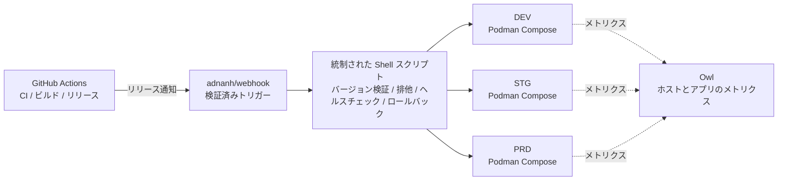

<div align="center">
    

<h1>Yin-Panel</h1>

[](https://github.com/yinorg/Yin-Panel/releases)
[](../../LICENSE)


[English](../../README.md) | [简体中文](../zh-CN/README.md) | [繁體中文](../zh-TW/README.md) | **日本語** | [한국어](../ko-KR/README.md) | [Deutsch](../de-DE/README.md) | [Français](../fr-FR/README.md) | [Español](../es-ES/README.md) | [Português (Brasil)](../pt-BR/README.md) | [Русский](../ru-RU/README.md) | [Bahasa Indonesia](../id-ID/README.md) | [Türkçe](../tr-TR/README.md) | [Polski](../pl-PL/README.md) | [Italiano](../it-IT/README.md) | [Nederlands](../nl-NL/README.md) | [हिन्दी](../hi-IN/README.md) | [ไทย](../th-TH/README.md)

</div>

Yin-Panel は、個人用と共有のスペースのための軽量でセルフホスト可能なナビゲーションパネルです。家庭内ネットワーク、NAS、サーバー、小規模組織に適しています。

## デモ

<picture>
  <source media="(prefers-color-scheme: dark)" srcset="../images/readme-home-dark.jpg">
  
</picture>

| 項目エディター | スペース管理 |
| --- | --- |
|  |  |

### 画面プレビュー

| ログイン | 公開アクセス |
| --- | --- |
|  |  |

| 壁紙センター | スペースの既定壁紙 |
| --- | --- |
|  |  |

**ディレクトリテーマ**：スペースごとにテーマパッケージを指定でき、同じインスタンスでもスペースによってレイアウトが変わります。


## 機能

- 個人スペースと共有スペース（コンテンツは互いに分離）
- スペースの作成、名前変更、複製、管理者譲渡
- グループツリー、ブックマーク、アイコン、並べ替え
- ブラウザーの HTML 形式によるブックマークのインポートとエクスポート
- スペースメンバーの役割：管理者、編集者、閲覧者
- OAuth 2.0 / OIDC ログイン、アカウント連携、OIDC グループ認可
- ログイン ID はメールアドレス、ニックネームは独立して管理
- カスタムアイコン、インストール可能なテーマパッケージ、17 種類の UI 言語、壁紙、WAN/LAN・モバイル URL モード、ページ内ポップアップ表示
- SQLite、MySQL、MariaDB、PostgreSQL に対応し、amd64 / arm64 の Docker イメージと Kubernetes 用 Helm チャートを提供

## 公式ホスティング環境

3 つのオンライン環境を用意しており、すぐに登録して試せます。いずれも GitHub / GitLab / Google でログインでき、稼働状況とアラートを見る監視パネルもあります。

| 環境 | アドレス | 用途 | 可用性 |
| --- | --- | --- | --- |
| 本番（PRD） | <https://panel.yiniot.com> | 通常利用 | 可用性 99.9% を目標にベストエフォートで運用 |
| STG | <https://panel-stg.yiniot.com> | リリース前の確認 | いつでも再起動・ロールバックされる可能性あり |
| DEV | <https://panel-dev.yiniot.com> | 試用・不具合報告 | 最も不安定で、データが随時消去される可能性あり |
| 監視 | <https://owl.yiniot.com> | 3 環境の稼働指標とアラート | — |

3 つの環境は同じ無償サーバー上で動いており、**高可用構成ではありません**。PRD は 99.9% を目標にベストエフォートで運用しますが補償はなく、STG と DEV はいつでも停止する可能性があります。重要なデータは置かず、長期利用は以下のセルフホストを選んでください。

## クイックスタート

### Docker Compose

Docker と Compose プラグインが必要です。

```bash
mkdir yin-panel && cd yin-panel
curl -LO https://raw.githubusercontent.com/yinorg/Yin-Panel/master/docker/docker-compose.yml
curl -o conf.yaml https://raw.githubusercontent.com/yinorg/Yin-Panel/master/backend/conf.yaml.example
mkdir -p database uploads
jwt_secret="$(openssl rand -hex 32)"
sed -i "s#^  secret: your_secret_key$#  secret: ${jwt_secret}#" conf.yaml
unset jwt_secret
YIN_PANEL_IMAGE=ghcr.io/yinorg/yin-panel-ce:latest docker compose up -d
```

<http://localhost:3002> を開きます。

`latest` は現在の正式版を指し、まず試すのに向いています。**本番では具体的なタグかイメージ digest に固定してください**（「CI/CD アーキテクチャ」を参照）。

既定の管理者：`admin@yiniot.com`、パスワード `admin@yiniot.com`。初回ログイン後にすぐパスワードを変更し、`conf.yaml` で `base.root_url` と一意の `jwt.secret` を設定してください。

各デプロイ環境はそれぞれ独立したランダムな `jwt.secret` を生成してください。リポジトリが提供するのは `conf.yaml.example` のみです。実行ディレクトリの `conf.yaml` にはインスタンスのシークレットと OAuth 認証情報が含まれるため、Git にコミットしないでください。

### GHCR イメージ

```bash
docker pull ghcr.io/yinorg/yin-panel-ce:latest
docker pull ghcr.io/yinorg/yin-panel-ce:<x.y.z>
```

`latest` は現在の正式版を指します。これも各リリースタグも amd64 / arm64 ホスト向けのマルチアーキテクチャマニフェストです。リリースタグにアーキテクチャの接尾辞は付きません。`-amd64` や `-arm64` のようなタグは正式リリースには含まれません。

## パフォーマンスと推奨構成

以下の数値はローカル単体ベンチマーク（SQLite、空のデータベース、loopback、同一ホストでの負荷テスト）によるもので、構成選定の参考値です。本番の容量保証ではありません。実際の容量は主にスペースごとのデータ量、書き込み頻度、ピーク同時接続数に依存します。

### リソース使用量（実測オーダー）

| 指標 | アイドル | 5000 req/s 混合負荷 | 限界（数万 req/s） |
| --- | --- | --- | --- |
| メモリ RSS | ~16 MB | ~105 MB | ピーク ~500 MB、負荷停止後に低下 |
| CPU | ほぼ 0 | ~0.3 コア | 2–3 コア |

- メモリは約 **2 万 req/s** 付近までは **105 MB** 程度でほぼ一定となり、負荷に比例して増加しません。~500 MB は合成の極限負荷時のみ発生します。
- シングルコアで約 **1 万–1.2 万 req/s**（混合読み書き、小規模データ）を処理できます。
- 5000 req/s の混合負荷時：失敗 0、p95 約 **0.25 ms**。

### 推奨構成

| シナリオ | CPU | メモリ | ストレージ | データベース |
| --- | --- | --- | --- | --- |
| 個人 / 家庭 / NAS | 1 vCPU | 128–256 MB | SSD、512 MB 以上（アイコンアップロード用の余裕を含む） | SQLite |
| 小規模チーム / 共有スペース | 1–2 vCPU | 256–512 MB | SSD、1–2 GB | SQLite |
| 組織 / 高負荷 | 2–4 vCPU | 1–2 GB | SSD | SQLite（単一ホスト）または MySQL（マルチインスタンス、HA） |

### ユーザー規模の目安

オンラインユーザー 1 人あたり約 0.1 req/s（アイドル中心）と見積もり、ピーク余裕を確保した場合：

| 構成 | 理論上の平均スループット | アイドル同時接続（理論上限） | 推奨規模（ピーク余裕込み） |
| --- | --- | --- | --- |
| 1 vCPU | ~10k req/s | ~10 万 | 2 万–4 万 |
| 2 vCPU | ~20k req/s | ~20 万 | 5 万–8 万 |
| 4 vCPU | ~40k req/s | ~40 万 | 10 万以上 |

ユーザーが活発なほど（編集、インポート、頻繁な更新）、1 人あたりのリクエスト率が上がり、支えられるユーザー数は相応に減少します。

### 容量に影響する主な要因

1. **データ量**：一覧 API は 1 回の応答でスペース内の全項目を返すため、項目が多いほど 1 リクエストのコストが増えます。自分のデータで実測する価値が最も高い部分です。
2. **書き込み頻度**：SQLite は同時に 1 つの書き込み者しか持てず、書き込みスループットはディスク fsync に制約されます（毎秒数百回程度）。書き込みが多い場合やマルチインスタンス構成では MySQL を推奨します。
3. **平均ではなくピーク**：ピークを基準に選定し、通常は平均の 2–5 倍の余裕を見込みます。
4. **静的ファイル**：`/assets/*` とハッシュ付きアセットはリバースプロキシまたは CDN からの配信を推奨します。ハッシュ付きファイルは長期キャッシュし、入口ファイルと `/api/*` は常に最新に保ってください。

## データベース

SQLite（デフォルト）、MySQL、MariaDB、PostgreSQL に対応しています。

- `base.database_drive`：`sqlite`（デフォルト）| `mysql` | `postgres`。**MariaDB は `mysql` を使用します。**
- SQLite：`sqlite.file_path`（`read_pool_size` も参照）。
- MySQL / MariaDB：`mysql.{host,port,username,password,db_name,wait_timeout}`。
- PostgreSQL：`postgres.{host,port,username,password,db_name,ssl_mode,time_zone,wait_timeout}`。

SQLite 専用の機能（WAL、読み取り専用コネクションプール、ファイルスナップショットによる移行バックアップ）は SQLite にのみ適用されます。MySQL/MariaDB/PostgreSQL は各ツールでバックアップしてください。

### SQLite から MySQL/MariaDB/PostgreSQL への移行

```bash
# conf.yaml        — 既存の SQLite 設定
# conf.target.yaml — mysql または postgres を指す移行先設定（移行先データベースは空である必要があります）
./yin-panel migrate-db -source conf.yaml -target conf.target.yaml
```

移行は移行先に完全なスキーマを作成し、全データを主キーを**保持したまま**コピーします（PostgreSQL では ID シーケンスもリセットされます）。繰り返し実行でき、実行のたびに移行先テーブルの内容が置き換わります。完了後、`conf.yaml` の `database_drive` を移行先に変更してください。

## 設定と OAuth/OIDC

`oauth` は OAuth 2.0 と OpenID Connect（OIDC）の共通設定エントリーです。既定のテンプレートには検証済みの 3 つの例（GitHub（OAuth 2.0）、GitLab（標準 OIDC）、Google（OAuth 2.0））があります。例は既定ですべてコメントアウトされています。実際の認証情報を入力し `oauth.enable` を `true` に設定した場合のみ有効になります。すべての設定項目は `backend/conf.yaml.example` を参照してください。

標準的な OIDC プロバイダーは discovery、authorization code + PKCE、JWKS 署名検証をサポートし、ユーザー情報で `email` と `email_verified` を返す必要があります。これらの基準を満たすプロバイダーは原理的に利用できますが、サービスによっては追加のフィールドマッピング設定が必要になる場合があります。

OIDC コールバック URL：

```text
<base.root_url>/api/oauth/<provider>/callback
```

コールバック後、プロバイダーは検証済みメールアドレスを返す必要があります。システムは `provider + sub` で外部 ID を識別し、メールアドレスでローカルアカウントを関連付けます。

## スペースと権限

スペースの権限は内部の `UserID` で関連付け、メールアドレスを権限の主キーにはしません。そのためメールアドレスを変更しても既存のスペース権限は有効なまま、メンバー一覧には最新のメールアドレスが表示されます。

- 管理者：スペース、メンバー、役割、OIDC ルールを管理
- 編集者：グループとブックマークを管理
- 閲覧者：読み取り専用

スペースの作成、名前変更、グループ追加、メンバー追加、OIDC ルール追加はすべてダイアログで行います。

## Helm

```bash
helm upgrade --install yin-panel ./distribution/helm-chart/yin-panel \
  --set image.tag=latest
```

本番では `image.tag` を具体的なバージョンに変更してください。

デプロイ前に `helm template yin-panel ./distribution/helm-chart/yin-panel` でレンダリング結果を確認できます。

## ソースからの開発

環境要件：Go `1.27.1`、Node.js `24.21.0`、npm または pnpm `9.15.5`。

```bash
cd frontend
npm ci
npm run build-only
```

固定バージョンの pnpm を使う場合：

```bash
cd frontend
corepack pnpm install --frozen-lockfile
pnpm run build-only
```

```bash
cd backend
go test ./...
go build ./...
```

ローカルの一括更新（フロントエンドのビルド、バックエンドのテストとビルド、デプロイ、再起動）は次の 1 コマンドで行います：

```bash
./scripts/deploy-local.sh
```

スクリプトは既定でリポジトリ内の `backend/` を実行ディレクトリとし、そこにローカルの `conf.yaml` が必要です。`.env.local` の `YIN_PANEL_RUNTIME_DIR` で上書きできます。ビルドとテストがすべて成功した後、Yin-Panel のリスナーのみを停止し、`sudo` で旧バイナリと静的ファイルを置き換えます。データベース、アップロードファイル、設定ファイルには触れません。

ホームページのテーマシステムは [`frontend/THEME_SYSTEM.md`](../../frontend/THEME_SYSTEM.md) を参照してください。`npm run create:theme -- init "<名前>"` で新しいテーマの雛形を作成できます。AI 開発・リリース・再起動の規約は [AGENTS.md](../../AGENTS.md) にあります。

## バックアップとアップグレード

アップグレード前にデータベース、`uploads/`、`conf.yaml`、Helm values をバックアップしてください。マイグレーションはユーザー、スペース、グループ、ブックマーク、ファイル参照を保持します。問題が発生した場合はアップグレード前のバックアップから復元し、データベースを削除して作り直さないでください。

Compose 構成のアップグレード手順：

```bash
docker compose pull
docker compose up -d
```

`docker/docker-compose.yml` は既定で `latest` を使い、`pull_policy: missing` はローカルにイメージが無いときだけ取得するため、アップグレード時は `docker compose pull` を明示的に実行します。本番では `YIN_PANEL_IMAGE` を具体的なバージョンに固定し、更新時に書き換えてください。

## CI/CD アーキテクチャ

公式環境は 1C1G の VPS 1 台で DEV / STG / PRD を同時に動かしています。狙いはコンポーネントを積み上げることではなく、**常駐プロセスの削減、低リソース、監査可能なリリース、復旧可能な失敗**です。



| 層 | コンポーネント | 役割 |
| --- | --- | --- |
| CI | GitHub Actions | テスト、イメージのビルド、バージョン付与、リリースの起動 |
| リリース入口 | adnanh/webhook | 送信元とリクエストを検証し、固定されたリリース処理だけを起動 |
| リリース実行 | Shell スクリプト | バージョン検証、環境選択、排他、デプロイ、ヘルスチェック、ロールバック |
| 実行環境 | Podman Compose | 3 つの分離されたアプリインスタンスを実行（Podman は Docker より常駐メモリが約 150 MB 少ない） |
| 監視 | Owl | ホストとアプリのメトリクス |

**なぜこの分担か**：CI はすべて GitHub Actions 側で実行し、VPS はビルド済みイメージを取得して配置するだけです。小さなマシンがコンパイル時のメモリピークを抱えることも、CI/CD の常駐コントロールプレーンを持つこともありません。3 環境は 1 本のリリース経路を共有しますが、Compose プロジェクト、設定、ボリューム、ネットワーク、ポートはそれぞれ独立しており、経路の共有はデータの共有ではありません。

### リリースの流れ

1. **ビルド**：Actions がテストとイメージのビルドを行います。バージョンは Git タグ、コミット SHA、イメージ digest で固定し、本番では `latest` を使いません。
2. **起動と検証**：Actions が検証済みのリリース要求を webhook に送ります。スクリプトはバージョン、対象環境、許可された操作を確認し、任意の入力を Shell コマンドに連結しません。
3. **排他とデプロイ**：同じ環境で同時にデプロイせず、対象の環境だけを更新します（全環境をまとめて再起動しません）。
4. **ヘルスチェックと失敗時の扱い**：サービスの起動と応答を確認し、失敗時は直前の正常バージョンを残してロールバックし、環境、バージョン、トリガー元、結果、ロールバック理由を記録します。

昇格の流れ：DEV は自動デプロイ → 確認後に STG へ同じバージョンをデプロイ → スモークテスト後に **PRD は人手による承認**。緊急修正も監査可能な例外手順を通し、通常の開発イベントが本番承認を迂回することはありません。

### 前提と限界

これは**単一マシン、低リソース、監査可能**なデプロイ構成であり、高可用構成ではありません。3 環境はプロセス・設定・データの面で分離されていますが、VPS のカーネル、ディスク、ネットワーク、メモリは共有しているため、ホスト障害やリソース枯渇は 3 環境に同時に影響します。価値は、常駐コンポーネントを最小限にしつつ、確実なリリースに必要な仕組み（バージョン固定、環境分離、ヘルスチェック、ロールバック、監視、監査記録）を保てる点にあります。

## Open Core

Yin-Panel Core エディションは無償で、継続的に保守・更新されます。このリポジトリは公開 Core の唯一のソースであり、`yin-panel-ce` イメージを公開しています。エンタープライズ版は非公開リポジトリ [yinorg/Yin-Panel-EE](https://github.com/yinorg/Yin-Panel-EE) にあり、公開インターフェース経由でエンタープライズモジュールを組み込みます。

実行中のインスタンスは `GET /api/system/capabilities` でエディション、機能、読み取り専用状態、バージョンを確認できます。問題や提案は [GitHub Issues](https://github.com/yinorg/Yin-Panel/issues) へお寄せください。

このリポジトリにマージされたコントリビューションは Core に残ります。Enterprise 版へ移されることも、再ライセンスされることもありません。詳しくは [Core と Enterprise](../../GOVERNANCE.md) を参照してください。

## クレジット

Yin-Panel はオープンソースプロジェクト [hslr-s/sun-panel](https://github.com/hslr-s/sun-panel) から発展しました。プロジェクトの基盤を築いた原作者に感謝します。

[PhantomMaa/sun-panel](https://github.com/PhantomMaa/sun-panel) の最適化と保守作業にも感謝します。Yin-Panel はその基盤を引き継いで継続的な保守を行い、新機能、操作性の向上、セルフホストに適した改善を続けています。

すべての原作者、コントリビューター、ユーザーに感謝します。

## コントリビュート

プロジェクトが続いていくのは、利用者が問題やアイデアを共有してくれるからです。どんな形の参加も歓迎します：

- **提案・不具合報告**：[Issues](https://github.com/yinorg/Yin-Panel/issues) に、バージョン、環境、再現手順、起きたことを書いてください。スクリーンショットやログがあると対応が速くなります。
- **手を動かす**：[Pull Requests](https://github.com/yinorg/Yin-Panel/pulls) を歓迎します。バグ修正、文言の修正、言語の追加、スクリーンショットの差し替えも価値ある貢献です。
- **まだ決めていない**：先に Issue で方針を相談してからコードを書くと、方向性のズレを避けられます。

始める前に [CONTRIBUTING.md](../../CONTRIBUTING.md) に目を通してください：大きな変更は先に相談を、セキュリティの問題は公開 Issue ではなく非公開で報告してください。分からない点は Issue で聞いてもらえれば、できる範囲で方向を示します。

Issue と PR はどちらも確認し、7 日以内の返信を心がけます。安定して再現できる問題や文脈のある提案はより早く進みます。フィードバックの一つひとつが、このプロジェクトを続ける理由になります。

## ライセンス

Yin-Panel は [Business Source License 1.1](../../LICENSE) でライセンスされています。フォーク、改変、セルフホストは無償で、組織内での利用や自社顧客への提供も含まれます。Yin-Panel 自体をホスト型サービスとして第三者に提供する場合は商用ライセンスが必要です。各バージョンは、そのバージョンの初回公開配布から 3 年後に AGPL-3.0-or-later ライセンスで利用できるようになります。詳しくは [Core と Enterprise](../../GOVERNANCE.md) を参照してください。

サードパーティの通知は [THIRD-PARTY-NOTICES.md](../../THIRD-PARTY-NOTICES.md) に記載されており、コントリビューションは [Contributor License Agreement](../../CLA.md) に基づいて受け入れられます。
