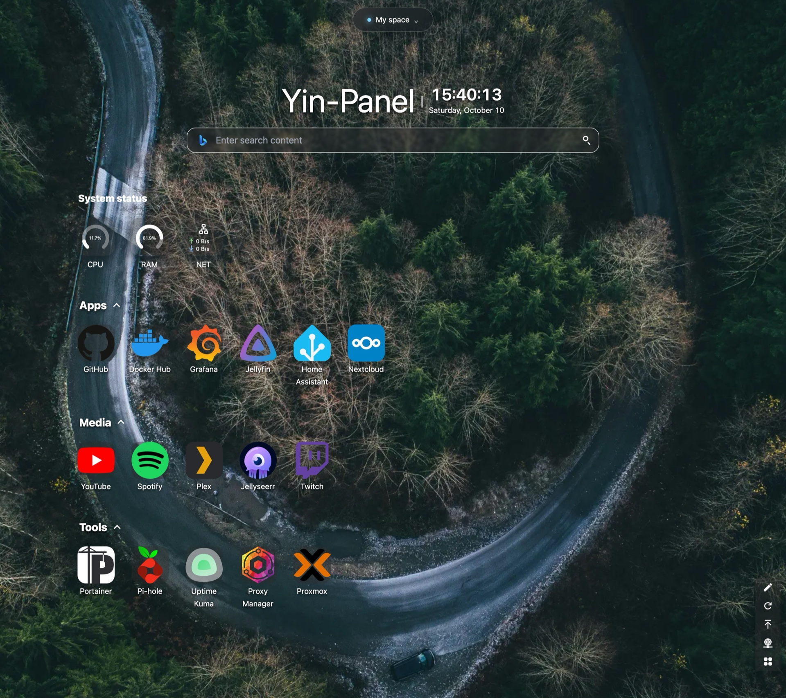
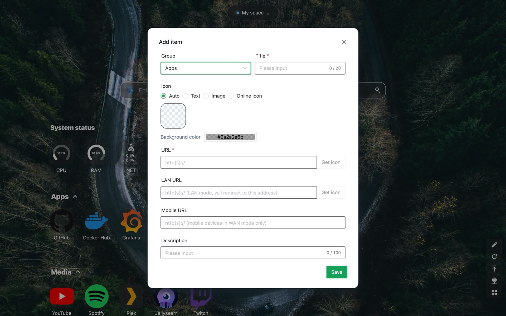
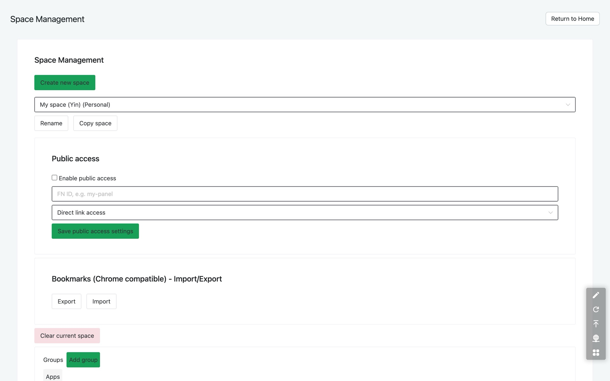
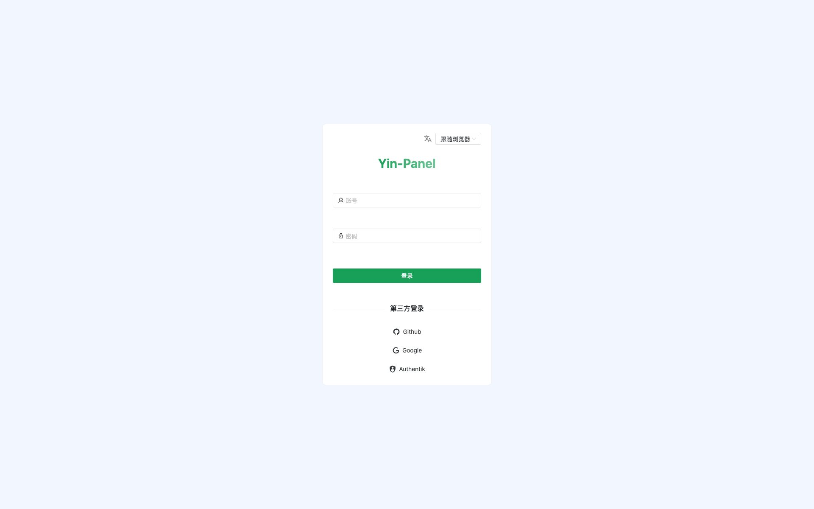
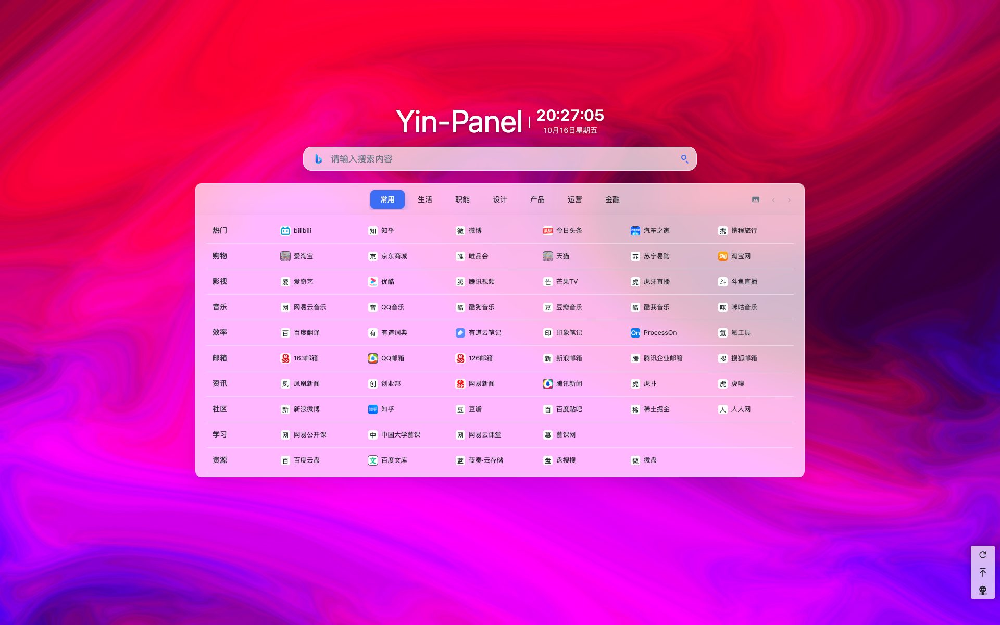
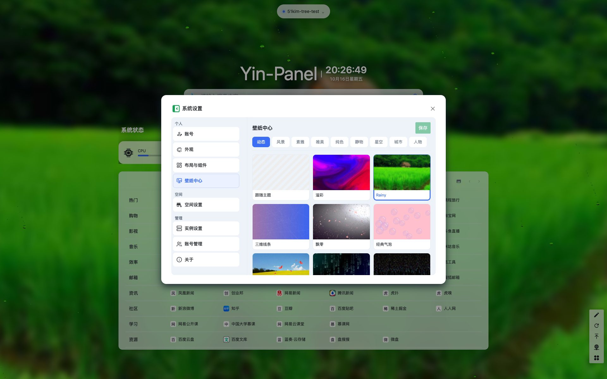
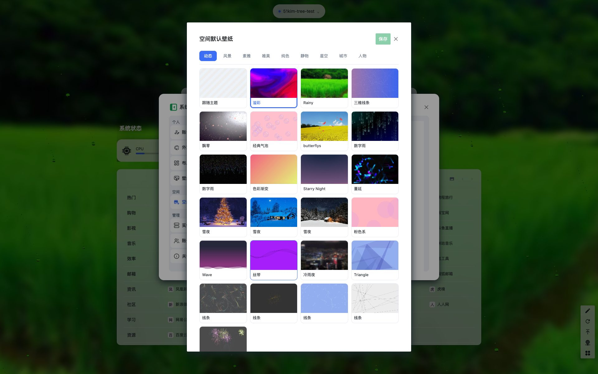
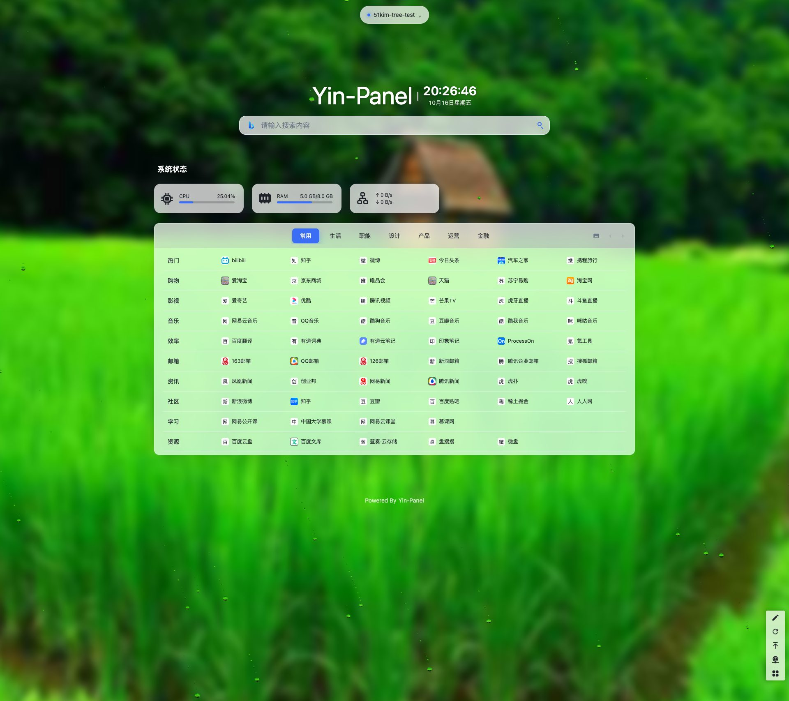
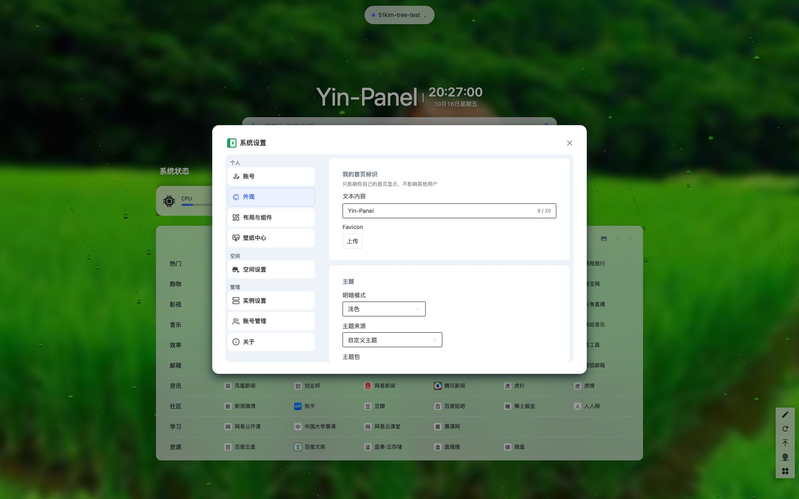
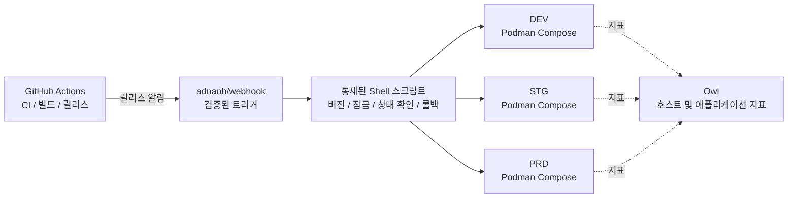

<div align="center">
    

<h1>Yin-Panel</h1>

[](https://github.com/yinorg/Yin-Panel/releases)
[](../../LICENSE)


[English](../../README.md) | [简体中文](../zh-CN/README.md) | [繁體中文](../zh-TW/README.md) | [日本語](../ja-JP/README.md) | **한국어** | [Deutsch](../de-DE/README.md) | [Français](../fr-FR/README.md) | [Español](../es-ES/README.md) | [Português (Brasil)](../pt-BR/README.md) | [Русский](../ru-RU/README.md) | [Bahasa Indonesia](../id-ID/README.md) | [Türkçe](../tr-TR/README.md) | [Polski](../pl-PL/README.md) | [Italiano](../it-IT/README.md) | [Nederlands](../nl-NL/README.md) | [हिन्दी](../hi-IN/README.md) | [ไทย](../th-TH/README.md)

</div>

Yin-Panel은 개인 및 공유 공간을 위한 가볍고 셀프 호스팅 가능한 내비게이션 패널입니다. 가정 네트워크, NAS, 서버, 소규모 조직에 적합합니다.

## 데모

<picture>
  <source media="(prefers-color-scheme: dark)" srcset="../images/readme-home-dark.jpg">
  
</picture>

| 항목 편집기 | 공간 관리 |
| --- | --- |
|  |  |

### 화면 미리보기

| 로그인 | 공개 접근 |
| --- | --- |
|  |  |

| 배경화면 센터 | 공간 기본 배경 |
| --- | --- |
|  |  |

**디렉터리 테마**: 공간마다 테마 패키지를 지정할 수 있어 같은 인스턴스에서도 공간별로 레이아웃이 달라집니다.





## 기능

- 개인 공간과 공유 공간, 콘텐츠는 서로 격리
- 공간 생성, 이름 변경, 복사, 관리자 양도
- 그룹 트리, 북마크, 아이콘, 정렬 관리
- 브라우저 HTML 형식 북마크 가져오기와 내보내기
- 공간 멤버 역할: 관리자, 편집자, 뷰어
- OAuth 2.0 / OIDC 로그인, 계정 연결, OIDC 그룹 권한 부여
- 이메일을 로그인 계정으로 사용하고 닉네임은 별도로 관리
- 사용자 지정 아이콘, 설치 가능한 테마 패키지, 17개 UI 언어, 배경 화면, WAN/LAN 및 모바일 URL 모드, 페이지 내 팝업 열기
- SQLite, MySQL, MariaDB, PostgreSQL 스토리지, amd64/arm64 Docker 이미지, Kubernetes용 Helm 차트

## 공식 호스팅 환경

바로 가입해서 사용해 볼 수 있는 온라인 환경 세 개를 운영하고 있습니다. 세 환경 모두 GitHub / GitLab / Google 로그인을 지원하며, 모니터링 패널에서 지표와 알림을 볼 수 있습니다.

로그인 없이도 공개 링크 <https://panel.yiniot.com/my-demo> 로 둘러볼 수 있습니다(브라우저 시작 페이지로 지정해도 됩니다).

함께 쓰는 브라우저 확장 [Yin-Panel Helper](https://github.com/yinorg/yin-panel-extension)([Chrome 웹 스토어](https://chromewebstore.google.com/detail/yin-panel-helper/hlfhnjccidngjjkidlgejefcchoegofo)에 등록됨)도 설치할 수 있습니다. 하는 일은 딱 두 가지입니다: 새 탭을 내 패널로 연결하고, 사이트 아이콘을 가져오도록 돕습니다.

| 환경 | 주소 | 용도 | 안정성 |
| --- | --- | --- | --- |
| 프로덕션(PRD) | <https://panel.yiniot.com> | 일상 사용 | 99.9% 가용성을 목표로 하는 베스트 에포트 |
| STG | <https://panel-stg.yiniot.com> | 릴리스 전 검증 | 언제든 재시작되거나 롤백될 수 있음 |
| DEV | <https://panel-dev.yiniot.com> | 체험 및 문제 제보 | 가장 불안정하며 데이터가 언제든 삭제될 수 있음 |
| 모니터링 | <https://owl.yiniot.com> | 세 환경의 지표와 알림 | — |

세 환경은 같은 무료 서버에서 실행되며 **고가용성이 아닙니다**: PRD는 99.9%를 목표로 하지만 보상은 없고, STG와 DEV는 언제든 중단될 수 있습니다. 중요한 데이터는 두지 말고, 장기적으로 쓰려면 아래처럼 직접 설치해 운영하세요.

## 빠른 시작

### Docker Compose

Docker와 Compose 플러그인이 필요합니다.

```bash
mkdir yin-panel && cd yin-panel
curl -LO https://raw.githubusercontent.com/yinorg/Yin-Panel/master/docker/docker-compose.yml
curl -o conf.yaml https://raw.githubusercontent.com/yinorg/Yin-Panel/master/backend/conf.yaml.example
mkdir -p database uploads
jwt_secret="$(openssl rand -hex 32)"
sed -i "s#^  secret: your_secret_key$#  secret: ${jwt_secret}#" conf.yaml
unset jwt_secret
YIN_PANEL_IMAGE=ghcr.io/yinorg/yin-panel-ce:latest docker compose up -d
```

브라우저에서 <http://localhost:3002>를 엽니다.

`latest`는 현재 릴리스를 가리키며 가장 빠르게 써 보는 방법입니다. **프로덕션에서는 구체적인 태그나 이미지 digest로 고정하세요**(“CI/CD 아키텍처” 참고). 그래야 배포가 흔들리지 않습니다.

기본 관리자: `admin@yiniot.com`, 비밀번호 `admin@yiniot.com`. 첫 로그인 후 즉시 비밀번호를 변경하고 `conf.yaml`에서 `base.root_url`과 고유한 `jwt.secret`을 설정하세요.

모든 배포 환경은 각자의 무작위 `jwt.secret`을 생성해야 합니다. 저장소는 `conf.yaml.example`만 제공합니다. 실행 디렉터리의 `conf.yaml`에는 인스턴스 비밀과 OAuth 자격 증명이 포함되므로 Git에 커밋하지 마세요.

### GHCR 이미지

```bash
docker pull ghcr.io/yinorg/yin-panel-ce:latest
docker pull ghcr.io/yinorg/yin-panel-ce:<x.y.z>
```

`latest`는 현재 릴리스를 가리키며, 이것과 모든 릴리스 태그는 amd64와 arm64 호스트를 위한 멀티 아키텍처 매니페스트입니다. 릴리스 태그에는 아키텍처 접미사가 붙지 않습니다. `-amd64`, `-arm64` 같은 태그는 정식 릴리스에 포함되지 않습니다.

## 성능 및 권장 구성

아래 수치는 로컬 단일 머신 벤치마크(SQLite, 빈 데이터베이스, loopback, 동일 호스트 부하 테스트)에서 나온 값으로, 구성 선택의 참고 자료일 뿐 프로덕션 용량 보장이 아닙니다. 실제 용량은 주로 공간별 데이터 양, 쓰기 빈도, 최대 동시성에 따라 달라집니다.

### 리소스 사용량(실측 규모)

| 지표 | 유휴 | 5000 req/s 혼합 부하 | 한계(수만 req/s) |
| --- | --- | --- | --- |
| 메모리 RSS | ~16 MB | ~105 MB | 최대 ~500 MB, 부하 중지 후 감소 |
| CPU | 거의 0 | ~0.3 코어 | 2–3 코어 |

- 메모리는 약 **2만 req/s**까지 **105 MB** 수준에서 거의 일정하며 부하에 따라 선형으로 증가하지 않습니다. ~500 MB는 합성 극한 부하에서만 나타납니다.
- 단일 코어로 약 **1만–1.2만 req/s**(혼합 읽기/쓰기, 소규모 데이터)를 처리할 수 있습니다.
- 5000 req/s 혼합 부하에서 실패 0건, p95 약 **0.25 ms**.

### 권장 구성

| 시나리오 | CPU | 메모리 | 스토리지 | 데이터베이스 |
| --- | --- | --- | --- | --- |
| 개인 / 가정 / NAS | 1 vCPU | 128–256 MB | SSD, 512 MB 이상(아이콘 업로드 여유 포함) | SQLite |
| 소규모 팀 / 공유 공간 | 1–2 vCPU | 256–512 MB | SSD, 1–2 GB | SQLite |
| 조직 / 높은 동시성 | 2–4 vCPU | 1–2 GB | SSD | SQLite(단일 호스트) 또는 MySQL(다중 인스턴스, HA) |

### 사용자 규모 참고

온라인 사용자당 약 0.1 req/s(대부분 유휴)로 추정하고 최대 여유를 확보한 경우:

| 구성 | 이론상 평균 처리량 | 유휴 동시 접속(이론상 한도) | 권장 규모(최대 여유 포함) |
| --- | --- | --- | --- |
| 1 vCPU | ~10k req/s | ~10만 | 2만–4만 |
| 2 vCPU | ~20k req/s | ~20만 | 5만–8만 |
| 4 vCPU | ~40k req/s | ~40만 | 10만 이상 |

사용자가 활발할수록(편집, 가져오기, 잦은 새로 고침) 사용자당 요청률이 높아지고 지원 가능한 사용자 수는 그만큼 줄어듭니다.

### 용량에 영향을 주는 핵심 요인

1. **데이터 양**: 목록 API는 한 번의 응답으로 공간의 모든 항목을 반환하므로 항목이 많을수록 요청 비용이 커집니다. 직접 실측해 볼 가치가 가장 큰 부분입니다.
2. **쓰기 빈도**: SQLite는 한 번에 하나의 쓰기만 허용하며 쓰기 처리량은 디스크 fsync에 제한됩니다(초당 수백 회 수준). 쓰기가 많거나 다중 인스턴스 구성이면 MySQL을 권장합니다.
3. **평균이 아닌 최대치**: 최대치를 기준으로 선정하고 보통 평균의 2–5배 여유를 둡니다.
4. **정적 자산**: `/assets/*`와 해시가 포함된 자산은 리버스 프록시나 CDN에서 제공하고, 해시가 붙은 파일은 장기간 캐시하세요. 진입 파일과 `/api/*`는 항상 최신으로 유지해야 합니다.

## 데이터베이스

SQLite(기본), MySQL, MariaDB, PostgreSQL을 지원합니다.

- `base.database_drive`: `sqlite`(기본) | `mysql` | `postgres`. **MariaDB는 `mysql`을 사용합니다.**
- SQLite: `sqlite.file_path`(`read_pool_size`도 참고).
- MySQL / MariaDB: `mysql.{host,port,username,password,db_name,wait_timeout}`.
- PostgreSQL: `postgres.{host,port,username,password,db_name,ssl_mode,time_zone,wait_timeout}`.

SQLite 전용 기능(WAL, 읽기 전용 연결 풀, 파일 스냅샷 기반 마이그레이션 백업)은 SQLite에만 적용됩니다. MySQL/MariaDB/PostgreSQL은 각자의 도구로 백업하세요.

### SQLite에서 MySQL/MariaDB/PostgreSQL로 마이그레이션

```bash
# conf.yaml        — 기존 SQLite 구성
# conf.target.yaml — mysql 또는 postgres를 가리키는 대상 구성(대상 데이터베이스는 비어 있어야 합니다)
./yin-panel migrate-db -source conf.yaml -target conf.target.yaml
```

마이그레이션은 대상에 전체 스키마를 생성하고 모든 행을 **기본 키를 유지한 채** 복사합니다(PostgreSQL에서는 ID 시퀀스도 재설정됩니다). 반복 실행할 수 있으며, 실행할 때마다 대상 테이블 내용이 교체됩니다. 완료 후 `conf.yaml`의 `database_drive`를 대상으로 변경하세요.

## 구성과 OAuth/OIDC

`oauth`는 OAuth 2.0과 OpenID Connect(OIDC)의 통합 구성 진입점입니다. 기본 템플릿에는 검증된 세 가지 예시가 있습니다: GitHub(OAuth 2.0), GitLab(표준 OIDC), Google(OAuth 2.0). 예시는 기본적으로 모두 주석 처리되어 있으며, 실제 자격 증명을 입력하고 `oauth.enable`을 `true`로 설정해야 활성화됩니다. 모든 구성 키는 `backend/conf.yaml.example`에 문서화되어 있습니다.

표준 OIDC 공급자는 discovery, authorization code + PKCE, JWKS 서명 검증을 지원해야 하며 사용자 정보에서 `email`과 `email_verified`를 제공해야 합니다. 이 기준을 충족하는 공급자는 원칙적으로 사용할 수 있지만 공급자마다 추가 필드 매핑 구성이 필요할 수 있습니다.

OIDC 콜백 URL:

```text
<base.root_url>/api/oauth/<provider>/callback
```

콜백 후 공급자는 검증된 이메일을 반환해야 합니다. 시스템은 `provider + sub`로 외부 신원을 식별하고 이메일로 로컬 계정을 연결합니다.

## 공간과 권한

공간 권한은 내부 `UserID`로 연결되며 이메일 텍스트를 권한 기본 키로 사용하지 않습니다. 따라서 이메일을 변경해도 기존 공간 권한은 유지되고 멤버 목록에는 최신 이메일이 표시됩니다.

- 관리자: 공간, 멤버, 역할, OIDC 규칙 관리
- 편집자: 그룹과 북마크 관리
- 뷰어: 읽기 전용 접근

공간 생성, 이름 변경, 그룹 추가, 멤버 추가, OIDC 규칙 추가는 모두 대화 상자에서 수행합니다.

## Helm

```bash
helm upgrade --install yin-panel ./distribution/helm-chart/yin-panel \
  --set image.tag=latest
```

프로덕션에서는 `image.tag`를 구체적인 버전으로 바꾸세요.

배포 전에 `helm template yin-panel ./distribution/helm-chart/yin-panel`로 렌더링 결과를 확인할 수 있습니다.

## 소스 개발

환경 요구 사항: Go `1.27.1`, Node.js `24.21.0`, npm 또는 pnpm `9.15.5`.

```bash
cd frontend
npm ci
npm run build-only
```

고정된 pnpm을 사용하는 경우:

```bash
cd frontend
corepack pnpm install --frozen-lockfile
pnpm run build-only
```

```bash
cd backend
go test ./...
go build ./...
```

로컬 전체 업데이트(프런트엔드 빌드, 백엔드 테스트와 빌드, 배포, 재시작)는 한 명령으로 실행합니다:

```bash
./scripts/deploy-local.sh
```

스크립트는 기본적으로 저장소의 `backend/`를 실행 디렉터리로 사용하며 로컬 `conf.yaml`이 필요합니다. `.env.local`의 `YIN_PANEL_RUNTIME_DIR`로 재정의할 수 있습니다. 빌드와 테스트가 모두 통과하면 Yin-Panel 리스너만 중지하고 `sudo`로 이전 바이너리와 정적 파일을 교체하며 데이터베이스, 업로드 파일, 구성 파일은 건드리지 않습니다.

홈 페이지 테마 시스템은 [`frontend/THEME_SYSTEM.md`](../../frontend/THEME_SYSTEM.md)에 문서화되어 있습니다. `npm run create:theme -- init "<이름>"`으로 새 테마 뼈대를 만들 수 있습니다. AI 개발·릴리스·재시작 규칙은 [AGENTS.md](../../AGENTS.md)에 있습니다.

브라우저 수준 인수 테스트는 별도 저장소 [yinorg/yin-panel-e2e](https://github.com/yinorg/yin-panel-e2e)에 있습니다. Playwright가 실제 브라우저로 전체 흐름(로그인과 계정, 공간과 권한, 북마크 가져오기와 내보내기, 테마 시스템, PWA 오프라인 동작, 확장의 새 탭 대체)을 돌리고, k6 스크립트가 부하와 용량을 측정합니다. 실행하려면 돌아가는 Yin-Panel 인스턴스, Core 저장소의 `.env.local`, 패키징하지 않은 확장 소스가 필요하며 체크아웃 위치는 `YIN_PANEL_E2E_DIR`로 지정합니다.

## 백업과 업그레이드

업그레이드 전에 데이터베이스, `uploads/`, `conf.yaml`, Helm values를 백업하세요. 마이그레이션은 사용자, 공간, 그룹, 북마크, 파일 참조를 보존합니다. 문제가 발생하면 업그레이드 전 백업으로 복원하고 데이터베이스를 삭제해 다시 만들지 마세요.

Compose 설치의 업그레이드 절차:

```bash
docker compose pull
docker compose up -d
```

`docker/docker-compose.yml`은 기본값으로 `latest`를 쓰고, `pull_policy: missing`은 로컬에 이미지가 없을 때만 내려받습니다. 그래서 업그레이드할 때는 `docker compose pull`을 명시적으로 실행해야 합니다. 프로덕션에서는 `YIN_PANEL_IMAGE`를 구체적인 버전으로 고정하고 업데이트할 때 바꾸세요.

## CI/CD 아키텍처

공식 환경은 1C1G VPS 한 대에서 DEV, STG, PRD를 함께 운영합니다. 목표는 구성 요소를 쌓는 것이 아니라 **상주 프로세스를 줄이고, 자원을 적게 쓰고, 릴리스를 감사 가능하게 만들고, 실패하면 되돌릴 수 있게 하는 것**입니다.



| 계층 | 구성 요소 | 역할 |
| --- | --- | --- |
| CI | GitHub Actions | 테스트, 이미지 빌드, 버전 기록, 릴리스 시작 |
| 릴리스 진입 | adnanh/webhook | 출처와 요청을 검증하고 정해진 릴리스 작업만 실행 |
| 릴리스 실행 | Shell 스크립트 | 버전 확인, 환경 선택, 잠금, 배포, 상태 확인, 롤백 |
| 실행 환경 | Podman Compose | 세 개의 격리된 애플리케이션 인스턴스 실행(Podman은 Docker보다 RSS를 약 150MB 절약) |
| 모니터링 | Owl | 호스트 및 애플리케이션 지표 |

**왜 이렇게 나누는가**: CI는 모두 GitHub Actions에서 실행하고 VPS는 이미 빌드된 이미지를 받아 배포만 합니다. 작은 서버가 컴파일 피크를 떠안지 않고 CI/CD 컨트롤 플레인도 상주하지 않습니다. 세 환경은 하나의 릴리스 체인을 공유하지만 Compose 프로젝트, 설정, 볼륨, 네트워크, 포트는 각각 분리되어 있습니다. 릴리스 방식을 공유하는 것이 데이터를 공유하는 것은 아닙니다.

### 릴리스 흐름

1. **빌드**: Actions가 테스트를 돌리고 이미지를 빌드합니다. 버전은 Git 태그, 커밋 SHA 또는 이미지 digest로 고정하며 프로덕션에는 `latest`를 배포하지 않습니다.
2. **트리거와 검증**: Actions가 검증된 릴리스 요청을 웹훅으로 보내고, 스크립트가 버전과 대상 환경, 허용된 동작을 확인합니다. 임의의 입력을 Shell 명령에 붙이지 않습니다.
3. **잠금과 배포**: 한 환경에는 한 번에 하나의 배포만 실행하며 대상 환경만 갱신합니다. 아무것도 무작정 재시작하지 않습니다.
4. **상태 확인과 실패 처리**: 서비스가 올라와 응답하는지 확인하고, 실패하면 직전 정상 버전을 유지한 채 롤백하며 환경, 버전, 트리거 출처, 결과, 롤백 사유를 기록합니다.

승격: DEV 자동 배포 → 검증 후 STG에 같은 버전 배포 → 스모크 테스트 후 **PRD는 사람의 승인이 필요합니다**. 긴급 수정도 감사 가능한 예외 절차를 거치므로, 일반적인 개발 이벤트가 프로덕션 승인을 건너뛰는 일은 없습니다.

### 경계

이것은 **단일 머신, 저자원, 감사 가능**한 배포 아키텍처로, 고가용성 아키텍처가 아닙니다. 세 환경은 프로세스, 설정, 데이터가 분리되어 있지만 같은 VPS의 커널, 디스크, 네트워크, 메모리를 공유하므로 호스트 장애나 자원 고갈은 세 환경에 동시에 영향을 줍니다. 장점은 신뢰할 수 있는 릴리스에 필요한 장치 — 버전 고정, 환경 격리, 상태 확인, 롤백, 모니터링, 감사 기록 — 을 아주 적은 상주 구성 요소로 유지한다는 데 있습니다.

## Open Core

Yin-Panel Core 에디션은 무료이며 계속 유지 관리되고 업데이트됩니다. 이 저장소는 공개 Core의 유일한 소스이며 `yin-panel-ce` 이미지를 게시합니다. 엔터프라이즈 에디션은 비공개 저장소 [yinorg/Yin-Panel-EE](https://github.com/yinorg/Yin-Panel-EE)에 있으며 공개 인터페이스로 연결됩니다.

실행 중인 인스턴스는 `GET /api/system/capabilities`에서 에디션, 기능, 읽기 전용 상태, 버전을 확인할 수 있습니다. 문제와 제안은 [GitHub Issues](https://github.com/yinorg/Yin-Panel/issues)에 남겨 주세요.

이 저장소에 병합된 기여는 Core에 남습니다. 엔터프라이즈 에디션으로 옮겨지거나 재라이선스되지 않습니다. [Core와 엔터프라이즈](../../GOVERNANCE.md)를 참고하세요.

## 감사의 글

Yin-Panel은 오픈 소스 프로젝트 [hslr-s/sun-panel](https://github.com/hslr-s/sun-panel)에서 발전했습니다. 프로젝트 기반을 만든 원저자에게 감사드립니다.

[PhantomMaa/sun-panel](https://github.com/PhantomMaa/sun-panel)의 최적화와 유지 관리 작업에도 감사드립니다. Yin-Panel은 그 기반을 이어받아 지속적으로 유지 관리하며 새로운 기능, 사용성 개선, 셀프 호스팅에 적합한 개선을 계속 추가하고 있습니다.

모든 원저자, 기여자, 사용자에게 감사드립니다.

## 기여하기

이 프로젝트가 계속되는 이유는 사용자들이 시간을 내어 문제와 아이디어를 알려주기 때문입니다. 어떤 형태의 참여든 환영합니다:

- **제안과 버그 신고**: [Issue](https://github.com/yinorg/Yin-Panel/issues)에 버전, 환경, 재현 절차, 나타난 현상을 적어 주세요. 스크린샷이나 로그가 있으면 훨씬 빠르게 처리됩니다.
- **코드와 문서**: Pull Request를 환영합니다. 버그 수정, 문장 다듬기, 언어 추가, 스크린샷 교체도 모두 값진 기여입니다.
- **아직 확신이 없다면**: 먼저 Issue에서 방향을 정하고 코드를 작성하세요. 아무도 원하지 않는 방향으로 작업하는 일을 막을 수 있습니다.

시작하기 전에 [CONTRIBUTING.md](../../CONTRIBUTING.md)를 봐 주세요. 큰 변경은 먼저 논의하는 편이 좋고, 보안 문제는 공개 Issue 대신 비공개로 알려 주세요. 확실하지 않은 점은 Issue에서 물어보시면 방향을 잡아 드리겠습니다.

Issue와 Pull Request 모두 확인하며 7일 안에 답변하려고 합니다. 재현이 안정적인 문제와 맥락이 담긴 제안이 가장 빠릅니다. 보내 주시는 피드백 하나하나가 이 프로젝트를 계속하는 이유입니다.

## 라이선스

Yin-Panel은 [Business Source License 1.1](../../LICENSE)로 라이선스됩니다. 포크, 수정, 셀프 호스팅은 무료이며, 조직 내부 사용과 자사 고객을 위한 서비스 제공도 포함됩니다. Yin-Panel 자체를 호스팅 서비스로 제3자에게 제공하려면 상용 라이선스가 필요합니다. 각 버전은 해당 버전의 최초 공개 배포 후 3년이 지나면 AGPL-3.0-or-later 라이선스로 전환됩니다. 자세한 내용은 [Core와 엔터프라이즈](../../GOVERNANCE.md)를 참고하세요.

서드파티 고지는 [THIRD-PARTY-NOTICES.md](../../THIRD-PARTY-NOTICES.md)에 나열되어 있으며, 기여는 [Contributor License Agreement](../../CLA.md)에 따라 접수됩니다.
