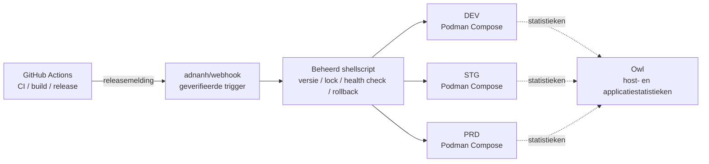

<div align="center">
    

<h1>Yin-Panel</h1>

[](https://github.com/yinorg/Yin-Panel/releases)
[](../../LICENSE)


[English](../../README.md) | [简体中文](../zh-CN/README.md) | [繁體中文](../zh-TW/README.md) | [日本語](../ja-JP/README.md) | [한국어](../ko-KR/README.md) | [Deutsch](../de-DE/README.md) | [Français](../fr-FR/README.md) | [Español](../es-ES/README.md) | [Português (Brasil)](../pt-BR/README.md) | [Русский](../ru-RU/README.md) | [Bahasa Indonesia](../id-ID/README.md) | [Türkçe](../tr-TR/README.md) | [Polski](../pl-PL/README.md) | [Italiano](../it-IT/README.md) | **Nederlands** | [हिन्दी](../hi-IN/README.md) | [ไทย](../th-TH/README.md)

</div>

Yin-Panel is een lichtgewicht, zelf te hosten navigatiepaneel voor persoonlijke en gedeelde ruimten. Het past bij thuisnetwerken, NAS-apparaten, servers en kleine organisaties.

## Demo

<picture>
  <source media="(prefers-color-scheme: dark)" srcset="../images/readme-home-dark.jpg">
  
</picture>

| Item-editor | Ruimtebeheer |
| --- | --- |
|  |  |

### Interfacevoorbeeld

| Aanmelden | Openbare toegang |
| --- | --- |
|  |  |

| Achtergrondencentrum | Standaardachtergrond van de ruimte |
| --- | --- |
|  |  |

**Directory-thema**: elke space kan een eigen themapakket gebruiken, waardoor spaces in dezelfde instantie er anders uit kunnen zien.


## Functies

- Persoonlijke en gedeelde ruimten met gescheiden inhoud
- Ruimten aanmaken, hernoemen, kopiëren en het beheerderschap overdragen
- Groepsbomen, bladwijzers, pictogrammen en sortering
- Bladwijzers importeren en exporteren in de HTML-indeling van de browser
- Ruimteleden met de rollen beheerder, bewerker en kijker
- OAuth 2.0 / OIDC-aanmelding, accountkoppeling en OIDC-groepsautorisatie
- E-mailadres als aanmeldingsidentiteit, met een onafhankelijke bijnaam
- Aangepaste pictogrammen, installeerbare themapakketten, 17 UI-talen, achtergronden, WAN-/LAN- en mobiele URL-modus en pop-upvensters in de pagina
- Opslag met SQLite, MySQL, MariaDB of PostgreSQL, Docker-images voor amd64 en arm64 en een Helm-chart voor Kubernetes

## Officieel gehoste omgevingen

We draaien drie online omgevingen waarop je je direct kunt registreren en alles kunt uitproberen; alle drie ondersteunen inloggen met GitHub / GitLab / Google, en een monitoringspaneel toont hun statistieken en waarschuwingen.

| Omgeving | Adres | Doel | Beschikbaarheid |
| --- | --- | --- | --- |
| Productie (PRD) | <https://panel.yiniot.com> | Dagelijks gebruik | Best effort met als doel 99,9% beschikbaarheid |
| STG | <https://panel-stg.yiniot.com> | Controle voor de release | Kan op elk moment opnieuw starten of terugrollen |
| DEV | <https://panel-dev.yiniot.com> | Uitproberen en problemen melden | Het minst stabiel; gegevens kunnen op elk moment verdwijnen |
| Monitoring | <https://owl.yiniot.com> | Statistieken en waarschuwingen van de drie omgevingen | — |

De drie omgevingen draaien op dezelfde gratis server en **er is geen hoge beschikbaarheid**: PRD mikt op 99,9% maar biedt geen compensatie, terwijl STG en DEV op elk moment kunnen uitvallen. Bewaar er geen belangrijke gegevens; voor langdurig gebruik host je het zelf, zoals hieronder beschreven.

## Snel starten

### Docker Compose

Vereist Docker met de Compose-plugin.

```bash
mkdir yin-panel && cd yin-panel
curl -LO https://raw.githubusercontent.com/yinorg/Yin-Panel/master/docker/docker-compose.yml
curl -o conf.yaml https://raw.githubusercontent.com/yinorg/Yin-Panel/master/backend/conf.yaml.example
mkdir -p database uploads
jwt_secret="$(openssl rand -hex 32)"
sed -i "s#^  secret: your_secret_key$#  secret: ${jwt_secret}#" conf.yaml
unset jwt_secret
YIN_PANEL_IMAGE=ghcr.io/yinorg/yin-panel-ce:latest docker compose up -d
```

Open <http://localhost:3002>.

`latest` wijst naar de huidige release en is de snelste manier om het te proberen; **zet in productie een specifieke tag of image-digest vast** (zie "CI/CD-architectuur") zodat een deployment niet verschuift.

Standaardbeheerder: `admin@yiniot.com`, wachtwoord `admin@yiniot.com`. Wijzig het wachtwoord direct na de eerste aanmelding en stel `base.root_url` en een unieke `jwt.secret` in `conf.yaml` in.

Elke implementatie moet een eigen willekeurige `jwt.secret` genereren. De repository levert alleen `conf.yaml.example`; de `conf.yaml` in uw runtime-map bevat instantiegeheimen en OAuth-inloggegevens en mag niet naar Git worden gecommit.

### GHCR-images

```bash
docker pull ghcr.io/yinorg/yin-panel-ce:latest
docker pull ghcr.io/yinorg/yin-panel-ce:<x.y.z>
```

`latest` wijst naar de huidige release; die en elke release-tag zijn multi-architectuurmanifests voor amd64- en arm64-hosts. Release-tags krijgen nooit een architectuurachtervoegsel; tags zoals `-amd64` of `-arm64` maken geen deel uit van een release.

## Prestaties en aanbevolen configuratie

De onderstaande cijfers komen uit lokale benchmarks op één machine (SQLite, lege database, loopback, loadgenerator op dezelfde host). Beschouw ze als een richtlijn voor dimensionering, niet als een belofte over productiecapaciteit. De werkelijke capaciteit hangt vooral af van het gegevensvolume per ruimte, de schrijfsnelheid en de piekconcurrentie.

### Resourcegebruik (gemeten grootheden)

| Metriek | Inactief | Gemengde belasting van 5000 req/s | Limiet (tienduizenden req/s) |
| --- | --- | --- | --- |
| Geheugen (RSS) | ~16 MB | ~105 MB | ~500 MB piek; valt terug nadat de belasting stopt |
| CPU | bijna nul | ~0.3 core | 2–3 cores |

- Het geheugen blijft rond **105 MB** tot ongeveer **20k req/s** en groeit niet lineair met de belasting; de ~500 MB verschijnt alleen onder extreme synthetische druk.
- Eén core verwerkt ongeveer **10k–12k req/s** (gemengd lezen/schrijven, kleine dataset).
- Onder een gemengde belasting van 5000 req/s: 0 fouten, p95 ongeveer **0.25 ms**.

### Aanbevolen configuratie

| Scenario | CPU | Geheugen | Opslag | Database |
| --- | --- | --- | --- | --- |
| Persoonlijk / thuis / NAS | 1 vCPU | 128–256 MB | SSD, 512 MB+ (plus ruimte voor het uploaden van pictogrammen) | SQLite |
| Klein team / gedeelde ruimten | 1–2 vCPU | 256–512 MB | SSD, 1–2 GB | SQLite |
| Organisatie / hoge gelijktijdigheid | 2–4 vCPU | 1–2 GB | SSD | SQLite (één host) of MySQL (meerdere instanties, HA) |

### Referentie voor gebruikersaantallen

Uitgaande van ongeveer 0.1 req/s per online gebruiker (meestal inactief) en met reserve voor pieken:

| Configuratie | Theoretische gemiddelde doorvoer | Inactieve gelijktijdigheid (theoretisch plafond) | Aanbevolen schaal (met piekreserve) |
| --- | --- | --- | --- |
| 1 vCPU | ~10k req/s | ~100k | 20k–40k |
| 2 vCPU | ~20k req/s | ~200k | 50k–80k |
| 4 vCPU | ~40k req/s | ~400k | 100k+ |

Hoe actiever de gebruikers (bewerken, importeren, vaak vernieuwen), hoe hoger het aantal verzoeken per gebruiker en hoe lager het duurzame gebruikersaantal.

### Belangrijkste factoren die de capaciteit beïnvloeden

1. **Gegevensvolume** — lijsteindpunten retourneren alle items van een ruimte in één antwoord; meer items betekenen een duurder verzoek. Dit is het onderdeel dat het meest de moeite waard is om op uw eigen gegevens te meten.
2. **Schrijfsnelheid** — SQLite staat slechts één schrijver tegelijk toe; de schrijfdoorvoer wordt begrensd door disk-fsync (in de orde van honderden schrijfacties per seconde). Gebruik MySQL voor schrijfintensieve opstellingen of opstellingen met meerdere instanties.
3. **Piek, niet gemiddelde** — dimensioneer op pieken en reserveer daarbij meestal 2–5× het gemiddelde.
4. **Statische assets** — laat een reverse proxy of CDN `/assets/*` en andere gehashte assets leveren, en cache de gehashte bestanden langdurig; ingangsbestanden en `/api/*` moeten altijd actueel blijven.

## Database

SQLite (standaard), MySQL, MariaDB en PostgreSQL worden ondersteund.

- `base.database_drive`: `sqlite` (standaard) | `mysql` | `postgres`. **MariaDB gebruikt `mysql`.**
- SQLite: `sqlite.file_path` (zie ook `read_pool_size`).
- MySQL / MariaDB: `mysql.{host,port,username,password,db_name,wait_timeout}`.
- PostgreSQL: `postgres.{host,port,username,password,db_name,ssl_mode,time_zone,wait_timeout}`.

Mogelijkheden die alleen SQLite biedt (WAL, de alleen-lezen verbindingspool en migratieback-ups via bestandssnapshots) gelden alleen voor SQLite; maak back-ups van MySQL/MariaDB/PostgreSQL met hun eigen hulpmiddelen.

### Migreren van SQLite naar MySQL/MariaDB/PostgreSQL

```bash
# conf.yaml        — bestaande SQLite-configuratie
# conf.target.yaml — doelconfiguratie die naar mysql of postgres wijst (de doeldatabase moet leeg zijn)
./yin-panel migrate-db -source conf.yaml -target conf.target.yaml
```

De migratie maakt het volledige schema aan in het doel, kopieert elke rij met behoud van primaire sleutels (en reset identiteitsreeksen op PostgreSQL). Ze kan herhaaldelijk worden uitgevoerd — elke uitvoering vervangt de inhoud van de doeltabellen. Wijs daarna `database_drive` in `conf.yaml` aan op het doel.

## Configuratie en OAuth/OIDC

`oauth` is het uniforme configuratie-item voor OAuth 2.0 en OpenID Connect (OIDC). De standaardsjabloon bevat drie geverifieerde voorbeelden: GitHub (OAuth 2.0), GitLab (standaard OIDC) en Google (OAuth 2.0). De voorbeelden zijn standaard allemaal uitgecommentarieerd; een provider wordt pas ingeschakeld nadat u echte inloggegevens hebt ingevuld en `oauth.enable: true` hebt ingesteld. Alle configuratiesleutels zijn gedocumenteerd in `backend/conf.yaml.example`.

Een standaard OIDC-provider moet discovery, authorization code + PKCE en JWKS-handtekeningvalidatie ondersteunen en moet `email` en `email_verified` in de gebruikersinformatie leveren. Providers die aan deze standaarden voldoen, werken in principe, maar verschillende leveranciers kunnen alsnog extra veldtoewijzingsconfiguratie vereisen.

OIDC-callback-URL:

```text
<base.root_url>/api/oauth/<provider>/callback
```

Na de callback moet de provider een geverifieerd e-mailadres retourneren. Het systeem identificeert externe identiteiten aan de hand van `provider + sub` en koppelt lokale accounts via e-mail.

## Ruimten en rechten

Ruimterechten zijn gekoppeld aan een interne `UserID` en nooit aan de e-mailtekst. Het wijzigen van een e-mailadres behoudt dus bestaande ruimterechten, en de ledenlijst toont het nieuwste e-mailadres.

- Beheerder: beheert de ruimte, leden, rollen en OIDC-regels
- Bewerker: onderhoudt groepen en bladwijzers
- Kijker: alleen-lezentoegang

Het aanmaken van een ruimte, het hernoemen ervan, het toevoegen van groepen, het toevoegen van leden en het toevoegen van OIDC-regels gebeuren allemaal in dialoogvensters.

## Helm

```bash
helm upgrade --install yin-panel ./distribution/helm-chart/yin-panel \
  --set image.tag=latest
```

Zet in productie `image.tag` op een concrete versie.

Bekijk vóór de implementatie de gerenderde manifests met `helm template yin-panel ./distribution/helm-chart/yin-panel`.

## Ontwikkeling vanuit de broncode

Vereisten: Go `1.27.1`, Node.js `24.21.0`, npm of pnpm `9.15.5`.

```bash
cd frontend
npm ci
npm run build-only
```

Of met de vastgezette pnpm:

```bash
cd frontend
corepack pnpm install --frozen-lockfile
pnpm run build-only
```

```bash
cd backend
go test ./...
go build ./...
```

Volledige lokale update (frontend bouwen, backend testen en bouwen, implementeren, herstarten) met één opdracht:

```bash
./scripts/deploy-local.sh
```

Het script gebruikt standaard de `backend/` van de repository als runtime-map en vereist daar een lokale `conf.yaml`; `YIN_PANEL_RUNTIME_DIR` in `.env.local` kan dit overschrijven. Nadat alle builds en tests zijn geslaagd, stopt het alleen de Yin-Panel-listener, gebruikt het `sudo` om de oude binary en de statische bestanden te vervangen, en raakt het de database, uploads of configuratiebestanden nooit aan.

Het themasysteem van de startpagina is gedocumenteerd in [`frontend/THEME_SYSTEM.md`](../../frontend/THEME_SYSTEM.md); maak een nieuw thema aan met `npm run create:theme -- init "<name>"`. Volledige conventies voor AI-ontwikkeling, releases en herstarten staan in [AGENTS.md](../../AGENTS.md).

## Back-up en upgrade

Maak vóór een upgrade een back-up van de database, `uploads/`, `conf.yaml` en de Helm-waarden. Migraties behouden gebruikers, ruimten, groepen, bladwijzers en bestandsverwijzingen. Als een upgrade misgaat, herstelt u de back-up van vóór de upgrade; verwijder de database niet en begin niet opnieuw.

Upgradestappen voor een Compose-installatie:

```bash
docker compose pull
docker compose up -d
```

`docker/docker-compose.yml` gebruikt standaard `latest`, en `pull_policy: missing` haalt alleen op als de image lokaal ontbreekt; bij een upgrade moet je dus expliciet `docker compose pull` uitvoeren. Zet in productie `YIN_PANEL_IMAGE` vast op een concrete versie en wijzig die bij een update.

## CI/CD-architectuur

De officiële omgevingen draaien DEV, STG en PRD op één 1C1G-VPS. Het doel is niet een stapel componenten, maar **weinig blijvende processen, lage overhead, controleerbare releases en fouten waarop je kunt terugrollen**.



| Laag | Component | Verantwoordelijkheid |
| --- | --- | --- |
| CI | GitHub Actions | Testen, image bouwen, versie vastleggen, release starten |
| Release-ingang | adnanh/webhook | Herkomst en verzoek verifiëren; alleen vaste releasetaken uitvoeren |
| Release-uitvoering | Shellscript | Versiecontrole, omgevingskeuze, lock, deployment, health check en rollback |
| Runtime | Podman Compose | Drie geïsoleerde applicatie-instanties draaien (Podman bespaart ongeveer 150 MB RSS ten opzichte van Docker) |
| Monitoring | Owl | Host- en applicatiestatistieken |

**Waarom zo verdeeld**: alle CI draait op GitHub Actions en de VPS haalt alleen de gebouwde image op en zet die neer; de kleine machine draagt nooit de compileerpiek en houdt geen CI/CD-control plane draaiend. De drie omgevingen delen één releaseketen maar houden aparte Compose-projecten, configuratie, volumes, netwerken en poorten; het releaseproces delen is geen data delen.

### Releaseverloop

1. **Build**: Actions test en bouwt de image; de versie staat vast via een Git-tag, commit-SHA of image-digest, en in productie wordt nooit `latest` uitgerold.
2. **Trigger en validatie**: Actions stuurt een geverifieerd releaseverzoek naar de webhook; het script controleert versie, doelomgeving en toegestane actie en zet nooit willekeurige invoer in een shellcommando.
3. **Lock en deployment**: één deployment per omgeving tegelijk, en alleen de doelomgeving wordt bijgewerkt — niets wordt blind herstart.
4. **Health check en fouten**: er wordt gecontroleerd of de dienst start en antwoordt; bij een fout blijft de laatste goede versie staan en wordt teruggerold, met vastlegging van omgeving, versie, triggerbron, resultaat en reden van de rollback.

Promotie: DEV rolt automatisch uit → na controle rolt STG dezelfde versie uit → na smoke tests **vraagt PRD om menselijke goedkeuring**. Ook noodfixes lopen via een controleerbare uitzonderingsroute, zodat een gewone ontwikkelgebeurtenis de productiegoedkeuring nooit omzeilt.

### Grenzen

Dit is een **single-machine, zuinige en controleerbare** deploymentarchitectuur, geen architectuur voor hoge beschikbaarheid: de drie omgevingen zijn gescheiden in proces, configuratie en data, maar delen de kernel, schijf, het netwerk en het geheugen van één VPS, dus een hoststoring of resourcetekort treft alle drie tegelijk. De waarde zit erin dat de mechanismen voor een betrouwbare release — vaste versies, gescheiden omgevingen, health checks, rollback, monitoring en een auditspoor — behouden blijven met heel weinig blijvende componenten.

## Open Core

De Yin-Panel Core-editie is gratis en blijft onderhouden en bijgewerkt. Deze repository is de enige openbare bron voor de Core en publiceert de `yin-panel-ce`-image. De Enterprise-editie leeft in de besloten repository [yinorg/Yin-Panel-EE](https://github.com/yinorg/Yin-Panel-EE) en communiceert via openbare interfaces.

Een draaiende instantie stelt zijn editie, mogelijkheden, alleen-lezenstatus en versie beschikbaar via `GET /api/system/capabilities`. Meld problemen en suggesties in [GitHub Issues](https://github.com/yinorg/Yin-Panel/issues).

Bijdragen die in deze repository worden samengevoegd blijven in de Core: ze worden niet naar de Enterprise-editie verplaatst en niet opnieuw gelicentieerd. Zie [Core en Enterprise](../../GOVERNANCE.md).

## Credits

Yin-Panel is voortgekomen uit het opensourceproject [hslr-s/sun-panel](https://github.com/hslr-s/sun-panel); dank aan de oorspronkelijke auteur voor het bouwen van de basis.

Ook dank aan [PhantomMaa/sun-panel](https://github.com/PhantomMaa/sun-panel) voor de optimalisaties en het onderhoudswerk. Yin-Panel nam het onderhoud van die basis over en blijft functies, interactieverbeteringen en wijzigingen gericht op self-hosting toevoegen.

Dank aan alle oorspronkelijke auteurs, bijdragers en gebruikers.

## Bijdragen

Het project blijft bestaan doordat mensen de tijd nemen om problemen en ideeën te delen. Elke vorm van deelname is welkom:

- **Suggesties en bugmeldingen**: open een [issue](https://github.com/yinorg/Yin-Panel/issues) met de versie, omgeving, stappen om het te reproduceren en wat je zag — een schermafbeelding of log maakt het veel sneller.
- **Code en documentatie**: pull requests zijn welkom. Een bug oplossen, een zin herschrijven, een taal toevoegen of een schermafbeelding vervangen telt allemaal mee.
- **Nog niet zeker**: open eerst een issue en bepaal de aanpak voordat je code schrijft, zodat het werk niet een richting op gaat die niemand wil.

Kijk voor je begint even naar [CONTRIBUTING.md](../../CONTRIBUTING.md): grotere wijzigingen kun je beter eerst bespreken, en beveiligingsproblemen meld je privé in plaats van in een openbaar issue. Is iets onduidelijk, vraag het in een issue en ik probeer de richting aan te geven.

Issues en pull requests worden allebei gelezen, en ik probeer binnen 7 dagen te reageren; reproduceerbare problemen en goed beschreven suggesties gaan het snelst. Elke reactie is een reden om met dit project door te gaan.

## Licentie

Yin-Panel is gelicentieerd onder de [Business Source License 1.1](../../LICENSE). Forken, wijzigen en zelf hosten zijn gratis, inclusief intern gebruik in uw organisatie en het bedienen van uw eigen klanten; het aanbieden van Yin-Panel zelf als gehoste dienst aan derden vereist een commerciële licentie. Elke versie wordt drie jaar na de eigen eerste openbare distributie beschikbaar onder de AGPL-3.0-or-later-licentie. Zie [Core en Enterprise](../../GOVERNANCE.md).

Kennisgevingen van derden staan in [THIRD-PARTY-NOTICES.md](../../THIRD-PARTY-NOTICES.md); bijdragen worden geaccepteerd onder de [Contributor License Agreement](../../CLA.md).
