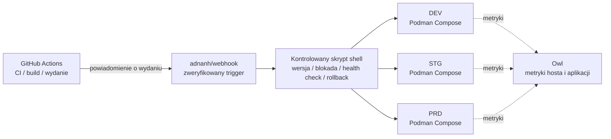

<div align="center">
    

<h1>Yin-Panel</h1>

[](https://github.com/yinorg/Yin-Panel/releases)
[](../../LICENSE)


[English](../../README.md) | [简体中文](../zh-CN/README.md) | [繁體中文](../zh-TW/README.md) | [日本語](../ja-JP/README.md) | [한국어](../ko-KR/README.md) | [Deutsch](../de-DE/README.md) | [Français](../fr-FR/README.md) | [Español](../es-ES/README.md) | [Português (Brasil)](../pt-BR/README.md) | [Русский](../ru-RU/README.md) | [Bahasa Indonesia](../id-ID/README.md) | [Türkçe](../tr-TR/README.md) | **Polski** | [Italiano](../it-IT/README.md) | [Nederlands](../nl-NL/README.md) | [हिन्दी](../hi-IN/README.md) | [ไทย](../th-TH/README.md)

</div>

Yin-Panel to lekki panel nawigacyjny do samodzielnego hostowania, przeznaczony dla przestrzeni osobistych i współdzielonych. Sprawdza się w sieciach domowych, na urządzeniach NAS, serwerach i w małych organizacjach.

## Demo

<picture>
  <source media="(prefers-color-scheme: dark)" srcset="../images/readme-home-dark.jpg">
  
</picture>

| Edytor elementów | Zarządzanie przestrzeniami |
| --- | --- |
|  |  |

### Podgląd interfejsu

| Zaloguj się | Dostęp publiczny |
| --- | --- |
|  |  |

| Centrum tapet | Domyślna tapeta przestrzeni |
| --- | --- |
|  |  |

**Motyw Directory**: każda przestrzeń może używać własnego pakietu motywu, więc przestrzenie w tej samej instalacji mogą wyglądać inaczej.


## Funkcje

- Przestrzenie osobiste i współdzielone z odizolowaną zawartością
- Tworzenie, zmiana nazwy, kopiowanie przestrzeni i przekazywanie uprawnień administratora
- Drzewa grup, zakładki, ikony i sortowanie
- Import i eksport zakładek w formacie HTML przeglądarki
- Członkowie przestrzeni z rolami administratora, redaktora i widza
- Logowanie OAuth 2.0 / OIDC, łączenie kont i autoryzacja grup OIDC
- E-mail jako tożsamość logowania, z niezależnym pseudonimem
- Własne ikony, instalowalne pakiety motywów, 17 języków interfejsu, tapety, tryby WAN/LAN i mobilnego adresu URL oraz okna popup na stronie
- Magazyn SQLite, MySQL, MariaDB lub PostgreSQL, obrazy Docker dla amd64 i arm64 oraz Helm chart dla Kubernetes

## Oficjalne środowiska hostowane

Utrzymujemy trzy środowiska online, na których można od razu się zarejestrować i wszystkiego wypróbować; wszystkie trzy obsługują logowanie przez GitHub / GitLab / Google, a panel monitoringu pokazuje ich metryki i alerty.

| Środowisko | Adres | Przeznaczenie | Dostępność |
| --- | --- | --- | --- |
| Produkcja (PRD) | <https://panel.yiniot.com> | Codzienne użytkowanie | Best effort z celem 99,9% dostępności |
| STG | <https://panel-stg.yiniot.com> | Weryfikacja przed wydaniem | Może zostać zrestartowane lub wycofane w każdej chwili |
| DEV | <https://panel-dev.yiniot.com> | Testowanie i zgłaszanie problemów | Najmniej stabilne; dane mogą zniknąć w każdej chwili |
| Monitoring | <https://owl.yiniot.com> | Metryki i alerty trzech środowisk | — |

Wszystkie trzy środowiska działają na tym samym darmowym serwerze i **nie ma wysokiej dostępności**: PRD celuje w 99,9%, ale bez żadnej rekompensaty, a STG i DEV mogą paść w każdej chwili. Nie trzymaj tam ważnych danych; do długotrwałego użytku postaw własną instalację, jak opisano poniżej.

## Szybki start

### Docker Compose

Wymaga Docker z wtyczką Compose.

```bash
mkdir yin-panel && cd yin-panel
curl -LO https://raw.githubusercontent.com/yinorg/Yin-Panel/master/docker/docker-compose.yml
curl -o conf.yaml https://raw.githubusercontent.com/yinorg/Yin-Panel/master/backend/conf.yaml.example
mkdir -p database uploads
jwt_secret="$(openssl rand -hex 32)"
sed -i "s#^  secret: your_secret_key$#  secret: ${jwt_secret}#" conf.yaml
unset jwt_secret
YIN_PANEL_IMAGE=ghcr.io/yinorg/yin-panel-ce:latest docker compose up -d
```

Otwórz <http://localhost:3002>.

`latest` wskazuje bieżące wydanie i jest najszybszym sposobem na wypróbowanie; **w produkcji przypnij konkretny tag lub digest obrazu** (zob. „Architektura CI/CD”), aby wdrożenie nie dryfowało.

Domyślny administrator: `admin@yiniot.com`, hasło `admin@yiniot.com`. Zmień hasło natychmiast po pierwszym logowaniu i ustaw `base.root_url` oraz unikalny `jwt.secret` w `conf.yaml`.

Każde wdrożenie powinno wygenerować własny losowy `jwt.secret`. Repozytorium dostarcza tylko `conf.yaml.example`; plik `conf.yaml` w katalogu środowiska uruchomieniowego przechowuje sekrety instancji i dane uwierzytelniające OAuth i nie wolno go zatwierdzać w Git.

### Obrazy GHCR

```bash
docker pull ghcr.io/yinorg/yin-panel-ce:latest
docker pull ghcr.io/yinorg/yin-panel-ce:<x.y.z>
```

`latest` wskazuje bieżące wydanie; on i każdy tag wydania to manifesty wieloarchitekturowe dla hostów amd64 i arm64. Tagi wydań nigdy nie zawierają sufiksu architektury; tagi takie jak `-amd64` lub `-arm64` nie są częścią wydania.

## Wydajność i zalecana konfiguracja

Poniższe liczby pochodzą z lokalnych testów wydajności na jednej maszynie (SQLite, pusta baza danych, interfejs loopback, generator obciążenia na tym samym hoście). Traktuj je jako punkt odniesienia przy doborze rozmiaru, a nie jako gwarancję wydajności produkcyjnej. Rzeczywista wydajność zależy głównie od ilości danych na przestrzeń, tempa zapisu i szczytowego współbieżnego obciążenia.

### Zużycie zasobów (zmierzone wartości)

| Metryka | Bezczynność | Obciążenie mieszane 5000 req/s | Granica (dziesiątki tysięcy req/s) |
| --- | --- | --- | --- |
| Pamięć (RSS) | ~16 MB | ~105 MB | Szczyt ~500 MB; spada po ustaniu obciążenia |
| CPU | blisko zera | ~0.3 rdzenia | 2–3 rdzenie |

- Pamięć utrzymuje się na poziomie około **105 MB** aż do mniej więcej **20k req/s** i nie rośnie liniowo wraz z obciążeniem; wartość ~500 MB pojawia się tylko pod syntetycznym ekstremalnym obciążeniem.
- Pojedynczy rdzeń obsługuje około **10k–12k req/s** (mieszany odczyt/zapis, mały zbiór danych).
- Przy obciążeniu mieszanym 5000 req/s: 0 błędów, p95 około **0.25 ms**.

### Zalecana konfiguracja

| Scenariusz | CPU | Pamięć | Pamięć masowa | Baza danych |
| --- | --- | --- | --- | --- |
| Osobisty / domowy / NAS | 1 vCPU | 128–256 MB | SSD, 512 MB+ (plus zapas na przesyłanie ikon) | SQLite |
| Mały zespół / współdzielone przestrzenie | 1–2 vCPU | 256–512 MB | SSD, 1–2 GB | SQLite |
| Organizacja / duża współbieżność | 2–4 vCPU | 1–2 GB | SSD | SQLite (pojedynczy host) lub MySQL (wiele instancji, HA) |

### Odniesienie dotyczące skali użytkowników

Przy założeniu około 0.1 req/s na zalogowanego użytkownika (przeważnie bezczynnego) i z rezerwą na szczyty:

| Konfiguracja | Teoretyczna średnia przepustowość | Współbieżność bezczynna (teoretyczny pułap) | Sugerowana skala (z rezerwą na szczyty) |
| --- | --- | --- | --- |
| 1 vCPU | ~10k req/s | ~100k | 20k–40k |
| 2 vCPU | ~20k req/s | ~200k | 50k–80k |
| 4 vCPU | ~40k req/s | ~400k | 100k+ |

Im aktywniejsi są użytkownicy (edycja, import, częste odświeżanie), tym wyższy współczynnik żądań generowany przez każdego użytkownika i tym niższa możliwa do utrzymania liczba użytkowników.

### Kluczowe czynniki wpływające na wydajność

1. **Ilość danych** — punkty końcowe list zwracają wszystkie wpisy przestrzeni w jednej odpowiedzi; więcej wpisów oznacza droższe żądanie. To element, który najbardziej warto zmierzyć na własnych danych.
2. **Tempo zapisu** — SQLite pozwala na tylko jednego piszącego naraz; przepustowość zapisu jest ograniczona przez fsync dysku (rzędu setek zapisów na sekundę). W przypadku intensywnego zapisu lub konfiguracji z wieloma instancjami użyj MySQL.
3. **Szczyt, nie średnia** — rozmiar dobieraj pod szczyty, zwykle rezerwując 2–5× średniej.
4. **Zasoby statyczne** — pozwól serwerowi odwrotnemu proxy lub CDN serwować `/assets/*` i inne zasoby z hashem oraz buforuj te pliki długoterminowo; pliki wejściowe i `/api/*` powinny zawsze pozostawać świeże.

## Baza danych

Obsługiwane są SQLite (domyślnie), MySQL, MariaDB i PostgreSQL.

- `base.database_drive`: `sqlite` (domyślnie) | `mysql` | `postgres`. **MariaDB używa `mysql`.**
- SQLite: `sqlite.file_path` (zobacz też `read_pool_size`).
- MySQL / MariaDB: `mysql.{host,port,username,password,db_name,wait_timeout}`.
- PostgreSQL: `postgres.{host,port,username,password,db_name,ssl_mode,time_zone,wait_timeout}`.

Funkcje dostępne tylko w SQLite (WAL, pula połączeń tylko do odczytu i kopie zapasowe migracji oparte na migawkach plików) dotyczą wyłącznie SQLite; wykonuj kopie zapasowe MySQL/MariaDB/PostgreSQL za pomocą ich własnych narzędzi.

### Migracja z SQLite do MySQL/MariaDB/PostgreSQL

```bash
# conf.yaml        — istniejąca konfiguracja SQLite
# conf.target.yaml — konfiguracja docelowa wskazująca na mysql lub postgres (docelowa baza danych musi być pusta)
./yin-panel migrate-db -source conf.yaml -target conf.target.yaml
```

Migracja tworzy pełny schemat w bazie docelowej, kopiuje każdy wiersz z zachowaniem kluczy głównych (i resetuje sekwencje tożsamości w PostgreSQL). Można ją uruchamiać wielokrotnie — każde uruchomienie zastępuje zawartość tabel docelowych. Następnie wskaż `database_drive` w `conf.yaml` na bazę docelową.

## Konfiguracja i OAuth/OIDC

`oauth` to jednolite wejście konfiguracyjne dla OAuth 2.0 i OpenID Connect (OIDC). Domyślny szablon zawiera trzy zweryfikowane przykłady: GitHub (OAuth 2.0), GitLab (standardowy OIDC) i Google (OAuth 2.0). Przykłady są domyślnie zakomentowane; dostawca jest włączany dopiero po wpisaniu prawdziwych danych uwierzytelniających i ustawieniu `oauth.enable: true`. Wszystkie klucze konfiguracji opisano w `backend/conf.yaml.example`.

Standardowy dostawca OIDC musi obsługiwać discovery, authorization code + PKCE oraz walidację podpisu JWKS, a także udostępniać `email` i `email_verified` w informacjach o użytkowniku. Dostawcy spełniający te standardy działają zasadniczo, ale różni producenci mogą mimo to wymagać dodatkowej konfiguracji mapowania pól.

Adres URL wywołania zwrotnego OIDC:

```text
<base.root_url>/api/oauth/<provider>/callback
```

Po wywołaniu zwrotnym dostawca musi zwrócić zweryfikowany adres e-mail. System identyfikuje tożsamości zewnętrzne po `provider + sub` i łączy lokalne konta na podstawie adresu e-mail.

## Przestrzenie i uprawnienia

Uprawnienia do przestrzeni są powiązane z wewnętrznym `UserID`, a nigdy z tekstem adresu e-mail. Zmiana adresu e-mail zachowuje zatem istniejące uprawnienia do przestrzeni, a lista członków pokazuje najnowszy adres e-mail.

- Administrator: zarządza przestrzenią, członkami, rolami i regułami OIDC
- Redaktor: utrzymuje grupy i zakładki
- Widz: dostęp tylko do odczytu

Tworzenie przestrzeni, zmiana jej nazwy, dodawanie grup, dodawanie członków i dodawanie reguł OIDC odbywa się w oknach dialogowych.

## Helm

```bash
helm upgrade --install yin-panel ./distribution/helm-chart/yin-panel \
  --set image.tag=latest
```

W produkcji zmień `image.tag` na konkretną wersję.

Przed wdrożeniem przejrzyj wygenerowane manifesty za pomocą `helm template yin-panel ./distribution/helm-chart/yin-panel`.

## Rozwój ze źródeł

Wymagania: Go `1.27.1`, Node.js `24.21.0`, npm lub pnpm `9.15.5`.

```bash
cd frontend
npm ci
npm run build-only
```

Lub z przypiętym pnpm:

```bash
cd frontend
corepack pnpm install --frozen-lockfile
pnpm run build-only
```

```bash
cd backend
go test ./...
go build ./...
```

Pełna lokalna aktualizacja (budowa frontendu, testy i budowa backendu, wdrożenie, restart) jednym poleceniem:

```bash
./scripts/deploy-local.sh
```

Skrypt domyślnie używa katalogu `backend/` z repozytorium jako katalogu środowiska uruchomieniowego i wymaga tam lokalnego pliku `conf.yaml`; `YIN_PANEL_RUNTIME_DIR` w `.env.local` może go nadpisać. Po pomyślnym zakończeniu wszystkich budów i testów zatrzymuje tylko proces nasłuchujący Yin-Panel, używa `sudo` do zastąpienia starego pliku binarnego i plików statycznych i nigdy nie dotyka bazy danych, przesłanych plików ani plików konfiguracji.

System motywów strony głównej opisano w [`frontend/THEME_SYSTEM.md`](../../frontend/THEME_SYSTEM.md); utwórz szkielet nowego motywu za pomocą `npm run create:theme -- init "<name>"`. Pełne konwencje rozwoju z udziałem AI, wydań i restartu znajdują się w [AGENTS.md](../../AGENTS.md).

## Kopia zapasowa i aktualizacja

Przed aktualizacją wykonaj kopię zapasową bazy danych, katalogu `uploads/`, pliku `conf.yaml` i wartości Helm. Migracje zachowują użytkowników, przestrzenie, grupy, zakładki i odwołania do plików. Jeśli aktualizacja się nie powiedzie, przywróć kopię zapasową sprzed aktualizacji; nie usuwaj bazy danych i nie zaczynaj od nowa.

Kroki aktualizacji instalacji Compose:

```bash
docker compose pull
docker compose up -d
```

`docker/docker-compose.yml` domyślnie używa `latest`, a `pull_policy: missing` pobiera obraz tylko wtedy, gdy nie ma go lokalnie, więc przy aktualizacji trzeba jawnie uruchomić `docker compose pull`. W produkcji przypnij `YIN_PANEL_IMAGE` do konkretnej wersji i zmieniaj ją przy aktualizacji.

## Architektura CI/CD

Oficjalne środowiska uruchamiają DEV, STG i PRD na jednym VPS 1C1G. Celem nie jest stos komponentów, ale **mało procesów rezydentnych, niski narzut, audytowalne wydania i błędy, z których można wrócić**.



| Warstwa | Komponent | Odpowiedzialność |
| --- | --- | --- |
| CI | GitHub Actions | Testy, budowa obrazu, nadanie wersji, uruchomienie wydania |
| Wejście wydania | adnanh/webhook | Weryfikacja źródła i żądania; uruchamianie tylko ustalonych zadań wydania |
| Wykonanie wydania | Skrypt shell | Sprawdzenie wersji, wybór środowiska, blokada, wdrożenie, health check i rollback |
| Środowisko uruchomieniowe | Podman Compose | Uruchomienie trzech odizolowanych instancji (Podman oszczędza około 150 MB RSS wobec Dockera) |
| Monitoring | Owl | Metryki hosta i aplikacji |

**Dlaczego taki podział**: całe CI działa w GitHub Actions, a VPS tylko pobiera zbudowany obraz i go wdraża — mała maszyna nigdy nie dźwiga szczytu kompilacji i nie utrzymuje płaszczyzny kontrolnej CI/CD. Trzy środowiska dzielą jeden łańcuch wydawniczy, ale mają osobne projekty Compose, konfigurację, wolumeny, sieci i porty; wspólny mechanizm wydania to nie wspólne dane.

### Przebieg wydania

1. **Budowa**: Actions uruchamia testy i buduje obraz; wersję ustala tag Git, SHA commita lub digest obrazu, a produkcja nigdy nie wdraża `latest`.
2. **Wyzwolenie i walidacja**: Actions wysyła zweryfikowane żądanie wydania do webhooka; skrypt sprawdza wersję, środowisko docelowe i dozwoloną akcję i nigdy nie wstawia dowolnych danych do polecenia powłoki.
3. **Blokada i wdrożenie**: jedno wdrożenie na środowisko naraz i aktualizowane jest tylko środowisko docelowe — nic nie jest restartowane na ślepo.
4. **Health check i obsługa błędu**: sprawdzane jest, czy usługa startuje i odpowiada; przy błędzie ostatnia dobra wersja zostaje zachowana i następuje rollback, a środowisko, wersja, źródło wyzwolenia, wynik i powód rollbacku trafiają do zapisu.

Promocja: DEV wdraża automatycznie → po weryfikacji STG wdraża tę samą wersję → po testach dymnych **PRD wymaga zatwierdzenia przez człowieka**. Pilne poprawki też przechodzą ścieżką wyjątku z audytem, więc zwykłe zdarzenie deweloperskie nigdy nie omija zatwierdzenia produkcji.

### Granice

To architektura wdrożeniowa **jednomaszowa, oszczędna i audytowalna**, a nie wysokiej dostępności: trzy środowiska są rozdzielone procesem, konfiguracją i danymi, ale dzielą jądro, dysk, sieć i pamięć jednego VPS-a, więc awaria hosta lub brak zasobów dotknie wszystkie trzy naraz. Jej wartość polega na zachowaniu mechanizmów potrzebnych do niezawodnego wydania — przypiętych wersji, izolacji środowisk, health checków, rollbacku, monitoringu i śladu audytowego — przy bardzo małej liczbie procesów rezydentnych.

## Open Core

Wersja Core Yin-Panel jest bezpłatna i będzie nadal rozwijana oraz aktualizowana. To repozytorium jest jedynym publicznym źródłem wersji Core i publikuje obraz `yin-panel-ce`. Wersja Enterprise znajduje się w prywatnym repozytorium [yinorg/Yin-Panel-EE](https://github.com/yinorg/Yin-Panel-EE) i łączy się przez publiczne interfejsy.

Działająca instancja udostępnia swoją edycję, możliwości, stan tylko do odczytu i wersję pod `GET /api/system/capabilities`. Problemy i sugestie zgłaszaj w [GitHub Issues](https://github.com/yinorg/Yin-Panel/issues).

Wkłady scalone z tym repozytorium pozostają w Core: nie są przenoszone do wersji Enterprise ani ponownie licencjonowane. Zobacz [Core i Enterprise](../../GOVERNANCE.md).

## Podziękowania

Yin-Panel powstał na bazie projektu open source [hslr-s/sun-panel](https://github.com/hslr-s/sun-panel); podziękowania dla pierwotnego autora za stworzenie fundamentu.

Podziękowania również dla [PhantomMaa/sun-panel](https://github.com/PhantomMaa/sun-panel) za optymalizacje i prace konserwacyjne. Yin-Panel przejął od tej podstawy dalsze utrzymanie i stale dodaje funkcje, ulepszenia interakcji oraz zmiany ukierunkowane na samodzielne hostowanie.

Dziękujemy wszystkim pierwotnym autorom, współtwórcom i użytkownikom.

## Współpraca

Projekt trwa, bo ludzie znajdują czas, by zgłaszać problemy i dzielić się pomysłami. Każda forma udziału jest mile widziana:

- **Sugestie i błędy**: otwórz [issue](https://github.com/yinorg/Yin-Panel/issues) z wersją, środowiskiem, krokami reprodukcji i tym, co zobaczyłeś — zrzut ekranu lub log znacznie przyspieszają sprawę.
- **Kod i dokumentacja**: pull requesty są mile widziane. Naprawa błędu, poprawa zdania, dodanie języka czy wymiana zrzutu ekranu to równie wartościowy wkład.
- **Jeszcze nie wiesz**: najpierw otwórz issue i ustal podejście, zanim napiszesz kod, żeby praca nie poszła w kierunku, którego nikt nie potrzebuje.

Zajrzyj przed startem do [CONTRIBUTING.md](../../CONTRIBUTING.md): większe zmiany warto najpierw omówić, a problemy bezpieczeństwa zgłaszaj prywatnie, nie w publicznym issue. Jeśli coś jest niejasne, zapytaj w issue, a postaram się wskazać kierunek.

Czytam zarówno issues, jak i pull requesty, i staram się odpowiadać w ciągu 7 dni; powtarzalne problemy i dobrze opisane sugestie idą najszybciej. Każda opinia jest powodem, dla którego projekt działa dalej.

## Licencja

Yin-Panel jest objęty licencją [Business Source License 1.1](../../LICENSE). Forkowanie, modyfikowanie i samodzielny hosting są bezpłatne, obejmują użytkowanie wewnętrzne w organizacji oraz obsługę własnych klientów; oferowanie samego Yin-Panel jako usługi hostowanej osobom trzecim wymaga licencji komercyjnej. Każda wersja staje się dostępna na licencji AGPL-3.0-or-later trzy lata po jej pierwszej publicznej dystrybucji. Zobacz [Core i Enterprise](../../GOVERNANCE.md).

Informacje o stronach trzecich znajdują się w [THIRD-PARTY-NOTICES.md](../../THIRD-PARTY-NOTICES.md); wkłady są przyjmowane na podstawie [Contributor License Agreement](../../CLA.md).
