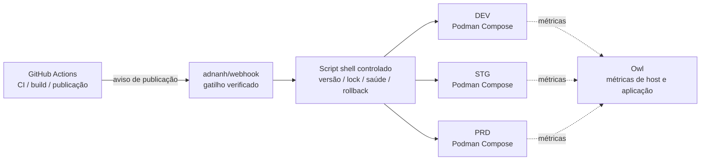

<div align="center">
    

<h1>Yin-Panel</h1>

[](https://github.com/yinorg/Yin-Panel/releases)
[](../../LICENSE)


[English](../../README.md) | [简体中文](../zh-CN/README.md) | [繁體中文](../zh-TW/README.md) | [日本語](../ja-JP/README.md) | [한국어](../ko-KR/README.md) | [Deutsch](../de-DE/README.md) | [Français](../fr-FR/README.md) | [Español](../es-ES/README.md) | **Português (Brasil)** | [Русский](../ru-RU/README.md) | [Bahasa Indonesia](../id-ID/README.md) | [Türkçe](../tr-TR/README.md) | [Polski](../pl-PL/README.md) | [Italiano](../it-IT/README.md) | [Nederlands](../nl-NL/README.md) | [हिन्दी](../hi-IN/README.md) | [ไทย](../th-TH/README.md)

</div>

O Yin-Panel é um painel de navegação leve e auto-hospedável para espaços pessoais e compartilhados. Ele atende redes domésticas, NAS, servidores e pequenas organizações.

## Demonstração

<picture>
  <source media="(prefers-color-scheme: dark)" srcset="../images/readme-home-dark.jpg">
  
</picture>

| Editor de itens | Gerenciamento de espaços |
| --- | --- |
|  |  |

### Prévia da interface

| Entrar | Acesso público |
| --- | --- |
|  |  |

| Central de papéis de parede | Papel de parede padrão do espaço |
| --- | --- |
|  |  |

**Tema Directory**: cada espaço pode usar o próprio pacote de tema, então espaços da mesma instância podem ter layouts diferentes.


## Funcionalidades

- Espaços pessoais e compartilhados com conteúdo isolado entre si
- Criação, renomeação, cópia e transferência de administração de espaços
- Árvores de grupos, favoritos, ícones e ordenação
- Importação e exportação de favoritos no formato HTML do navegador
- Membros do espaço com papéis de administrador, editor e visualizador
- Login OAuth 2.0 / OIDC, vinculação de contas e autorização por grupos OIDC
- E-mail como conta de login, apelido mantido separadamente
- Ícones personalizados, temas instaláveis, 17 idiomas de interface, papéis de parede, modos de URL WAN/LAN e móvel, janelas pop-up dentro da página
- Armazenamento SQLite, MySQL, MariaDB ou PostgreSQL, imagens Docker para amd64 e arm64 e chart Helm para Kubernetes

## Ambientes hospedados oficiais

Mantemos três ambientes online nos quais você pode se registrar e testar tudo na hora; os três aceitam login com GitHub / GitLab / Google, e um painel de monitoramento mostra as métricas e os alertas deles.

Sem entrar, você pode dar uma olhada pelo link público <https://panel.yiniot.com/my-demo> (também dá para definir como página inicial do navegador).

Você também pode instalar a extensão complementar [Yin-Panel Helper](https://github.com/yinorg/yin-panel-extension) (agora na [Chrome Web Store](https://chromewebstore.google.com/detail/yin-panel-helper/hlfhnjccidngjjkidlgejefcchoegofo)). Ela faz exatamente duas coisas: levar a nova aba ao seu painel e ajudar a obter os ícones dos sites.

| Ambiente | Endereço | Uso | Disponibilidade |
| --- | --- | --- | --- |
| Produção (PRD) | <https://panel.yiniot.com> | Uso diário | Best effort com meta de 99,9% de disponibilidade |
| STG | <https://panel-stg.yiniot.com> | Verificação antes da publicação | Pode reiniciar ou ser revertido a qualquer momento |
| DEV | <https://panel-dev.yiniot.com> | Testar e reportar problemas | O menos estável; os dados podem ser apagados a qualquer momento |
| Monitoramento | <https://owl.yiniot.com> | Métricas e alertas dos três ambientes | — |

Os três ambientes rodam no mesmo servidor gratuito e **não há alta disponibilidade**: o PRD mira 99,9% mas sem qualquer compensação, enquanto STG e DEV podem cair a qualquer momento. Não guarde dados importantes neles; para uso prolongado, hospede você mesmo como descrito abaixo.

## Início rápido

### Docker Compose

Requer Docker com o plugin Compose.

```bash
mkdir yin-panel && cd yin-panel
curl -LO https://raw.githubusercontent.com/yinorg/Yin-Panel/master/docker/docker-compose.yml
curl -o conf.yaml https://raw.githubusercontent.com/yinorg/Yin-Panel/master/backend/conf.yaml.example
mkdir -p database uploads
jwt_secret="$(openssl rand -hex 32)"
sed -i "s#^  secret: your_secret_key$#  secret: ${jwt_secret}#" conf.yaml
unset jwt_secret
YIN_PANEL_IMAGE=ghcr.io/yinorg/yin-panel-ce:latest docker compose up -d
```

Abra <http://localhost:3002>.

`latest` aponta para a versão atual e é o jeito mais rápido de experimentar; **em produção fixe uma tag ou um digest de imagem** (veja «Arquitetura de CI/CD») para que o deploy não derive.

Administrador padrão: `admin@yiniot.com`, senha `admin@yiniot.com`. Altere a senha imediatamente após o primeiro login e defina `base.root_url` e um `jwt.secret` exclusivo no `conf.yaml`.

Cada implantação deve gerar seu próprio `jwt.secret` aleatório. O repositório fornece apenas o `conf.yaml.example`; o `conf.yaml` no diretório de execução contém segredos da instância e credenciais OAuth e não deve ser enviado ao Git.

### Imagens GHCR

```bash
docker pull ghcr.io/yinorg/yin-panel-ce:latest
docker pull ghcr.io/yinorg/yin-panel-ce:<x.y.z>
```

`latest` aponta para a versão atual; ela e cada tag de versão são manifestos multiarquitetura para hosts amd64 e arm64. As tags de versão nunca têm sufixo de arquitetura; tags como `-amd64` ou `-arm64` não fazem parte de uma versão publicada.

## Desempenho e configuração recomendada

Os números abaixo vêm de benchmarks locais em uma única máquina (SQLite, banco vazio, loopback, teste de carga no mesmo host). São referência de dimensionamento, não promessa de capacidade em produção. A capacidade real depende principalmente do volume de dados por espaço, da taxa de escrita e da concorrência de pico.

### Uso de recursos (ordens de magnitude medidas)

| Métrica | Ocioso | Carga mista de 5000 req/s | Limite (dezenas de milhares de req/s) |
| --- | --- | --- | --- |
| Memória (RSS) | ~16 MB | ~105 MB | Pico de ~500 MB; cai após o fim da carga |
| CPU | quase 0 | ~0,3 núcleo | 2–3 núcleos |

- A memória fica em torno de **105 MB** até cerca de **20 mil req/s** e não cresce linearmente com a carga; o valor de ~500 MB só aparece sob pressão sintética extrema.
- Um único núcleo suporta cerca de **10 mil–12 mil req/s** (leitura/escrita mista, conjunto de dados pequeno).
- Sob carga mista de 5000 req/s: 0 falhas, p95 de cerca de **0,25 ms**.

### Configuração recomendada

| Cenário | CPU | Memória | Armazenamento | Banco de dados |
| --- | --- | --- | --- | --- |
| Pessoal / casa / NAS | 1 vCPU | 128–256 MB | SSD, 512 MB+ (mais margem para ícones enviados) | SQLite |
| Equipe pequena / espaços compartilhados | 1–2 vCPU | 256–512 MB | SSD, 1–2 GB | SQLite |
| Organização / alta concorrência | 2–4 vCPU | 1–2 GB | SSD | SQLite (máquina única) ou MySQL (várias instâncias, HA) |

### Referência de escala de usuários

Supondo cerca de 0,1 req/s por usuário online (a maioria ocioso) e reservando margem para picos:

| Configuração | Throughput médio teórico | Concorrência ociosa (teto teórico) | Escala sugerida (com margem de pico) |
| --- | --- | --- | --- |
| 1 vCPU | ~10k req/s | ~100k | 20k–40k |
| 2 vCPU | ~20k req/s | ~200k | 50k–80k |
| 4 vCPU | ~40k req/s | ~400k | 100k+ |

Quanto mais ativos os usuários (edição, importação, atualizações frequentes), maior a taxa de requisições por usuário e menor o número sustentável de usuários.

### Principais fatores que afetam a capacidade

1. **Volume de dados**: os endpoints de listagem retornam todas as entradas de um espaço em uma única resposta; mais entradas significam requisições mais caras. É a parte que mais vale a pena medir com os seus próprios dados.
2. **Taxa de escrita**: o SQLite permite apenas um escritor por vez; o throughput de escrita é limitado pelo fsync do disco (na ordem de centenas de gravações por segundo). Para cargas intensas de escrita ou várias instâncias, use MySQL.
3. **Pico, não média**: dimensione para os picos, reservando normalmente 2–5× a média.
4. **Arquivos estáticos**: sirva `/assets/*` e outros recursos com hash por um proxy reverso ou CDN e mantenha esses arquivos com hash em cache de longo prazo; os arquivos de entrada e `/api/*` devem ficar sempre atualizados.

## Banco de dados

SQLite (padrão), MySQL, MariaDB e PostgreSQL são suportados.

- `base.database_drive`: `sqlite` (padrão) | `mysql` | `postgres`. **MariaDB usa `mysql`.**
- SQLite: `sqlite.file_path` (veja também `read_pool_size`).
- MySQL / MariaDB: `mysql.{host,port,username,password,db_name,wait_timeout}`.
- PostgreSQL: `postgres.{host,port,username,password,db_name,ssl_mode,time_zone,wait_timeout}`.

Os recursos exclusivos do SQLite (WAL, pool de conexões somente leitura e backups de migração por snapshot de arquivo) se aplicam apenas ao SQLite; faça backup de MySQL/MariaDB/PostgreSQL com as próprias ferramentas.

### Migração de SQLite para MySQL/MariaDB/PostgreSQL

```bash
# conf.yaml        — configuração existente do SQLite
# conf.target.yaml — configuração de destino apontando para mysql ou postgres (o banco de dados de destino deve estar vazio)
./yin-panel migrate-db -source conf.yaml -target conf.target.yaml
```

A migração cria o esquema completo no destino, copia todas as linhas **preservando as chaves primárias** (e redefine as sequências de identidade no PostgreSQL). Pode ser executada repetidamente — cada execução substitui o conteúdo das tabelas de destino. Depois, aponte `database_drive` no `conf.yaml` para o destino.

## Configuração e OAuth/OIDC

`oauth` é o ponto de entrada de configuração unificado para OAuth 2.0 e OpenID Connect (OIDC). O modelo padrão inclui três exemplos verificados: GitHub (OAuth 2.0), GitLab (OIDC padrão) e Google (OAuth 2.0). Todos os exemplos vêm comentados por padrão; um provedor só é ativado depois de preencher credenciais reais e definir `oauth.enable: true`. Todas as chaves de configuração estão documentadas em `backend/conf.yaml.example`.

Um provedor OIDC padrão precisa oferecer suporte a discovery, authorization code + PKCE e validação de assinatura JWKS, além de fornecer `email` e `email_verified` nas informações do usuário. Provedores que atendem a esses padrões funcionam em princípio, mas alguns serviços ainda podem exigir configuração extra de mapeamento de campos.

URL de callback do OIDC:

```text
<base.root_url>/api/oauth/<provider>/callback
```

Após o callback, o provedor deve retornar um e-mail verificado. O sistema identifica identidades externas por `provider + sub` e vincula contas locais por e-mail.

## Espaços e permissões

As permissões de espaço são vinculadas ao `UserID` interno, nunca ao texto do e-mail. Por isso, alterar o e-mail mantém as permissões de espaço existentes, e a lista de membros mostra o e-mail mais recente.

- Administrador: gerencia o espaço, membros, papéis e regras OIDC
- Editor: mantém grupos e favoritos
- Visualizador: acesso somente leitura

Criar um espaço, renomear, adicionar grupos, membros e regras OIDC acontecem em caixas de diálogo.

## Helm

```bash
helm upgrade --install yin-panel ./distribution/helm-chart/yin-panel \
  --set image.tag=latest
```

Em produção, troque `image.tag` por uma versão concreta.

Antes de implantar, visualize os manifestos renderizados com `helm template yin-panel ./distribution/helm-chart/yin-panel`.

## Desenvolvimento a partir do código-fonte

Requisitos: Go `1.27.1`, Node.js `24.21.0`, npm ou pnpm `9.15.5`.

```bash
cd frontend
npm ci
npm run build-only
```

Ou com o pnpm fixado:

```bash
cd frontend
corepack pnpm install --frozen-lockfile
pnpm run build-only
```

```bash
cd backend
go test ./...
go build ./...
```

Atualização local completa (build do frontend, testes e build do backend, implantação, reinício) em um único comando:

```bash
./scripts/deploy-local.sh
```

O script usa `backend/` do repositório como diretório de execução por padrão e exige um `conf.yaml` local nele; `YIN_PANEL_RUNTIME_DIR` em `.env.local` pode substituí-lo. Depois que todos os builds e testes passam, ele para apenas o listener do Yin-Panel, substitui o binário antigo e os arquivos estáticos com `sudo`, e nunca toca no banco de dados, nos uploads ou nos arquivos de configuração.

O sistema de temas da página inicial está documentado em [`frontend/THEME_SYSTEM.md`](../../frontend/THEME_SYSTEM.md); crie um tema novo com `npm run create:theme -- init "<nome>"`. As convenções completas de desenvolvimento com IA, publicação e reinício estão em [AGENTS.md](../../AGENTS.md).

Os testes de aceitação no navegador ficam em um repositório separado, [yinorg/yin-panel-e2e](https://github.com/yinorg/yin-panel-e2e): o Playwright conduz navegadores reais por jornadas completas (login e contas, espaços e permissões, importação e exportação de favoritos, o sistema de temas, o comportamento offline do PWA e a substituição da nova aba pela extensão), com um conjunto k6 para medir carga e capacidade. É preciso ter uma instância do Yin-Panel em execução, o `.env.local` do repositório Core e o código não empacotado da extensão; o local do checkout é definido por `YIN_PANEL_E2E_DIR`.

## Backup e atualização

Antes de atualizar, faça backup do banco de dados, de `uploads/`, do `conf.yaml` e dos values do Helm. As migrações preservam usuários, espaços, grupos, favoritos e referências de arquivos. Se algo der errado, restaure o backup anterior à atualização; não exclua o banco de dados para recriá-lo.

Passos de atualização em uma instalação Compose:

```bash
docker compose pull
docker compose up -d
```

O `docker/docker-compose.yml` usa `latest` por padrão, e `pull_policy: missing` só baixa quando a imagem não existe localmente, então na atualização é preciso rodar `docker compose pull` explicitamente. Em produção, fixe `YIN_PANEL_IMAGE` em uma versão concreta e troque ao atualizar.

## Arquitetura de CI/CD

Os ambientes oficiais rodam DEV, STG e PRD em um único VPS 1C1G. O objetivo não é empilhar componentes, mas **poucos processos residentes, pouco overhead, publicações auditáveis e falhas das quais dá para voltar**.



| Camada | Componente | Responsabilidade |
| --- | --- | --- |
| CI | GitHub Actions | Testar, construir a imagem, marcar a versão e disparar a publicação |
| Entrada da publicação | adnanh/webhook | Verificar a origem e a requisição; executar apenas tarefas de publicação fixas |
| Execução da publicação | Script shell | Checagem de versão, escolha do ambiente, lock, deploy, health check e rollback |
| Execução | Podman Compose | Rodar as três instâncias isoladas (o Podman economiza cerca de 150 MB de RSS em relação ao Docker) |
| Monitoramento | Owl | Métricas de host e aplicação |

**Por que dividir assim**: toda a CI roda no GitHub Actions e o VPS apenas baixa a imagem já construída e a coloca no ar; a máquina pequena nunca carrega o pico de compilação nem mantém um control plane de CI/CD. Os três ambientes compartilham uma única cadeia de publicação, mas mantêm projetos Compose, configuração, volumes, redes e portas separados; compartilhar o mecanismo de publicação não é compartilhar dados.

### Fluxo de publicação

1. **Build**: o Actions roda os testes e constrói a imagem; a versão fica fixada por tag Git, SHA do commit ou digest da imagem, e a produção nunca implanta `latest`.
2. **Disparo e validação**: o Actions envia uma requisição de publicação verificada ao webhook; o script confere versão, ambiente de destino e ação permitida, e nunca concatena entrada arbitrária em um comando shell.
3. **Lock e deploy**: um deploy por ambiente de cada vez, e só o ambiente de destino é atualizado — nada é reiniciado às cegas.
4. **Health check e falhas**: confirma-se que o serviço sobe e responde; se falhar, a última versão boa é mantida e há rollback, registrando ambiente, versão, origem do disparo, resultado e motivo do rollback.

Promoção: o DEV implanta automaticamente → após a verificação o STG implanta a mesma versão → depois dos smoke tests **o PRD exige aprovação humana**. Correções emergenciais também passam por um caminho de exceção auditável, então um evento comum de desenvolvimento nunca pula a aprovação de produção.

### Limites

É uma arquitetura de deploy **de máquina única, econômica e auditável**, não de alta disponibilidade: os três ambientes são isolados em processo, configuração e dados, mas compartilham kernel, disco, rede e memória do mesmo VPS, então uma falha do host ou o esgotamento de recursos atinge os três ao mesmo tempo. O valor está em manter os mecanismos de uma publicação confiável — versões fixadas, ambientes isolados, health checks, rollback, monitoramento e trilha de auditoria — com pouquíssimos processos residentes.

## Open Core

A edição Core do Yin-Panel é gratuita e continua recebendo manutenção e atualizações. Este repositório é a única fonte pública do Core e publica a imagem `yin-panel-ce`. A edição Enterprise fica no repositório privado [yinorg/Yin-Panel-EE](https://github.com/yinorg/Yin-Panel-EE) e se conecta por interfaces públicas.

Uma instância em execução expõe edição, capacidades, estado somente leitura e versão em `GET /api/system/capabilities`. Relate problemas e sugestões nas [GitHub Issues](https://github.com/yinorg/Yin-Panel/issues).

As contribuições mescladas neste repositório permanecem no Core: não são movidas para a edição Enterprise nem relicenciadas. Veja [Core e Enterprise](../../GOVERNANCE.md).

## Créditos

O Yin-Panel nasceu do projeto de código aberto [hslr-s/sun-panel](https://github.com/hslr-s/sun-panel); agradecemos ao autor original por construir a base.

Agradecemos também a [PhantomMaa/sun-panel](https://github.com/PhantomMaa/sun-panel) pelas otimizações e pelo trabalho de manutenção. O Yin-Panel assumiu a manutenção continuada a partir dessa base e segue adicionando recursos, melhorias de interação e mudanças voltadas à auto-hospedagem.

Agradecemos a todos os autores originais, contribuidores e usuários.

## Contribuir

O projeto continua porque as pessoas dedicam tempo a relatar problemas e compartilhar ideias. Toda forma de participação é bem-vinda:

- **Sugestões e bugs**: abra uma [issue](https://github.com/yinorg/Yin-Panel/issues) com a versão, o ambiente, os passos para reproduzir e o que você viu — uma captura de tela ou um log acelera bastante o atendimento.
- **Código e documentação**: pull requests são bem-vindos. Corrigir um bug, reescrever uma frase, adicionar um idioma ou trocar uma captura de tela também conta.
- **Ainda em dúvida**: abra uma issue primeiro e combine a abordagem antes de escrever código, para o trabalho não seguir uma direção que ninguém quer.

Dê uma olhada no [CONTRIBUTING.md](../../CONTRIBUTING.md) antes de começar: mudanças maiores vale a pena discutir antes, e problemas de segurança devem ser reportados em privado, não em uma issue pública. Se algo não estiver claro, pergunte em uma issue e vou tentar apontar o caminho.

Issues e pull requests são lidos, e procuro responder em até 7 dias; problemas reproduzíveis e sugestões bem descritas andam mais rápido. Cada retorno é um motivo para o projeto continuar.

## Licença

O Yin-Panel é licenciado sob a [Business Source License 1.1](../../LICENSE). Fork, modificação e auto-hospedagem são gratuitos, incluindo uso interno na sua organização e atendimento aos seus próprios clientes; oferecer o Yin-Panel em si como serviço hospedado a terceiros exige uma licença comercial. Cada versão passa a estar disponível sob a licença AGPL-3.0-or-later três anos após sua própria primeira distribuição pública. Veja [Core e Enterprise](../../GOVERNANCE.md).

Os avisos de terceiros estão listados em [THIRD-PARTY-NOTICES.md](../../THIRD-PARTY-NOTICES.md), e as contribuições são aceitas sob o [Contributor License Agreement](../../CLA.md).
