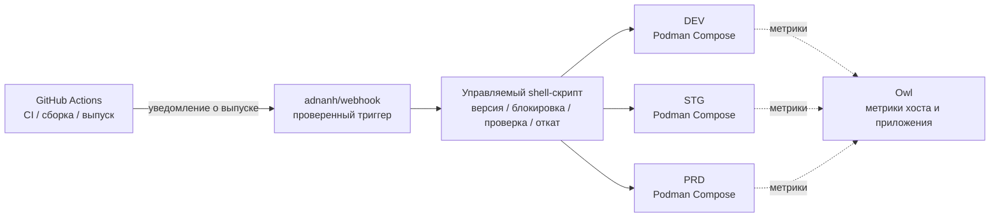

<div align="center">
    

<h1>Yin-Panel</h1>

[](https://github.com/yinorg/Yin-Panel/releases)
[](../../LICENSE)


[English](../../README.md) | [简体中文](../zh-CN/README.md) | [繁體中文](../zh-TW/README.md) | [日本語](../ja-JP/README.md) | [한국어](../ko-KR/README.md) | [Deutsch](../de-DE/README.md) | [Français](../fr-FR/README.md) | [Español](../es-ES/README.md) | [Português (Brasil)](../pt-BR/README.md) | **Русский** | [Bahasa Indonesia](../id-ID/README.md) | [Türkçe](../tr-TR/README.md) | [Polski](../pl-PL/README.md) | [Italiano](../it-IT/README.md) | [Nederlands](../nl-NL/README.md) | [हिन्दी](../hi-IN/README.md) | [ไทย](../th-TH/README.md)

</div>

Yin-Panel — это лёгкая панель навигации для самостоятельного размещения, предназначенная для личных и общих пространств. Она подходит для домашних сетей, NAS, серверов и небольших организаций.

## Демо

<picture>
  <source media="(prefers-color-scheme: dark)" srcset="../images/readme-home-dark.jpg">
  
</picture>

| Редактор элементов | Управление пространствами |
| --- | --- |
|  |  |

### Обзор интерфейса

| Войти | Публичный доступ |
| --- | --- |
|  |  |

| Центр обоев | Обои пространства по умолчанию |
| --- | --- |
|  |  |

**Тема Directory**: у каждого пространства может быть свой пакет темы, поэтому в одной установке пространства могут выглядеть по-разному.


## Возможности

- Личные и общие пространства с изолированным содержимым
- Создание, переименование, копирование пространств и передача администрирования
- Деревья групп, закладки, значки и сортировка
- Импорт и экспорт закладок в HTML-формате браузера
- Участники пространства с ролями администратор, редактор и наблюдатель
- Вход через OAuth 2.0 / OIDC, связывание аккаунтов и авторизация по группам OIDC
- Электронная почта как учётная запись для входа, никнейм хранится отдельно
- Настраиваемые значки, устанавливаемые темы, 17 языков интерфейса, обои, режимы WAN/LAN и мобильного URL, всплывающие окна на странице
- Хранение в SQLite, MySQL, MariaDB или PostgreSQL, Docker-образы для amd64 и arm64 и Helm-чарт для Kubernetes

## Официальные размещённые окружения

Мы поддерживаем три онлайн-окружения, где можно сразу зарегистрироваться и всё попробовать; во всех трёх есть вход через GitHub / GitLab / Google, а панель мониторинга показывает их метрики и оповещения.

Без входа можно посмотреть публичную ссылку <https://panel.yiniot.com/my-demo> (её же можно поставить домашней страницей браузера).

Можно также установить парное расширение [Yin-Panel Helper](https://github.com/yinorg/yin-panel-extension) (уже в [Chrome Web Store](https://chromewebstore.google.com/detail/yin-panel-helper/hlfhnjccidngjjkidlgejefcchoegofo)). Оно делает ровно две вещи: отправляет новую вкладку на вашу панель и помогает получать значки сайтов.

| Окружение | Адрес | Назначение | Доступность |
| --- | --- | --- | --- |
| Продакшен (PRD) | <https://panel.yiniot.com> | Повседневное использование | Best effort с целью 99,9% доступности |
| STG | <https://panel-stg.yiniot.com> | Проверка перед выпуском | Может быть перезапущено или откачено в любой момент |
| DEV | <https://panel-dev.yiniot.com> | Пробы и сообщения об ошибках | Наименее стабильно; данные могут исчезнуть в любой момент |
| Мониторинг | <https://owl.yiniot.com> | Метрики и оповещения трёх окружений | — |

Все три окружения работают на одном бесплатном сервере, и **высокой доступности здесь нет**: PRD целится в 99,9%, но без компенсаций, а STG и DEV могут упасть в любой момент. Не храните там важные данные; для долгой работы разверните своё, как описано ниже.

## Быстрый старт

### Docker Compose

Требуется Docker с плагином Compose.

```bash
mkdir yin-panel && cd yin-panel
curl -LO https://raw.githubusercontent.com/yinorg/Yin-Panel/master/docker/docker-compose.yml
curl -o conf.yaml https://raw.githubusercontent.com/yinorg/Yin-Panel/master/backend/conf.yaml.example
mkdir -p database uploads
jwt_secret="$(openssl rand -hex 32)"
sed -i "s#^  secret: your_secret_key$#  secret: ${jwt_secret}#" conf.yaml
unset jwt_secret
YIN_PANEL_IMAGE=ghcr.io/yinorg/yin-panel-ce:latest docker compose up -d
```

Откройте <http://localhost:3002>.

`latest` указывает на текущий выпуск, и это самый быстрый способ попробовать; **в продакшене зафиксируйте конкретный тег или digest образа** (см. «Архитектура CI/CD»), чтобы развёртывание не уплывало.

Администратор по умолчанию: `admin@yiniot.com`, пароль `admin@yiniot.com`. Сразу после первого входа смените пароль и задайте `base.root_url` и уникальный `jwt.secret` в `conf.yaml`.

Каждое развёртывание должно генерировать свой случайный `jwt.secret`. В репозитории есть только `conf.yaml.example`; файл `conf.yaml` в рабочем каталоге содержит секреты экземпляра и учётные данные OAuth — не добавляйте его в Git.

### Образы GHCR

```bash
docker pull ghcr.io/yinorg/yin-panel-ce:latest
docker pull ghcr.io/yinorg/yin-panel-ce:<x.y.z>
```

`latest` указывает на текущий выпуск; он и каждый тег выпуска — многоархитектурные манифесты для узлов amd64 и arm64. Теги релизов не содержат суффикса архитектуры; теги вроде `-amd64` или `-arm64` не являются частью релиза.

## Производительность и рекомендуемая конфигурация

Приведённые ниже данные получены в локальных тестах на одной машине (SQLite, пустая база, loopback, нагрузочный тест на том же узле). Это ориентир для подбора ресурсов, а не гарантия продакшн-ёмкости. Реальная ёмкость зависит главным образом от объёма данных в каждом пространстве, интенсивности записи и пиковой конкурентности.

### Использование ресурсов (измеренные порядки)

| Метрика | Простой | Смешанная нагрузка 5000 req/s | Предел (десятки тысяч req/s) |
| --- | --- | --- | --- |
| Память (RSS) | ~16 МБ | ~105 МБ | Пик ~500 МБ; снижается после остановки нагрузки |
| CPU | почти 0 | ~0,3 ядра | 2–3 ядра |

- Память остаётся на уровне **105 МБ** примерно до **20 тыс. req/s** и не растёт линейно с нагрузкой; ~500 МБ появляются только при синтетической экстремальной нагрузке.
- Одно ядро выдерживает примерно **10–12 тыс. req/s** (смешанные чтение/запись, небольшой объём данных).
- При смешанной нагрузке 5000 req/s: 0 ошибок, p95 около **0,25 мс**.

### Рекомендуемая конфигурация

| Сценарий | CPU | Память | Хранилище | База данных |
| --- | --- | --- | --- | --- |
| Персональное / домашнее / NAS | 1 vCPU | 128–256 МБ | SSD, от 512 МБ (плюс запас под загрузку значков) | SQLite |
| Небольшая команда / общие пространства | 1–2 vCPU | 256–512 МБ | SSD, 1–2 ГБ | SQLite |
| Организация / высокая конкурентность | 2–4 vCPU | 1–2 ГБ | SSD | SQLite (один узел) или MySQL (несколько экземпляров, HA) |

### Ориентир по числу пользователей

В расчёте около 0,1 req/s на онлайн-пользователя (в основном простой) с запасом на пики:

| Конфигурация | Теоретическая средняя пропускная способность | Конкурентность простоя (теоретический предел) | Рекомендуемый масштаб (с запасом на пики) |
| --- | --- | --- | --- |
| 1 vCPU | ~10k req/s | ~100 тыс. | 20–40 тыс. |
| 2 vCPU | ~20k req/s | ~200 тыс. | 50–80 тыс. |
| 4 vCPU | ~40k req/s | ~400 тыс. | более 100 тыс. |

Чем активнее пользователи (редактирование, импорт, частые обновления), тем выше интенсивность запросов на пользователя и тем ниже устойчивое число пользователей.

### Ключевые факторы, влияющие на ёмкость

1. **Объём данных** — списочные эндпоинты возвращают все записи пространства одним ответом; чем больше записей, тем дороже запрос. Именно это стоит измерять на своих данных.
2. **Интенсивность записи** — SQLite допускает только одного писателя одновременно; пропускная способность записи ограничена fsync диска (порядка сотен записей в секунду). Для интенсивной записи или нескольких экземпляров используйте MySQL.
3. **Пик, а не среднее** — подбирайте ресурсы под пики, обычно с запасом 2–5× от среднего.
4. **Статические ресурсы** — отдавайте `/assets/*` и другие хешированные ресурсы через обратный прокси или CDN и кэшируйте хешированные файлы надолго; входные файлы и `/api/*` должны всегда оставаться свежими.

## База данных

Поддерживаются SQLite (по умолчанию), MySQL, MariaDB и PostgreSQL.

- `base.database_drive`: `sqlite` (по умолчанию) | `mysql` | `postgres`. **MariaDB использует `mysql`.**
- SQLite: `sqlite.file_path` (см. также `read_pool_size`).
- MySQL / MariaDB: `mysql.{host,port,username,password,db_name,wait_timeout}`.
- PostgreSQL: `postgres.{host,port,username,password,db_name,ssl_mode,time_zone,wait_timeout}`.

Возможности, присущие только SQLite (WAL, пул соединений только для чтения и резервные копии миграции на основе снимков файлов), применяются только к SQLite; для MySQL/MariaDB/PostgreSQL используйте их собственные инструменты резервного копирования.

### Миграция с SQLite на MySQL/MariaDB/PostgreSQL

```bash
# conf.yaml        — существующая конфигурация SQLite
# conf.target.yaml — целевая конфигурация для mysql или postgres (целевая база должна быть пустой)
./yin-panel migrate-db -source conf.yaml -target conf.target.yaml
```

Миграция создаёт полную схему в целевой базе, копирует все строки **с сохранением первичных ключей** (в PostgreSQL также сбрасываются последовательности идентификаторов) и может выполняться повторно — каждый запуск заменяет содержимое целевых таблиц. После завершения укажите в `conf.yaml` параметр `database_drive` на целевую базу.

## Конфигурация и OAuth/OIDC

`oauth` — единая точка настройки OAuth 2.0 и OpenID Connect (OIDC). В шаблоне по умолчанию есть три проверенных примера: GitHub (OAuth 2.0), GitLab (стандартный OIDC) и Google (OAuth 2.0). Все примеры по умолчанию закомментированы; провайдер включается только после заполнения реальных учётных данных и установки `oauth.enable: true`. Все ключи конфигурации описаны в `backend/conf.yaml.example`.

Стандартный OIDC-провайдер должен поддерживать discovery, authorization code + PKCE и проверку подписи JWKS, а также возвращать `email` и `email_verified` в данных пользователя. Провайдеры, соответствующие этим требованиям, в принципе работают, но для некоторых сервисов может потребоваться дополнительная настройка сопоставления полей.

URL обратного вызова OIDC:

```text
<base.root_url>/api/oauth/<provider>/callback
```

После обратного вызова провайдер обязан вернуть подтверждённую электронную почту. Система определяет внешние идентификаторы по `provider + sub` и связывает локальные аккаунты по почте.

## Пространства и права

Права на пространства привязаны к внутреннему `UserID`, а не к тексту почты. Поэтому после смены почты существующие права сохраняются, а список участников показывает актуальную почту.

- Администратор: управляет пространством, участниками, ролями и правилами OIDC
- Редактор: ведёт группы и закладки
- Наблюдатель: доступ только для чтения

Создание пространства, переименование, добавление групп, участников и правил OIDC выполняются в диалоговых окнах.

## Helm

```bash
helm upgrade --install yin-panel ./distribution/helm-chart/yin-panel \
  --set image.tag=latest
```

В продакшене замените `image.tag` на конкретную версию.

Перед развёртыванием просмотрите отрендеренные манифесты с помощью `helm template yin-panel ./distribution/helm-chart/yin-panel`.

## Разработка из исходного кода

Требования: Go `1.27.1`, Node.js `24.21.0`, npm или pnpm `9.15.5`.

```bash
cd frontend
npm ci
npm run build-only
```

Или с зафиксированным pnpm:

```bash
cd frontend
corepack pnpm install --frozen-lockfile
pnpm run build-only
```

```bash
cd backend
go test ./...
go build ./...
```

Полное локальное обновление (сборка фронтенда, тесты и сборка бэкенда, развёртывание, перезапуск) одной командой:

```bash
./scripts/deploy-local.sh
```

Скрипт по умолчанию использует `backend/` репозитория как рабочий каталог и требует локальный `conf.yaml` в нём; `YIN_PANEL_RUNTIME_DIR` в `.env.local` может это переопределить. После успешных сборок и тестов он останавливает только слушатель Yin-Panel, заменяет старый бинарник и статические файлы через `sudo` и никогда не трогает базу данных, загрузки и файлы конфигурации.

Система тем главной страницы описана в [`frontend/THEME_SYSTEM.md`](../../frontend/THEME_SYSTEM.md); создать новую тему можно командой `npm run create:theme -- init "<имя>"`. Полные соглашения по ИИ-разработке, выпуску и перезапуску — в [AGENTS.md](../../AGENTS.md).

Приёмочные тесты в браузере живут в отдельном репозитории [yinorg/yin-panel-e2e](https://github.com/yinorg/yin-panel-e2e): Playwright водит настоящие браузеры по полным сценариям (вход и учётные записи, пространства и права, импорт и экспорт закладок, система тем, офлайн-поведение PWA и перехват новой вкладки расширением), а скрипты k6 измеряют нагрузку и ёмкость. Нужны запущенный экземпляр Yin-Panel, `.env.local` из репозитория Core и непакованные исходники расширения; место checkout задаёт `YIN_PANEL_E2E_DIR`.

## Резервное копирование и обновление

Перед обновлением сделайте резервную копию базы данных, `uploads/`, `conf.yaml` и Helm values. Миграции сохраняют пользователей, пространства, группы, закладки и ссылки на файлы. При сбое восстановите копию, сделанную до обновления; не удаляйте базу данных для пересоздания.

Шаги обновления установки на Compose:

```bash
docker compose pull
docker compose up -d
```

`docker/docker-compose.yml` по умолчанию использует `latest`, а `pull_policy: missing` скачивает образ только если его нет локально, поэтому при обновлении нужно явно выполнить `docker compose pull`. В продакшене зафиксируйте `YIN_PANEL_IMAGE` на конкретной версии и меняйте её при обновлении.

## Архитектура CI/CD

Официальные окружения запускают DEV, STG и PRD на одном VPS 1C1G. Цель — не нагромождение компонентов, а **мало постоянных процессов, низкие накладные расходы, проверяемые выпуски и ошибки, из которых можно вернуться**.



| Слой | Компонент | Роль |
| --- | --- | --- |
| CI | GitHub Actions | Тесты, сборка образа, простановка версии, запуск выпуска |
| Вход выпуска | adnanh/webhook | Проверить источник и запрос; запускать только фиксированные задачи выпуска |
| Выполнение выпуска | Shell-скрипт | Проверка версии, выбор окружения, блокировка, деплой, проверка здоровья и откат |
| Среда выполнения | Podman Compose | Три изолированных экземпляра приложения (Podman экономит около 150 МБ RSS по сравнению с Docker) |
| Мониторинг | Owl | Метрики хоста и приложения |

**Почему разделено так**: весь CI идёт в GitHub Actions, а VPS только скачивает собранный образ и разворачивает его — маленькая машина не держит пик компиляции и не держит плоскость управления CI/CD. Три окружения делят одну цепочку выпуска, но сохраняют отдельные проекты Compose, конфигурацию, тома, сети и порты; общий механизм выпуска — это не общие данные.

### Ход выпуска

1. **Сборка**: Actions прогоняет тесты и собирает образ; версия фиксируется тегом Git, SHA коммита или digest образа, а в продакшене `latest` не разворачивается никогда.
2. **Триггер и проверка**: Actions отправляет в вебхук проверенный запрос на выпуск; скрипт проверяет версию, целевое окружение и допустимое действие и никогда не подставляет произвольный ввод в shell-команду.
3. **Блокировка и деплой**: по одному развёртыванию на окружение за раз, обновляется только целевое окружение — ничего не перезапускается вслепую.
4. **Проверка здоровья и сбой**: проверяется, что сервис запускается и отвечает; при сбое сохраняется последняя рабочая версия и выполняется откат, а окружение, версия, источник триггера, результат и причина отката записываются.

Продвижение: DEV разворачивается автоматически → после проверки STG получает ту же версию → после smoke-тестов **PRD требует подтверждения человеком**. Срочные правки тоже идут по проверяемому исключительному пути, поэтому обычное событие разработки никогда не обходит подтверждение продакшена.

### Границы

Это архитектура развёртывания **на одной машине, экономная и проверяемая**, а не высокодоступная: три окружения изолированы по процессам, конфигурации и данным, но делят ядро, диск, сеть и память одного VPS, поэтому отказ хоста или нехватка ресурсов задевает все три сразу. Её ценность в том, что механизмы надёжного выпуска — фиксированные версии, изоляция окружений, проверки здоровья, откат, мониторинг и след аудита — сохраняются при очень малом числе постоянных процессов.

## Open Core

Core-редакция Yin-Panel бесплатна и продолжает поддерживаться и обновляться. Этот репозиторий — единственный публичный источник Core, публикующий образ `yin-panel-ce`. Enterprise-редакция находится в приватном репозитории [yinorg/Yin-Panel-EE](https://github.com/yinorg/Yin-Panel-EE) и подключается через публичные интерфейсы.

Работающий экземпляр раскрывает редакцию, возможности, режим только для чтения и версию по `GET /api/system/capabilities`. Сообщайте о проблемах и предложениях в [GitHub Issues](https://github.com/yinorg/Yin-Panel/issues).

Вклады, добавленные в этот репозиторий, остаются в Core: они не переносятся в Enterprise-редакцию и не перелицензируются. См. [Core и Enterprise](../../GOVERNANCE.md).

## Благодарности

Yin-Panel вырос из open-source проекта [hslr-s/sun-panel](https://github.com/hslr-s/sun-panel); спасибо автору оригинала за основу.

Также благодарим [PhantomMaa/sun-panel](https://github.com/PhantomMaa/sun-panel) за оптимизации и работу по поддержке. Yin-Panel принял дальнейшую поддержку на этой базе и продолжает добавлять функции, улучшения взаимодействия и изменения для сценариев самостоятельного размещения.

Спасибо всем авторам оригинала, участникам и пользователям.

## Участие

Проект живёт, потому что люди находят время рассказать о проблемах и поделиться идеями. Любая форма участия приветствуется:

- **Предложения и ошибки**: откройте [issue](https://github.com/yinorg/Yin-Panel/issues) и укажите версию, окружение, шаги воспроизведения и то, что вы увидели — скриншот или лог заметно ускоряют разбор.
- **Код и документация**: pull request'ы приветствуются. Исправить ошибку, переписать фразу, добавить язык или заменить скриншот — всё это ценный вклад.
- **Пока не решили**: сначала откройте issue и договоритесь о подходе, а потом пишите код, чтобы работа не ушла в никому не нужную сторону.

Перед началом загляните в [CONTRIBUTING.md](../../CONTRIBUTING.md): крупные изменения лучше обсудить заранее, а о проблемах безопасности сообщать приватно, а не в публичном issue. Если что-то непонятно, спросите в issue — постараюсь подсказать направление.

Я читаю и issues, и pull request'ы и стараюсь отвечать в течение 7 дней; воспроизводимые проблемы и хорошо описанные предложения идут быстрее всего. Каждый отзыв — причина продолжать этот проект.

## Лицензия

Yin-Panel распространяется по [Business Source License 1.1](../../LICENSE). Форк, изменение и самостоятельный хостинг бесплатны, включая внутреннее использование в организации и обслуживание собственных клиентов; предоставление самого Yin-Panel третьим лицам как хостинг-сервиса требует коммерческой лицензии. Каждая версия становится доступной по лицензии AGPL-3.0-or-later через три года после её первого публичного распространения. См. [Core и Enterprise](../../GOVERNANCE.md).

Уведомления третьих сторон перечислены в [THIRD-PARTY-NOTICES.md](../../THIRD-PARTY-NOTICES.md); вклады принимаются на условиях [Contributor License Agreement](../../CLA.md).
