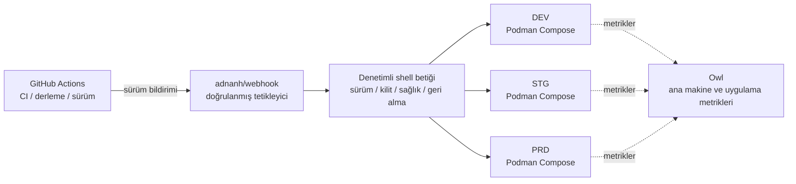

<div align="center">
    

<h1>Yin-Panel</h1>

[](https://github.com/yinorg/Yin-Panel/releases)
[](../../LICENSE)


[English](../../README.md) | [简体中文](../zh-CN/README.md) | [繁體中文](../zh-TW/README.md) | [日本語](../ja-JP/README.md) | [한국어](../ko-KR/README.md) | [Deutsch](../de-DE/README.md) | [Français](../fr-FR/README.md) | [Español](../es-ES/README.md) | [Português (Brasil)](../pt-BR/README.md) | [Русский](../ru-RU/README.md) | [Bahasa Indonesia](../id-ID/README.md) | **Türkçe** | [Polski](../pl-PL/README.md) | [Italiano](../it-IT/README.md) | [Nederlands](../nl-NL/README.md) | [हिन्दी](../hi-IN/README.md) | [ไทย](../th-TH/README.md)

</div>

Yin-Panel, kişisel ve paylaşılan alanlar için hafif, kendi sunucunuzda barındırabileceğiniz bir gezinme panelidir. Ev ağlarına, NAS cihazlarına, sunuculara ve küçük kuruluşlara uygundur.

## Demo

<picture>
  <source media="(prefers-color-scheme: dark)" srcset="../images/readme-home-dark.jpg">
  
</picture>

| Öğe düzenleyici | Alan yönetimi |
| --- | --- |
|  |  |

### Arayüz önizlemesi

| Giriş yap | Herkese açık erişim |
| --- | --- |
|  |  |

| Duvar kağıdı merkezi | Alanın varsayılan duvar kağıdı |
| --- | --- |
|  |  |

**Directory teması**: her alan kendi tema paketini kullanabilir; aynı kurulumdaki alanlar farklı görünebilir.


## Özellikler

- İzole içerikli kişisel ve paylaşılan alanlar
- Alan oluşturma, yeniden adlandırma, kopyalama ve yönetici devri
- Grup ağaçları, yer işaretleri, simgeler ve sıralama
- Tarayıcı HTML biçiminde yer işareti içe ve dışa aktarma
- Yönetici, düzenleyici ve görüntüleyici rollerine sahip alan üyeleri
- OAuth 2.0 / OIDC girişi, hesap bağlama ve OIDC grup yetkilendirmesi
- Giriş kimliği olarak e-posta, bağımsız takma ad
- Özel simgeler, yüklenebilir tema paketleri, 17 arayüz dili, duvar kağıtları, WAN/LAN ve mobil URL modları ve sayfa içi açılır pencereler
- SQLite, MySQL, MariaDB veya PostgreSQL depolama, amd64 ve arm64 için Docker imajları ve Kubernetes için Helm chart

## Resmî barındırılan ortamlar

Hemen kayıt olup deneyebileceğiniz üç çevrimiçi ortam işletiyoruz; üçü de GitHub / GitLab / Google ile girişi destekliyor ve bir izleme paneli metriklerle uyarıları gösteriyor.

Giriş yapmadan da herkese açık bağlantıya <https://panel.yiniot.com/my-demo> göz atabilirsiniz (tarayıcı ana sayfası olarak da ayarlanabilir).

Yardımcı tarayıcı uzantısını [Yin-Panel Helper](https://github.com/yinorg/yin-panel-extension) da kurabilirsiniz (artık [Chrome Web Store](https://chromewebstore.google.com/detail/yin-panel-helper/hlfhnjccidngjjkidlgejefcchoegofo) üzerinde). Yalnızca iki iş yapar: yeni sekmeyi panelinize yönlendirir ve site simgelerini almanıza yardım eder.

| Ortam | Adres | Amaç | Kararlılık |
| --- | --- | --- | --- |
| Üretim (PRD) | <https://panel.yiniot.com> | Günlük kullanım | %99,9 kullanılabilirlik hedefiyle best effort |
| STG | <https://panel-stg.yiniot.com> | Sürüm öncesi doğrulama | Her an yeniden başlatılabilir veya geri alınabilir |
| DEV | <https://panel-dev.yiniot.com> | Deneme ve sorun bildirme | En kararsız olan; veriler her an silinebilir |
| İzleme | <https://owl.yiniot.com> | Üç ortamın metrikleri ve uyarıları | — |

Üç ortam aynı ücretsiz sunucuda çalışır ve **yüksek kullanılabilirlik yoktur**: PRD %99,9'u hedefler ama herhangi bir tazminat sunmaz; STG ve DEV ise her an durabilir. Oralarda önemli veri tutmayın; uzun süreli kullanım için aşağıda anlatıldığı gibi kendiniz kurun.

## Hızlı başlangıç

### Docker Compose

Docker'ın Compose eklentisiyle birlikte kurulu olmasını gerektirir.

```bash
mkdir yin-panel && cd yin-panel
curl -LO https://raw.githubusercontent.com/yinorg/Yin-Panel/master/docker/docker-compose.yml
curl -o conf.yaml https://raw.githubusercontent.com/yinorg/Yin-Panel/master/backend/conf.yaml.example
mkdir -p database uploads
jwt_secret="$(openssl rand -hex 32)"
sed -i "s#^  secret: your_secret_key$#  secret: ${jwt_secret}#" conf.yaml
unset jwt_secret
YIN_PANEL_IMAGE=ghcr.io/yinorg/yin-panel-ce:latest docker compose up -d
```

<http://localhost:3002> adresini açın.

`latest` geçerli sürümü gösterir ve denemenin en hızlı yoludur; **üretimde belirli bir etikete veya imaj digest'ine sabitleyin** (bkz. «CI/CD mimarisi») ki dağıtım kaymasın.

Varsayılan yönetici: `admin@yiniot.com`, parola `admin@yiniot.com`. İlk girişten hemen sonra parolayı değiştirin ve `conf.yaml` içinde `base.root_url` ile benzersiz bir `jwt.secret` ayarlayın.

Her dağıtım kendi rastgele `jwt.secret` değerini üretmelidir. Depoda yalnızca `conf.yaml.example` bulunur; çalışma dizininizdeki `conf.yaml` örnek sırlarını ve OAuth kimlik bilgilerini barındırır ve Git'e işlenmemelidir.

### GHCR imajları

```bash
docker pull ghcr.io/yinorg/yin-panel-ce:latest
docker pull ghcr.io/yinorg/yin-panel-ce:<x.y.z>
```

`latest` geçerli sürümü gösterir; hem o hem de her sürüm etiketi amd64 ve arm64 ana makineler için çok mimarili manifestlerdir. Sürüm etiketleri hiçbir zaman mimari eki taşımaz; `-amd64` veya `-arm64` gibi etiketler bir sürümün parçası değildir.

## Performans ve önerilen yapılandırma

Aşağıdaki sayılar yerel tek makine karşılaştırmalı ölçümlerinden (SQLite, boş veritabanı, loopback, yük oluşturucu aynı ana makinede) gelmektedir. Bunları bir üretim kapasitesi taahhüdü değil, boyutlandırma referansı olarak değerlendirin. Gerçek kapasite temel olarak alan başına veri hacmine, yazma oranına ve en yoğun eşzamanlılığa bağlıdır.

### Kaynak kullanımı (ölçülen büyüklükler)

| Ölçüt | Boşta | 5000 req/s karma yük | Sınır (on binlerce req/s) |
| --- | --- | --- | --- |
| Bellek (RSS) | ~16 MB | ~105 MB | ~500 MB tepe; yük durduktan sonra geri düşer |
| CPU | sıfıra yakın | ~0.3 çekirdek | 2–3 çekirdek |

- Bellek, kabaca **20k req/s** değerine kadar **105 MB** civarında kalır ve yükle doğrusal olarak artmaz; ~500 MB rakamı yalnızca yapay uç baskı altında görülür.
- Tek bir çekirdek yaklaşık **10k–12k req/s** taşır (karma okuma/yazma, küçük veri kümesi).
- 5000 req/s karma yük altında: 0 hata, p95 yaklaşık **0.25 ms**.

### Önerilen yapılandırma

| Senaryo | CPU | Bellek | Depolama | Veritabanı |
| --- | --- | --- | --- | --- |
| Kişisel / ev / NAS | 1 vCPU | 128–256 MB | SSD, 512 MB+ (ayrıca simge yüklemeleri için pay) | SQLite |
| Küçük ekip / paylaşılan alanlar | 1–2 vCPU | 256–512 MB | SSD, 1–2 GB | SQLite |
| Kuruluş / yüksek eşzamanlılık | 2–4 vCPU | 1–2 GB | SSD | SQLite (tek ana makine) veya MySQL (birden çok örnek, HA) |

### Kullanıcı ölçeği referansı

Çevrimiçi kullanıcı başına yaklaşık 0.1 req/s (çoğunlukla boşta) ve tepe payı ayrılarak:

| Yapılandırma | Teorik ortalama iş hacmi | Boşta eşzamanlılık (teorik üst sınır) | Önerilen ölçek (tepe payıyla) |
| --- | --- | --- | --- |
| 1 vCPU | ~10k req/s | ~100k | 20k–40k |
| 2 vCPU | ~20k req/s | ~200k | 50k–80k |
| 4 vCPU | ~40k req/s | ~400k | 100k+ |

Kullanıcılar ne kadar etkinse (düzenleme, içe aktarma, sık yenileme), her kullanıcının ürettiği istek oranı o kadar yükselir ve sürdürülebilir kullanıcı sayısı o kadar düşer.

### Kapasiteyi etkileyen temel etkenler

1. **Veri hacmi** — liste uç noktaları bir alanın tüm girdilerini tek yanıtta döndürür; daha fazla girdi daha maliyetli istek anlamına gelir. Kendi verinizle ölçmeye en çok değer veren kısım budur.
2. **Yazma oranı** — SQLite aynı anda yalnızca bir yazıcıya izin verir; yazma iş hacmi disk fsync ile sınırlıdır (saniyede yüzlerce yazma düzeyinde). Yazma yoğun veya çok örnekli kurulumlar için MySQL kullanın.
3. **Ortalama değil tepe** — tepe noktalarına göre boyutlandırın; genellikle ortalamanın 2–5 katını ayırın.
4. **Statik varlıklar** — `/assets/*` ve diğer hash'li varlıkları bir ters proxy veya CDN sunsun ve hash'li dosyaları uzun süreli önbelleğe alın; giriş dosyaları ve `/api/*` her zaman güncel kalmalıdır.

## Veritabanı

SQLite (varsayılan), MySQL, MariaDB ve PostgreSQL desteklenir.

- `base.database_drive`: `sqlite` (varsayılan) | `mysql` | `postgres`. **MariaDB `mysql` kullanır.**
- SQLite: `sqlite.file_path` (ayrıca `read_pool_size` bölümüne bakın).
- MySQL / MariaDB: `mysql.{host,port,username,password,db_name,wait_timeout}`.
- PostgreSQL: `postgres.{host,port,username,password,db_name,ssl_mode,time_zone,wait_timeout}`.

Yalnızca SQLite'a özgü yetenekler (WAL, salt okunur bağlantı havuzu ve dosya anlık görüntüsü tabanlı geçiş yedekleri) yalnızca SQLite için geçerlidir; MySQL/MariaDB/PostgreSQL'i kendi araçlarıyla yedekleyin.

### SQLite'tan MySQL/MariaDB/PostgreSQL'e geçiş

```bash
# conf.yaml        — mevcut SQLite yapılandırması
# conf.target.yaml — mysql veya postgres'i işaret eden hedef yapılandırma (hedef veritabanı boş olmalıdır)
./yin-panel migrate-db -source conf.yaml -target conf.target.yaml
```

Geçiş, hedefte tam şemayı oluşturur, birincil anahtarları koruyarak her satırı kopyalar (ve PostgreSQL'de kimlik dizilerini sıfırlar). Tekrar tekrar çalıştırılabilir — her çalıştırma hedef tablo içeriğini değiştirir. Ardından `conf.yaml` içindeki `database_drive` ayarını hedefe yöneltin.

## Yapılandırma ve OAuth/OIDC

`oauth`, OAuth 2.0 ve OpenID Connect (OIDC) için birleşik yapılandırma girişidir. Varsayılan şablon doğrulanmış üç örnek içerir: GitHub (OAuth 2.0), GitLab (standart OIDC) ve Google (OAuth 2.0). Örneklerin tümü varsayılan olarak yorum satırıdır; bir sağlayıcı ancak gerçek kimlik bilgilerini girip `oauth.enable: true` olarak ayarladıktan sonra etkinleşir. Tüm yapılandırma anahtarları `backend/conf.yaml.example` içinde belgelenmiştir.

Standart bir OIDC sağlayıcısı keşif, yetkilendirme kodu + PKCE ve JWKS imza doğrulamasını desteklemeli ve kullanıcı bilgilerinde `email` ile `email_verified` sunmalıdır. Bu standartları karşılayan sağlayıcılar ilke olarak çalışır, ancak farklı sağlayıcılar yine de ek alan eşleme yapılandırması gerektirebilir.

OIDC geri çağırma URL'si:

```text
<base.root_url>/api/oauth/<provider>/callback
```

Geri çağırmadan sonra sağlayıcı doğrulanmış bir e-posta döndürmelidir. Sistem harici kimlikleri `provider + sub` ile tanımlar ve yerel hesapları e-posta ile bağlar.

## Alanlar ve izinler

Alan izinleri bir iç `UserID` ile anahtarlanır, hiçbir zaman e-posta metniyle değil. Bu nedenle bir e-postayı değiştirmek mevcut alan izinlerini korur ve üye listesi en güncel e-postayı gösterir.

- Yönetici: alanı, üyeleri, rolleri ve OIDC kurallarını yönetir
- Düzenleyici: grupları ve yer işaretlerini yönetir
- Görüntüleyici: salt okunur erişim

Alan oluşturma, yeniden adlandırma, grup ekleme, üye ekleme ve OIDC kuralı ekleme işlemlerinin tümü iletişim kutularında yapılır.

## Helm

```bash
helm upgrade --install yin-panel ./distribution/helm-chart/yin-panel \
  --set image.tag=latest
```

Üretimde `image.tag` değerini somut bir sürüme çevirin.

Dağıtımdan önce oluşturulan manifestleri `helm template yin-panel ./distribution/helm-chart/yin-panel` ile önizleyin.

## Kaynak geliştirme

Gereksinimler: Go `1.27.1`, Node.js `24.21.0`, npm veya pnpm `9.15.5`.

```bash
cd frontend
npm ci
npm run build-only
```

Ya da sabitlenmiş pnpm ile:

```bash
cd frontend
corepack pnpm install --frozen-lockfile
pnpm run build-only
```

```bash
cd backend
go test ./...
go build ./...
```

Tam yerel güncelleme (ön yüz derlemesi, arka uç testleri ve derlemesi, dağıtım, yeniden başlatma) tek komutta:

```bash
./scripts/deploy-local.sh
```

Betik varsayılan olarak depodaki `backend/` dizinini çalışma dizini olarak kullanır ve orada yerel bir `conf.yaml` gerektirir; `.env.local` içindeki `YIN_PANEL_RUNTIME_DIR` bunu geçersiz kılabilir. Tüm derlemeler ve testler geçtikten sonra yalnızca Yin-Panel dinleyicisini durdurur, eski ikili dosyayı ve statik dosyaları `sudo` ile değiştirir ve veritabanına, yüklemelere veya yapılandırma dosyalarına hiç dokunmaz.

Ana sayfa tema sistemi [`frontend/THEME_SYSTEM.md`](../../frontend/THEME_SYSTEM.md) içinde belgelenmiştir; `npm run create:theme -- init "<name>"` ile yeni bir tema oluşturabilirsiniz. Tüm yapay zeka geliştirme, sürüm ve yeniden başlatma kuralları [AGENTS.md](../../AGENTS.md) içinde yer alır.

Tarayıcı tarafındaki kabul testleri ayrı bir depoda, [yinorg/yin-panel-e2e](https://github.com/yinorg/yin-panel-e2e) içinde: Playwright gerçek tarayıcıları baştan sona akışlarda gezdirir (giriş ve hesaplar, alanlar ve izinler, yer işareti içe ve dışa aktarma, tema sistemi, PWA'nın çevrimdışı davranışı ve uzantının yeni sekmeyi devralması), ayrıca k6 betikleri yük ve kapasiteyi ölçer. Çalışan bir Yin-Panel örneği, Core deposunun `.env.local` dosyası ve paketlenmemiş uzantı kaynakları gerekir; checkout konumu `YIN_PANEL_E2E_DIR` ile belirtilir.

## Yedekleme ve yükseltme

Yükseltmeden önce veritabanını, `uploads/`, `conf.yaml` ve Helm değerlerini yedekleyin. Geçişler kullanıcıları, alanları, grupları, yer işaretlerini ve dosya başvurularını korur. Yükseltme ters giderse yükseltme öncesi yedeği geri yükleyin; veritabanını silip baştan başlamayın.

Compose kurulumunda yükseltme adımları:

```bash
docker compose pull
docker compose up -d
```

`docker/docker-compose.yml` varsayılan olarak `latest` kullanır ve `pull_policy: missing` yalnızca imaj yerelde yoksa indirir; bu yüzden yükseltme sırasında `docker compose pull` açıkça çalıştırılmalıdır. Üretimde `YIN_PANEL_IMAGE` değerini somut bir sürüme sabitleyin ve güncelleme sırasında değiştirin.

## CI/CD mimarisi

Resmî ortamlar DEV, STG ve PRD'yi tek bir 1C1G VPS üzerinde çalıştırır. Amaç bileşen yığmak değil, **az sayıda kalıcı süreç, düşük ek yük, denetlenebilir sürümler ve hata durumunda geri dönebilme**dir.



| Katman | Bileşen | Sorumluluk |
| --- | --- | --- |
| CI | GitHub Actions | Test etme, imajı derleme, sürümü damgalama, sürümü başlatma |
| Sürüm girişi | adnanh/webhook | Kaynağı ve isteği doğrulama; yalnızca sabit sürüm görevlerini çalıştırma |
| Sürüm yürütme | Shell betiği | Sürüm kontrolü, ortam seçimi, kilit, dağıtım, sağlık kontrolü ve geri alma |
| Çalışma ortamı | Podman Compose | Üç yalıtılmış uygulama örneğini çalıştırma (Podman, Docker'a göre yaklaşık 150 MB RSS tasarrufu sağlar) |
| İzleme | Owl | Ana makine ve uygulama metrikleri |

**Neden böyle bölünmüş**: CI tamamen GitHub Actions üzerinde çalışır ve VPS yalnızca derlenmiş imajı çekip dağıtır — küçük makine derleme zirvesini hiç taşımaz ve kalıcı bir CI/CD kontrol düzlemi işletmez. Üç ortam tek bir sürüm zincirini paylaşır ama Compose projeleri, yapılandırma, birimler, ağlar ve portlar ayrıdır; sürüm mekanizmasını paylaşmak veriyi paylaşmak değildir.

### Sürüm akışı

1. **Derleme**: Actions testleri çalıştırır ve imajı derler; sürüm bir Git etiketi, commit SHA'sı veya imaj digest'i ile sabitlenir ve üretimde `latest` asla dağıtılmaz.
2. **Tetikleme ve doğrulama**: Actions webhook'a doğrulanmış bir sürüm isteği gönderir; betik sürümü, hedef ortamı ve izin verilen eylemi kontrol eder ve rastgele girdiyi hiçbir zaman bir shell komutuna eklemez.
3. **Kilit ve dağıtım**: bir ortamda aynı anda tek dağıtım çalışır ve yalnızca hedef ortam güncellenir — hiçbir şey körlemesine yeniden başlatılmaz.
4. **Sağlık kontrolü ve hata**: servisin başlayıp yanıt verdiği doğrulanır; başarısız olursa son sağlam sürüm korunur ve geri alınır, ortam, sürüm, tetikleyici kaynağı, sonuç ve geri alma nedeni kaydedilir.

Yükseltme: DEV otomatik dağıtır → doğrulamadan sonra STG aynı sürümü dağıtır → smoke testlerinden sonra **PRD insan onayı gerektirir**. Acil düzeltmeler de denetlenebilir bir istisna yolundan geçer; sıradan bir geliştirme olayı üretim onayını asla atlamaz.

### Sınırlar

Bu **tek makineye dayalı, kaynak açısından tutumlu ve denetlenebilir** bir dağıtım mimarisidir, yüksek kullanılabilirlik mimarisi değildir: üç ortam süreç, yapılandırma ve veri olarak yalıtılmıştır ama aynı VPS'in çekirdeğini, diskini, ağını ve belleğini paylaşır; bir ana makine arızası veya kaynak tükenmesi üçünü birden etkiler. Değeri, güvenilir bir sürüm için gereken mekanizmaları — sabitlenmiş sürümler, ayrı ortamlar, sağlık kontrolleri, geri alma, izleme ve denetim izi — çok az kalıcı bileşenle korumasıdır.

## Open Core

Yin-Panel Core sürümü ücretsizdir ve bakımı ile güncellemeleri sürdürülecektir. Bu depo, Core için tek herkese açık kaynaktır ve `yin-panel-ce` imajını yayımlar. Enterprise sürümü özel [yinorg/Yin-Panel-EE](https://github.com/yinorg/Yin-Panel-EE) deposunda bulunur ve herkese açık arayüzler üzerinden bağlanır.

Çalışan bir örnek; sürümünü, yeteneklerini, salt okunur durumunu ve sürüm numarasını `GET /api/system/capabilities` üzerinden sunar. Sorunları ve önerileri [GitHub Issues](https://github.com/yinorg/Yin-Panel/issues) üzerinden bildirin.

Bu depoya birleştirilen katkılar Core'da kalır: Enterprise sürümüne taşınmaz ve yeniden lisanslanmaz. Bkz. [Core ve Enterprise](../../GOVERNANCE.md).

## Teşekkürler

Yin-Panel, açık kaynaklı [hslr-s/sun-panel](https://github.com/hslr-s/sun-panel) projesinden doğmuştur; temeli oluşturan özgün yazara teşekkürler.

Optimizasyonları ve bakım çalışmaları için [PhantomMaa/sun-panel](https://github.com/PhantomMaa/sun-panel) projesine de teşekkürler. Yin-Panel bu temelden kesintisiz bakımı devraldı ve özellikler, etkileşim iyileştirmeleri ve kendi sunucunuzda barındırma odaklı değişiklikler eklemeye devam ediyor.

Tüm özgün yazarlara, katkıda bulunanlara ve kullanıcılara teşekkürler.

## Katkıda bulunma

Bu proje, insanlar sorunları ve fikirleri paylaşmaya zaman ayırdığı için devam ediyor. Her türlü katkı memnuniyetle karşılanır:

- **Öneriler ve hata bildirimleri**: sürüm, ortam, yeniden üretme adımları ve gördüğünüz durumu içeren bir [issue](https://github.com/yinorg/Yin-Panel/issues) açın; ekran görüntüsü veya günlük işleri çok hızlandırır.
- **Kod ve dokümantasyon**: pull request'ler memnuniyetle karşılanır. Bir hatayı düzeltmek, bir cümleyi yeniden yazmak, bir dil eklemek veya ekran görüntüsünü değiştirmek de değerli katkıdır.
- **Henüz emin değilseniz**: kod yazmadan önce bir issue açıp yaklaşımı netleştirin; böylece emek kimsenin istemediği bir yöne gitmez.

Başlamadan önce [CONTRIBUTING.md](../../CONTRIBUTING.md) dosyasına göz atın: büyük değişiklikleri önce konuşmak daha iyi olur ve güvenlik sorunları herkese açık bir issue yerine özel olarak bildirilmelidir. Net olmayan bir şey varsa issue'da sorun, yön göstermeye çalışırım.

Hem issue'lar hem de pull request'ler okunuyor ve 7 gün içinde yanıt vermeye çalışıyorum; yeniden üretilebilen sorunlar ve iyi anlatılmış öneriler en hızlı ilerleyenlerdir. Her geri bildirim bu projenin sürmesi için bir neden.

## Lisans

Yin-Panel, [Business Source License 1.1](../../LICENSE) kapsamında lisanslanmıştır. Fork'lama, değiştirme ve kendi sunucunuzda barındırma ücretsizdir; kuruluş içi kullanım ve kendi müşterilerinize hizmet verme dahildir. Yin-Panel'in kendisini üçüncü taraflara barındırılan bir hizmet olarak sunmak ticari lisans gerektirir. Her sürüm, kendi ilk herkese açık dağıtımından üç yıl sonra AGPL-3.0-or-later lisansı altında kullanılabilir hale gelir. Bkz. [Core ve Enterprise](../../GOVERNANCE.md).

Üçüncü taraf bildirimleri [THIRD-PARTY-NOTICES.md](../../THIRD-PARTY-NOTICES.md) dosyasında listelenmiştir; katkılar [Contributor License Agreement](../../CLA.md) kapsamında kabul edilir.
