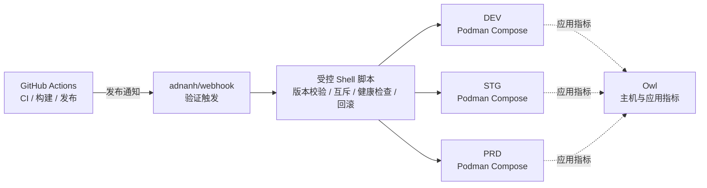

<div align="center">
    

<h1>Yin-Panel</h1>

[](https://github.com/yinorg/Yin-Panel/releases)
[](../../LICENSE)


[English](../../README.md) | **简体中文** | [繁體中文](../zh-TW/README.md) | [日本語](../ja-JP/README.md) | [한국어](../ko-KR/README.md) | [Deutsch](../de-DE/README.md) | [Français](../fr-FR/README.md) | [Español](../es-ES/README.md) | [Português (Brasil)](../pt-BR/README.md) | [Русский](../ru-RU/README.md) | [Bahasa Indonesia](../id-ID/README.md) | [Türkçe](../tr-TR/README.md) | [Polski](../pl-PL/README.md) | [Italiano](../it-IT/README.md) | [Nederlands](../nl-NL/README.md) | [हिन्दी](../hi-IN/README.md) | [ไทย](../th-TH/README.md)

</div>

Yin-Panel 是一个轻量、可自托管的个人与共享空间导航面板，适合家庭网络、NAS、服务器和小型组织。

## 演示

<picture>
  <source media="(prefers-color-scheme: dark)" srcset="../images/readme-home-dark.jpg">
  
</picture>

| 项目编辑器 | 空间管理 |
| --- | --- |
|  |  |

### 界面预览

| 登录 | 公开访问 |
| --- | --- |
|  |  |

| 壁纸中心 | 空间默认壁纸 |
| --- | --- |
|  |  |

**目录主题**：每个空间可以指定自己的主题包，同一个实例里不同空间呈现不同布局。


## 功能

- 个人空间与共享空间，内容彼此隔离
- 空间创建、重命名、复制和管理员转让
- 分组树、书签、图标和排序管理
- 浏览器 HTML 格式书签导入与导出
- 空间成员角色：管理员、编辑者、查看者
- OAuth 2.0 / OIDC 登录、账号关联和 OIDC 分组授权
- 邮箱作为登录账号，昵称独立维护
- 自定义图标、可安装的主题包、17 种界面语言、背景、WAN/LAN 与手机地址模式、页面内弹窗打开
- 支持 SQLite、MySQL、MariaDB 和 PostgreSQL，提供 amd64 与 arm64 Docker 镜像和 Kubernetes Helm Chart

## 官方托管环境

我们维护三套在线环境，可以直接注册试用，三套都支持 GitHub / GitLab / Google 登录；另有一套监控面板，用于查看运行指标与告警。

不想登录可以访问 公开链接 https://panel.yiniot.com/my-demo （也可设置为导航主页）

也可以安装配套的浏览器扩展 [Yin-Panel Helper](https://github.com/yinorg/yin-panel-extension)（已上架 [Chrome 应用商店](https://chromewebstore.google.com/detail/yin-panel-helper/hlfhnjccidngjjkidlgejefcchoegofo)），它只做两件事：把新标签页指向你的面板地址，以及辅助获取网站图标。

| 环境 | 地址 | 用途 | 稳定性 |
| --- | --- | --- | --- |
| 正式（PRD） | <https://panel.yiniot.com> | 正式使用 | 按 99.9% 可用性的目标尽力保障 |
| STG | <https://panel-stg.yiniot.com> | 发布前验证 | 可能随时重启或回滚 |
| DEV | <https://panel-dev.yiniot.com> | 尝鲜、反馈问题 | 最不稳定，数据可能随时清空 |
| 监控 | <https://owl.yiniot.com> | 查看三套环境的运行指标与告警 | — |

这三套环境跑在同一台免费服务器上，**没有做高可用**：PRD 按 99.9% 的可达目标尽力保障，但不提供赔付；STG 与 DEV 随时可能中断。请不要把重要数据放在这些环境里，长期使用请选择下面的自建部署。

## 快速开始

### Docker Compose

需要 Docker 及 Compose 插件。

```bash
mkdir yin-panel && cd yin-panel
curl -LO https://raw.githubusercontent.com/yinorg/Yin-Panel/master/docker/docker-compose.yml
curl -o conf.yaml https://raw.githubusercontent.com/yinorg/Yin-Panel/master/backend/conf.yaml.example
mkdir -p database uploads
jwt_secret="$(openssl rand -hex 32)"
sed -i "s#^  secret: your_secret_key$#  secret: ${jwt_secret}#" conf.yaml
unset jwt_secret
YIN_PANEL_IMAGE=ghcr.io/yinorg/yin-panel-ce:latest docker compose up -d
```

打开 <http://localhost:3002>。

`latest` 指向当前正式版，适合先跑起来试用；**生产环境请把它固定成具体 tag 或镜像 digest**（见「CI/CD 架构」），避免部署漂移。

默认管理员：`admin@yiniot.com`，密码 `admin@yiniot.com`。首次登录后请立即修改密码，并在 `conf.yaml` 中设置 `base.root_url` 和唯一的 `jwt.secret`。

每个部署实例都应生成独立的随机 `jwt.secret`。仓库只提供 `conf.yaml.example`；运行目录中的 `conf.yaml` 包含实例密钥和 OAuth 凭据，请勿提交到 Git。

### GHCR 镜像

```bash
docker pull ghcr.io/yinorg/yin-panel-ce:latest
docker pull ghcr.io/yinorg/yin-panel-ce:<版本>
```

`latest` 指向当前正式版；它和每个发布 tag 都是面向 amd64 与 arm64 主机的 multi-arch 清单。发布 tag 不带架构后缀；`-amd64`、`-arm64` 之类的 tag 不属于正式发布。

## 性能与推荐配置

以下数据来自本地单机基准（SQLite、空库、loopback、同机压测），用于选型参考，不代表生产容量承诺。实际容量主要取决于每个空间的数据量、写入频率和峰值并发。

### 资源占用（实测量级）

| 指标 | 空闲 | 5000 req/s 混合负载 | 极限（数万 req/s） |
| --- | --- | --- | --- |
| 内存 RSS | ~16 MB | ~105 MB | 峰值 ~500 MB，负载停止后回落 |
| CPU | 接近 0 | ~0.3 核 | 2–3 核 |

- 内存到约 **2 万 req/s** 前基本恒定在 **105 MB**，不随负载线性增长；那 ~500 MB 只在合成极压时出现。
- 单核约可承载 **1 万–1.2 万 req/s**（混合读写、小数据量）。
- 5000 req/s 混合负载下：0 失败、p95 约 **0.25 ms**。

### 推荐配置

| 场景 | CPU | 内存 | 存储 | 数据库 |
| --- | --- | --- | --- | --- |
| 个人 /小团队| 1 vCPU | 128–256 MB | SSD，512 MB 起 | SQLite |
| 组织级 / 高并发 | 2–4 vCPU | 512–768 MB | SSD | SQLite（单机）或 MySQL（多实例、HA） |

### 用户规模参考

按「每在线用户约 0.1 req/s（挂机为主）」估算，并预留峰值余量：

| 配置 | 理论平均吞吐 | 挂机并发（理论上限） | 建议规模（含峰值余量） |
| --- | --- | --- | --- |
| 1 vCPU | ~10k req/s | ~10 万 | 2 万–4 万 |
| 2 vCPU | ~20k req/s | ~20 万 | 5 万–8 万 |
| 4 vCPU | ~40k req/s | ~40 万 | 10 万以上 |

用户越活跃（编辑、导入、频繁刷新），每人产生的请求率越高，可支撑的用户数相应下降。

### 影响容量的关键因素

1. **数据量**：列表接口在单次响应中返回整个空间的全部条目，条目越多，单请求成本越高；这是最需要用自己的数据实测的部分。
2. **写入频率**：SQLite 同一时刻只有一个写者，写吞吐受磁盘 fsync 限制（数百次写/秒量级）。写密集或多实例场景建议改用 MySQL。
3. **峰值而非平均**：按峰值选型，通常预留均值 2–5 倍的余量。
4. **静态资源**：建议由反向代理或 CDN 承载 `/assets/*` 和带 hash 的资源，并对这些带 hash 的文件长期缓存；入口文件和 `/api/*` 应保持实时。

## 数据库

支持 SQLite（默认）、MySQL、MariaDB 和 PostgreSQL。

SQLite 专属能力（WAL、只读连接池、基于文件快照的迁移备份）只适用于 SQLite；MySQL/MariaDB/PostgreSQL 请使用各自工具备份。

### 从 SQLite 迁移到 MySQL/MariaDB/PostgreSQL

```bash
# conf.yaml        —— 现有 SQLite 配置
# conf.target.yaml —— 指向 mysql 或 postgres 的目标配置（目标库须为空）
./yin-panel migrate-db -source conf.yaml -target conf.target.yaml
```

迁移会在目标库创建完整 schema、按表复制全部数据并**保留主键**（PostgreSQL 会同步重置自增序列），可重复执行（每次替换目标表内容）。完成后把 `conf.yaml` 的 `database_drive` 指向目标库即可。

## 配置与 OAuth/OIDC

`oauth` 是 OAuth 2.0 和 OpenID Connect（OIDC）的统一配置入口。默认配置模板提供了三个已验证的示例：GitHub（OAuth 2.0）、GitLab（标准 OIDC）和 Google（OAuth 2.0）。示例默认全部注释，填写实际凭据并将 `oauth.enable` 设置为 `true` 后才会启用。全部配置项见 `backend/conf.yaml.example`。

标准 OIDC provider 需要支持 discovery、authorization code + PKCE 和 JWKS 签名校验，并在用户信息中提供 `email` 和 `email_verified`。符合这些标准的 provider 理论上可用，但不同服务商可能仍需要额外的字段映射配置。

OIDC 回调地址：

```text
<base.root_url>/api/oauth/<provider>/callback
```

回调完成后，Provider 必须返回已验证邮箱。系统使用 `provider + sub` 识别外部身份，并使用邮箱关联本地账号。

## 空间与权限

空间权限使用内部 `UserID` 关联，不依赖邮箱作为权限主键。因此修改邮箱后，已有空间权限仍然有效，成员列表会显示最新邮箱。

- 管理员：管理空间、成员、角色和 OIDC 规则
- 编辑者：维护分组和书签
- 查看者：只读访问

创建空间、重命名、添加分组、添加成员和添加 OIDC 规则均在弹窗中完成。

## Helm

```bash
helm upgrade --install yin-panel ./distribution/helm-chart/yin-panel \
  --set image.tag=latest
```

生产环境请把 `image.tag` 换成具体版本号。部署前可用 `helm template yin-panel ./distribution/helm-chart/yin-panel` 检查渲染结果。

## 源码开发

环境要求：Go `1.27.2`、Node.js `24.21.0`、npm 或 pnpm `9.15.5`。

```bash
cd frontend
npm ci
npm run build-only
```

也可以使用锁定版本的 pnpm：

```bash
cd frontend
corepack pnpm install --frozen-lockfile
pnpm run build-only
```

```bash
cd backend
go test ./...
go build ./...
```

本地完整更新（前端构建、后端测试与编译、部署、重启）统一使用：

```bash
./scripts/deploy-local.sh
```

脚本默认将仓库内的 `backend/` 作为运行目录，要求其中存在本地 `conf.yaml`；可通过 `.env.local` 中的 `YIN_PANEL_RUNTIME_DIR` 覆盖。脚本会在构建和测试全部通过后，仅停止 Yin-Panel 监听进程，使用 `sudo` 替换旧二进制与静态文件，不会修改数据库、上传文件或配置文件。

主页主题系统见 [`frontend/THEME_SYSTEM.md`](../../frontend/THEME_SYSTEM.md)；使用 `npm run create:theme -- init "<名称>"` 可脚手架一个新主题。完整的 AI 开发、发布和重启约定见 [AGENTS.md](../../AGENTS.md)。

浏览器端的验收测试放在独立仓库 [yinorg/yin-panel-e2e](https://github.com/yinorg/yin-panel-e2e)：用 Playwright 驱动真实浏览器跑完整流程（登录与账号、空间与权限、书签导入导出、主题系统、PWA 离线行为，以及扩展接管新标签页），另有一套 k6 脚本做负载与容量测量。运行前需要一个已启动的 Yin-Panel 实例、Core 仓库的 `.env.local` 和未打包的扩展源码，检出位置由 `YIN_PANEL_E2E_DIR` 指定。

## 备份与升级

升级前请备份数据库、`uploads/`、`conf.yaml` 和 Helm values。迁移会保留用户、空间、分组、书签和文件引用。升级异常时使用升级前备份恢复，不要直接删除数据库重建。

Compose 部署的升级步骤：

```bash
docker compose pull
docker compose up -d
```

`docker/docker-compose.yml` 默认使用 `latest`，`pull_policy: missing` 只在本地没有镜像时拉取，所以升级必须显式执行 `docker compose pull`。生产环境建议把 `YIN_PANEL_IMAGE` 固定成具体版本号，升级时再改成目标版本。

## CI/CD 架构

官方环境在一台 1C1G 的 VPS 上同时运行 DEV、STG、PRD。目标不是堆组件，而是**少常驻进程、低资源开销、发布可审计、失败可回滚**。



| 层次 | 组件 | 职责 |
| --- | --- | --- |
| CI | GitHub Actions | 测试、构建镜像、生成版本、触发发布 |
| 发布入口 | adnanh/webhook | 验证来源与请求，只触发固定的发布任务 |
| 发布执行 | Shell 脚本 | 版本校验、环境选择、互斥、部署、健康检查与回滚 |
| 运行环境 | Podman Compose | 运行三套相互隔离的应用实例（Podman 比 Docker 约省 150 MB 常驻内存） |
| 监控 | Owl | 主机与应用指标 |

**为什么这样分**：CI 全部在 GitHub Actions 里跑，VPS 只拉取已构建的镜像并部署——本机不承担编译时的内存峰值，也不常驻 CI/CD 控制面。三个环境共用一条发布链路，但各自拥有独立的 Compose 项目、配置、数据卷、网络与端口，共用发布机制不等于共享运行数据。

### 发布流程

1. **构建**：Actions 执行测试并构建镜像；版本用 Git tag、commit SHA 或镜像 digest 固定，生产环境不部署 `latest`。
2. **触发与校验**：Actions 向 webhook 发送经过验证的发布请求；脚本检查版本、目标环境和允许的操作，不把任意输入拼接成 Shell 命令。
3. **互斥与部署**：同一环境不允许并发部署，只更新指定环境，不同时无差别重启全部环境。
4. **健康检查与失败处理**：确认服务启动并正常响应；失败时保留上一个可用版本并回滚，同时记录环境、版本、触发来源、结果与回滚原因。

环境晋升：DEV 自动部署 → 验证通过后 STG 部署同一版本 → 冒烟测试通过后 **PRD 人工批准**。紧急修复也走可审计的例外流程，不让普通开发事件自动绕过生产批准。

### 边界

这是**单机、低资源、可审计**的部署架构，不是高可用架构：三个环境虽然进程、配置和数据相互隔离，但共享同一台 VPS 的内核、磁盘、网络与内存，主机故障或资源耗尽会同时影响三个环境。它的价值在于用很少的常驻组件保留了可靠发布的关键机制——版本固定、环境隔离、健康检查、回滚、监控和可审计记录。

## Open Core

Yin-Panel Core 版本免费使用，并会持续维护和更新。本仓库是公开 Core 的唯一来源，发布 `yin-panel-ce` 镜像。企业版位于私有仓库 [yinorg/Yin-Panel-EE](https://github.com/yinorg/Yin-Panel-EE)，通过公开接口接入企业模块。

运行中的实例可通过 `GET /api/system/capabilities` 查询发行版、能力、只读状态和版本。问题和建议请提交到 [GitHub Issues](https://github.com/yinorg/Yin-Panel/issues)。

合并进本仓库的贡献永远留在 Core：不会被挪进企业版，也不会被换成其他条款再授权。详见 [Core 与企业版](../../GOVERNANCE.md)。

## 项目沿革与致谢

Yin-Panel 基于开源项目 [hslr-s/sun-panel](https://github.com/hslr-s/sun-panel) 发展，感谢原作者建立了项目基础。

同时感谢 [PhantomMaa/sun-panel](https://github.com/PhantomMaa/sun-panel) 对项目进行的优化和维护工作。Yin-Panel 在此基础上接任后续维护，并持续加入新的功能、交互体验和适合自托管场景的改进。

感谢所有原作者、贡献者和使用者。

## 参与贡献

项目能一直走下去，靠的是使用者愿意把问题和新想法讲出来。欢迎所有形式的参与：

- **提建议、报 Bug**：到 [Issues](https://github.com/yinorg/Yin-Panel/issues) 说清楚版本、环境、复现步骤和现象，最好带上截图或日志，处理起来会快很多。
- **直接动手改**：欢迎提 [Pull Requests](https://github.com/yinorg/Yin-Panel/pulls)。修一个 Bug、改一句文案、补一种语言的翻译、换一张更清楚的截图，都算有价值的贡献。
- **还没想清楚**：先开一个 Issue 把方案聊明白再写代码，避免做完才发现方向不一致。

动手之前可以看一眼 [CONTRIBUTING.md](../../CONTRIBUTING.md)：较大的改动建议先讨论，安全问题请私下反馈而不是开公开 Issue；没想清楚的地方也可以直接在 Issue 里问，我会尽量给出方向。

Issue 和 PR 都会看，我会尽量在 7 天内回应；能稳定复现的问题和带上下文的建议会处理得更快。你的每一次反馈，都是这个项目继续更新的理由。

## 许可证

Yin-Panel 使用 [Business Source License 1.1](../../LICENSE) 授权。Fork、修改、自托管均免费，包括组织内部使用和为自己的客户提供服务；把 Yin-Panel 本身作为托管服务提供给第三方需要商业许可。每个版本在其首次公开发布三年后，该版本转为 AGPL-3.0-or-later 许可。详见 [Core 与企业版](../../GOVERNANCE.md)。

第三方声明详见 [THIRD-PARTY-NOTICES.md](../../THIRD-PARTY-NOTICES.md)，贡献依据[贡献者许可协议](../../CLA.md)接受。
