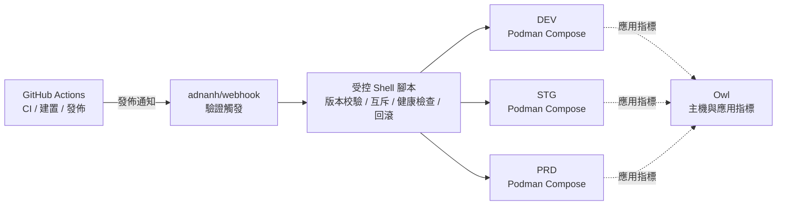

<div align="center">
    

<h1>Yin-Panel</h1>

[](https://github.com/yinorg/Yin-Panel/releases)
[](../../LICENSE)


[English](../../README.md) | [简体中文](../zh-CN/README.md) | **繁體中文** | [日本語](../ja-JP/README.md) | [한국어](../ko-KR/README.md) | [Deutsch](../de-DE/README.md) | [Français](../fr-FR/README.md) | [Español](../es-ES/README.md) | [Português (Brasil)](../pt-BR/README.md) | [Русский](../ru-RU/README.md) | [Bahasa Indonesia](../id-ID/README.md) | [Türkçe](../tr-TR/README.md) | [Polski](../pl-PL/README.md) | [Italiano](../it-IT/README.md) | [Nederlands](../nl-NL/README.md) | [हिन्दी](../hi-IN/README.md) | [ไทย](../th-TH/README.md)

</div>

Yin-Panel 是一個輕量、可自架的個人與共享空間導覽面板，適合家庭網路、NAS、伺服器與小型組織。

## 示範

<picture>
  <source media="(prefers-color-scheme: dark)" srcset="../images/readme-home-dark.jpg">
  
</picture>

| 項目編輯器 | 空間管理 |
| --- | --- |
|  |  |

### 介面預覽

| 登錄 | 公開訪問 |
| --- | --- |
|  |  |

| 壁紙中心 | 空間預設壁紙 |
| --- | --- |
|  |  |

**目錄主題**：每個空間可以指定自己的主題包，同一個實例裡不同空間呈現不同佈局。


## 功能

- 個人空間與共享空間，內容彼此隔離
- 空間建立、重新命名、複製與管理員轉讓
- 群組樹、書籤、圖示與排序管理
- 瀏覽器 HTML 格式書籤匯入與匯出
- 空間成員角色：管理員、編輯者、檢視者
- OAuth 2.0 / OIDC 登入、帳號連結與 OIDC 群組授權
- 電子郵件作為登入帳號，暱稱獨立維護
- 自訂圖示、可安裝的主題套件、17 種介面語言、背景、WAN/LAN 與手機網址模式、頁面內彈窗開啟
- 支援 SQLite、MySQL、MariaDB 與 PostgreSQL，提供 amd64 與 arm64 Docker 映像與 Kubernetes Helm Chart

## 官方託管環境

我們維護三套線上環境，可以直接註冊試用，三套都支援 GitHub / GitLab / Google 登入；另有一套監控面板，用於查看運行指標與告警。

不想登入也可以直接看公開連結 <https://panel.yiniot.com/my-demo>（也可以設為瀏覽器首頁）。

也可以安裝配套的瀏覽器擴充功能 [Yin-Panel Helper](https://github.com/yinorg/yin-panel-extension)（已上架 [Chrome 線上應用程式商店](https://chromewebstore.google.com/detail/yin-panel-helper/hlfhnjccidngjjkidlgejefcchoegofo)），它只做兩件事：把新分頁指向你的面板網址，以及輔助取得網站圖示。

| 環境 | 位址 | 用途 | 穩定性 |
| --- | --- | --- | --- |
| 正式（PRD） | <https://panel.yiniot.com> | 正式使用 | 以 99.9% 可用性為目標盡力保障 |
| STG | <https://panel-stg.yiniot.com> | 發佈前驗證 | 可能隨時重啟或回滾 |
| DEV | <https://panel-dev.yiniot.com> | 嘗鮮、回報問題 | 最不穩定，資料可能隨時清空 |
| 監控 | <https://owl.yiniot.com> | 查看三套環境的運行指標與告警 | — |

這三套環境跑在同一台免費伺服器上，**沒有做高可用**：PRD 以 99.9% 的可達目標盡力保障，但不提供賠付；STG 與 DEV 隨時可能中斷。請不要把重要資料放在這些環境裡，長期使用請選擇下面的自建部署。

## 快速開始

### Docker Compose

需要 Docker 及 Compose 外掛。

```bash
mkdir yin-panel && cd yin-panel
curl -LO https://raw.githubusercontent.com/yinorg/Yin-Panel/master/docker/docker-compose.yml
curl -o conf.yaml https://raw.githubusercontent.com/yinorg/Yin-Panel/master/backend/conf.yaml.example
mkdir -p database uploads
jwt_secret="$(openssl rand -hex 32)"
sed -i "s#^  secret: your_secret_key$#  secret: ${jwt_secret}#" conf.yaml
unset jwt_secret
YIN_PANEL_IMAGE=ghcr.io/yinorg/yin-panel-ce:latest docker compose up -d
```

開啟 <http://localhost:3002>。

`latest` 指向目前正式版，適合先跑起來試用；**正式環境請將它固定成具體 tag 或映像 digest**（見「CI/CD 架構」），避免部署漂移。

預設管理員：`admin@yiniot.com`，密碼 `admin@yiniot.com`。首次登入後請立即修改密碼，並在 `conf.yaml` 中設定 `base.root_url` 與唯一的 `jwt.secret`。

每個部署執行個體都應產生獨立的隨機 `jwt.secret`。儲存庫只提供 `conf.yaml.example`；執行目錄中的 `conf.yaml` 包含執行個體密鑰與 OAuth 憑證，請勿提交到 Git。

### GHCR 映像

```bash
docker pull ghcr.io/yinorg/yin-panel-ce:latest
docker pull ghcr.io/yinorg/yin-panel-ce:<x.y.z>
```

`latest` 指向目前正式版；它與每個發佈 tag 都是面向 amd64 與 arm64 主機的 multi-arch manifest。發佈 tag 不帶架構後綴；`-amd64`、`-arm64` 之類的 tag 不屬於正式發佈。

## 效能與建議組態

以下數據來自本機單機基準（SQLite、空資料庫、loopback、同機壓測），用於選型參考，不代表生產容量承諾。實際容量主要取決於每個空間的資料量、寫入頻率與峰值併發。

### 資源佔用（實測數量級）

| 指標 | 閒置 | 5000 req/s 混合負載 | 極限（數萬 req/s） |
| --- | --- | --- | --- |
| 記憶體 RSS | ~16 MB | ~105 MB | 峰值 ~500 MB，負載停止後回落 |
| CPU | 接近 0 | ~0.3 核 | 2–3 核 |

- 記憶體到約 **2 萬 req/s** 前基本恆定在 **105 MB**，不隨負載線性成長；那 ~500 MB 只在合成極壓時出現。
- 單核約可承載 **1 萬–1.2 萬 req/s**（混合讀寫、小資料量）。
- 5000 req/s 混合負載下：0 失敗、p95 約 **0.25 ms**。

### 建議組態

| 情境 | CPU | 記憶體 | 儲存 | 資料庫 |
| --- | --- | --- | --- | --- |
| 個人 / 家庭 / NAS | 1 vCPU | 128–256 MB | SSD，512 MB 起（另加圖示上傳餘量） | SQLite |
| 小型團隊 / 共享空間 | 1–2 vCPU | 256–512 MB | SSD，1–2 GB | SQLite |
| 組織級 / 高併發 | 2–4 vCPU | 1–2 GB | SSD | SQLite（單機）或 MySQL（多執行個體、HA） |

### 使用者規模參考

按「每位線上使用者約 0.1 req/s（掛機為主）」估算，並預留峰值餘量：

| 組態 | 理論平均輸送量 | 掛機併發（理論上限） | 建議規模（含峰值餘量） |
| --- | --- | --- | --- |
| 1 vCPU | ~10k req/s | ~10 萬 | 2 萬–4 萬 |
| 2 vCPU | ~20k req/s | ~20 萬 | 5 萬–8 萬 |
| 4 vCPU | ~40k req/s | ~40 萬 | 10 萬以上 |

使用者越活躍（編輯、匯入、頻繁重新整理），每人產生的請求率越高，可支撐的使用者數相應下降。

### 影響容量的關鍵因素

1. **資料量**：清單介面在單次回應中傳回整個空間的全部項目，項目越多，單請求成本越高；這是最需要用自身資料實測的部分。
2. **寫入頻率**：SQLite 同一時刻只有一個寫入者，寫入輸送量受磁碟 fsync 限制（數百次寫入/秒量級）。寫入密集或多執行個體情境建議改用 MySQL。
3. **峰值而非平均**：按峰值選型，通常預留均值 2–5 倍的餘量。
4. **靜態資源**：建議由反向代理或 CDN 承載 `/assets/*` 與帶 hash 的資源，並對這些帶 hash 的檔案長期快取；入口檔案與 `/api/*` 應保持即時。

## 資料庫

支援 SQLite（預設）、MySQL、MariaDB 與 PostgreSQL。

- `base.database_drive`：`sqlite`（預設）| `mysql` | `postgres`。**MariaDB 使用 `mysql`**。
- SQLite：`sqlite.file_path`（另見 `read_pool_size`）。
- MySQL / MariaDB：`mysql.{host,port,username,password,db_name,wait_timeout}`。
- PostgreSQL：`postgres.{host,port,username,password,db_name,ssl_mode,time_zone,wait_timeout}`。

SQLite 專屬能力（WAL、唯讀連線池、以檔案快照為基礎的遷移備份）僅適用於 SQLite；MySQL/MariaDB/PostgreSQL 請使用各自的工具備份。

### 從 SQLite 遷移至 MySQL/MariaDB/PostgreSQL

```bash
# conf.yaml        —— 現有 SQLite 設定
# conf.target.yaml —— 指向 mysql 或 postgres 的目標設定（目標資料庫須為空）
./yin-panel migrate-db -source conf.yaml -target conf.target.yaml
```

遷移會在目標資料庫建立完整 schema、逐表複製所有資料並**保留主鍵**（PostgreSQL 會同步重設自增序列），可重複執行（每次取代目標表內容）。完成後將 `conf.yaml` 的 `database_drive` 指向目標資料庫即可。

## 設定與 OAuth/OIDC

`oauth` 是 OAuth 2.0 與 OpenID Connect（OIDC）的統一設定入口。預設範本提供三個已驗證的範例：GitHub（OAuth 2.0）、GitLab（標準 OIDC）與 Google（OAuth 2.0）。範例預設全部註解，填寫實際憑證並將 `oauth.enable` 設為 `true` 後才會啟用。全部設定項見 `backend/conf.yaml.example`。

標準 OIDC provider 需要支援 discovery、authorization code + PKCE 與 JWKS 簽章驗證，並在使用者資訊中提供 `email` 與 `email_verified`。符合這些標準的 provider 理論上可用，但不同服務商可能仍需要額外的欄位對應設定。

OIDC 回呼位址：

```text
<base.root_url>/api/oauth/<provider>/callback
```

回呼完成後，Provider 必須傳回已驗證電子郵件。系統使用 `provider + sub` 識別外部身分，並使用電子郵件關聯本機帳號。

## 空間與權限

空間權限使用內部 `UserID` 關聯，不依賴電子郵件作為權限主鍵。因此修改電子郵件後，既有空間權限仍然有效，成員清單會顯示最新電子郵件。

- 管理員：管理空間、成員、角色與 OIDC 規則
- 編輯者：維護群組與書籤
- 檢視者：唯讀存取

建立空間、重新命名、新增群組、新增成員與新增 OIDC 規則均在彈窗中完成。

## Helm

```bash
helm upgrade --install yin-panel ./distribution/helm-chart/yin-panel \
  --set image.tag=latest
```

正式環境請把 `image.tag` 換成具體版本號。

部署前可用 `helm template yin-panel ./distribution/helm-chart/yin-panel` 檢查渲染結果。

## 原始碼開發

環境需求：Go `1.27.1`、Node.js `24.21.0`、npm 或 pnpm `9.15.5`。

```bash
cd frontend
npm ci
npm run build-only
```

也可以使用鎖定版本的 pnpm：

```bash
cd frontend
corepack pnpm install --frozen-lockfile
pnpm run build-only
```

```bash
cd backend
go test ./...
go build ./...
```

本機完整更新（前端建置、後端測試與編譯、部署、重新啟動）統一使用：

```bash
./scripts/deploy-local.sh
```

腳本預設將儲存庫內的 `backend/` 作為執行目錄，要求其中存在本機 `conf.yaml`；可透過 `.env.local` 中的 `YIN_PANEL_RUNTIME_DIR` 覆寫。腳本會在建置與測試全部通過後，僅停止 Yin-Panel 監聽程序，使用 `sudo` 替換舊二進位檔與靜態檔案，不會修改資料庫、上傳檔案或設定檔。

首頁主題系統見 [`frontend/THEME_SYSTEM.md`](../../frontend/THEME_SYSTEM.md)；使用 `npm run create:theme -- init "<名稱>"` 可建立新主題骨架。完整的 AI 開發、發佈與重新啟動慣例見 [AGENTS.md](../../AGENTS.md)。

瀏覽器端的驗收測試放在獨立儲存庫 [yinorg/yin-panel-e2e](https://github.com/yinorg/yin-panel-e2e)：用 Playwright 驅動真實瀏覽器跑完整流程（登入與帳號、空間與權限、書籤匯入匯出、主題系統、PWA 離線行為，以及擴充功能接管新分頁），另有一套 k6 腳本做負載與容量量測。執行前需要一個已啟動的 Yin-Panel 實例、Core 儲存庫的 `.env.local` 與未封裝的擴充功能原始碼，檢出位置由 `YIN_PANEL_E2E_DIR` 指定。

## 備份與升級

升級前請備份資料庫、`uploads/`、`conf.yaml` 與 Helm values。遷移會保留使用者、空間、群組、書籤與檔案參照。升級異常時使用升級前備份還原，不要直接刪除資料庫重建。

Compose 部署的升級步驟：

```bash
docker compose pull
docker compose up -d
```

`docker/docker-compose.yml` 預設使用 `latest`，`pull_policy: missing` 只在本地沒有映像時拉取，所以升級必須明確執行 `docker compose pull`。正式環境建議把 `YIN_PANEL_IMAGE` 固定成具體版本號，升級時再改成目標版本。

## CI/CD 架構

官方環境在一台 1C1G 的 VPS 上同時運行 DEV、STG、PRD。目標不是堆疊元件，而是**少常駐程序、低資源開銷、發佈可審計、失敗可回滾**。



| 層次 | 元件 | 職責 |
| --- | --- | --- |
| CI | GitHub Actions | 測試、建置映像、產生版本、觸發發佈 |
| 發佈入口 | adnanh/webhook | 驗證來源與請求，只觸發固定的發佈任務 |
| 發佈執行 | Shell 腳本 | 版本校驗、環境選擇、互斥、部署、健康檢查與回滾 |
| 執行環境 | Podman Compose | 執行三套互相隔離的應用實例（Podman 比 Docker 約省 150 MB 常駐記憶體） |
| 監控 | Owl | 主機與應用指標 |

**為什麼這樣分**：CI 全部在 GitHub Actions 上跑，VPS 只拉取已建置的映像並部署——本機不承擔編譯時的記憶體峰值，也不常駐 CI/CD 控制面。三個環境共用一條發佈鏈路，但各自擁有獨立的 Compose 專案、設定、資料卷、網路與連接埠，共用發佈機制不等於共享運行資料。

### 發佈流程

1. **建置**：Actions 執行測試並建置映像；版本以 Git tag、commit SHA 或映像 digest 固定，正式環境不部署 `latest`。
2. **觸發與校驗**：Actions 向 webhook 發送經過驗證的發佈請求；腳本檢查版本、目標環境與允許的操作，不把任意輸入拼接成 Shell 命令。
3. **互斥與部署**：同一環境不允許併發部署，只更新指定環境，不同時無差別重啟全部環境。
4. **健康檢查與失敗處理**：確認服務啟動並正常回應；失敗時保留上一個可用版本並回滾，同時記錄環境、版本、觸發來源、結果與回滾原因。

環境晉升：DEV 自動部署 → 驗證通過後 STG 部署同一版本 → 冒煙測試通過後 **PRD 人工批准**。緊急修復也走可審計的例外流程，不讓一般開發事件自動繞過正式批准。

### 邊界

這是**單機、低資源、可審計**的部署架構，不是高可用架構：三個環境雖然在程序、設定與資料上相互隔離，但共享同一台 VPS 的核心、磁碟、網路與記憶體，主機故障或資源耗盡會同時影響三個環境。它的價值在於用很少的常駐元件保留了可靠發佈所需的關鍵機制——版本固定、環境隔離、健康檢查、回滾、監控與可審計記錄。

## Open Core

Yin-Panel Core 版本免費使用，並會持續維護與更新。本儲存庫是公開 Core 的唯一來源，發佈 `yin-panel-ce` 映像。企業版位於私有儲存庫 [yinorg/Yin-Panel-EE](https://github.com/yinorg/Yin-Panel-EE)，透過公開介面接入企業模組。

執行中的執行個體可透過 `GET /api/system/capabilities` 查詢發行版、能力、唯讀狀態與版本。問題與建議請提交至 [GitHub Issues](https://github.com/yinorg/Yin-Panel/issues)。

合併進本儲存庫的貢獻永遠留在 Core：不會被挪進企業版，也不會被換成其他條款再授權。詳見 [Core 與企業版](../../GOVERNANCE.md)。

## 專案沿革與致謝

Yin-Panel 基於開源專案 [hslr-s/sun-panel](https://github.com/hslr-s/sun-panel) 發展，感謝原作者建立專案基礎。

同時感謝 [PhantomMaa/sun-panel](https://github.com/PhantomMaa/sun-panel) 對專案進行的最佳化與維護工作。Yin-Panel 在此基礎上接任後續維護，並持續加入新功能、互動體驗與適合自架情境的改進。

感謝所有原作者、貢獻者與使用者。

## 參與貢獻

專案能一直走下去，靠的是使用者願意把問題與新想法說出來。歡迎各種形式的參與：

- **提建議、回報 Bug**：到 [Issues](https://github.com/yinorg/Yin-Panel/issues) 說清楚版本、環境、重現步驟與現象，最好附上截圖或日誌，處理起來會快很多。
- **直接動手改**：歡迎提 [Pull Requests](https://github.com/yinorg/Yin-Panel/pulls)。修一個 Bug、改一句文案、補一種語言的翻譯、換一張更清楚的截圖，都算有價值的貢獻。
- **還沒想清楚**：先開一個 Issue 把方案聊明白再寫程式，避免做完才發現方向不一致。

動手之前可以看一眼 [CONTRIBUTING.md](../../CONTRIBUTING.md)：較大的改動建議先討論，安全問題請私下回報而不是開公開 Issue；沒想清楚的地方也可以直接在 Issue 裡問，我會盡量給出方向。

Issue 與 PR 都會看，我會盡量在 7 天內回應；能穩定重現的問題與帶脈絡的建議會處理得更快。你的每一次回饋，都是這個專案繼續更新的理由。

## 授權條款

Yin-Panel 採用 [Business Source License 1.1](../../LICENSE) 授權。Fork、修改、自架均免費，包括組織內部使用與為自己的客戶提供服務；將 Yin-Panel 本身作為託管服務提供給第三方需要商業授權。每個版本在其首次公開發佈三年後，該版本轉為 AGPL-3.0-or-later 授權。詳見 [Core 與企業版](../../GOVERNANCE.md)。

第三方聲明詳見 [THIRD-PARTY-NOTICES.md](../../THIRD-PARTY-NOTICES.md)，貢獻依[貢獻者授權協議](../../CLA.md)接受。
